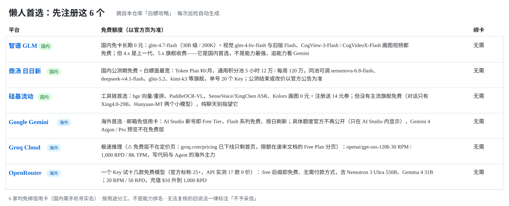

# Free LLM Intel · LLM 免费额度与活动情报

> 国内外 LLM 厂商的免费 API 额度、永久免费模型与限时活动情报，**每天由脚本对照官方页面自动更新、每条可复核**：
> 不提供、不分发任何 API Key；所有数字均来自巡检脚本对**官方页面**的实时抓取，每条情报附官方链接，
> 无法在官方页复核的旧说法一律标注「不予采信」。

[](LICENSE) [](https://github.com/rockbenben/365opensource)

- 🎯 不知道先注册谁？直接看下文「[白嫖攻略](#白嫖攻略)」
- ⚡ 客户端一键接入？直达「[OpenAI 兼容端点速查表](#一键接入)」
- 📊 免费额度总表：**Part 1–4**（见「快速开始」之后，每次巡检自动生成）
- 📡 订阅厂商动态：导入 [llm-news-feeds.opml](llm-news-feeds.opml) 一次订全（官方原生源 + 自建源 + 全部厂商动态 + 英文镜像）；[网页一键订阅](https://free-llm-intel.aishort.top/) ｜ [全部厂商动态（中文）](https://free-llm-intel.aishort.top/feeds/llm-news-all.xml) ｜ [全部厂商动态（英文）](https://free-llm-intel.aishort.top/feeds/llm-news-all.en.xml) ｜ 单厂商源 `…/feeds/llm-news-<厂商 id>.xml`（英文加 `.en.xml`）；博文明细：[llm-news-feeds.md](llm-news-feeds.md)（全量归档在 [`llm-news/`](llm-news/)）
- 🛰 订阅额度 / 活动变化（「哪家的白嫖政策刚变了」）：[llm-intel-changes.xml](https://free-llm-intel.aishort.top/feeds/llm-intel-changes.xml)——巡检采纳的额度调整（前值 → 后值）与新活动逐条入流
- 🤖 自己跑巡检 / 二次开发：`pip install -r requirements.txt && python crawler_llm_intel.py`（详见[快速开始](#快速开始)）



<!-- LLM-GUIDE:BEGIN  本章节由 crawler_llm_intel.py 自动生成，请勿手工修改 -->
---

<a id="白嫖攻略"></a>

## 🎯 白嫖攻略

> 本章节与下方厂商总表同源，每次巡检自动重建；免费政策随时变化（活动到期、限速调整、模型下架），注册 / 充值前请点进对应厂商的官方链接复核。

### 0. 懒人首选：不知道选谁，先注册这 6 个

> 这 6 家都**免绑信用卡**，注册即得（国内的需手机号实名，海外的邮箱即可——都属常规注册）；**按用途分工、不是能力排名**：要对话 / 写代码挑「模型免费」的那家，要向量 / OCR / 画图挑「工具链」那家，同一类需求注册一家就够。

1. [智谱 GLM](#3-智谱-glm) —— **国内免卡长期 0 元**：`glm-4.7-flash`（30B 级 / 200K）+ 视觉 `glm-4.6v-flash` 与旧版 Flash、`CogView-3-Flash` / `CogVideoX-Flash` 画图视频都免费；但 4.x 是上一代、5.x 旗舰收费——**它是国内首选，不是能力最强**，追能力看 Gemini
2. [商汤 日日新](#10-商汤-日日新-sensenova) —— **国内公测期免费 + 白嫖面最宽**：Token Plan ¥0/月，通用积分池 **5 小时 12 万 / 每周 120 万**，同池可调 `sensenova-6.8-flash`、`deepseek-v4.1-flash`、`glm-5.2`、`kimi-k3`；但**第三方模型实测容易 429**，高并发先用自研 `6.8-flash`，单号 20 个 Key
3. [硅基流动](#13-硅基流动-siliconflow) —— **工具链首选**：bge 向量/重排、PaddleOCR-VL、SenseVoice/XingChen ASR、Kolors 画图 **0 元** + 注册送 14 元券；但**没有主流旗舰免费**（对话只有 Xing4.0-29B、Hunyuan-MT 两个小模型），纯聊天别指望它
4. [Google Gemini](#25-google-gemini-google-ai-studio) —— **海外首选 · 邮箱免信用卡**：AI Studio 新号即 Free Tier，Flash 系列免费、按日刷新；具体额度官方不再公开（只在 AI Studio 内显示），`Gemini 4 Argon` / Pro 预览不在免费层
5. [Groq Cloud](#28-groq-cloud-lpu-推理) —— **极速推理**（⚠️ 免费层**不在定价页**：`groq.com/pricing` 已下线只剩首页，限额在速率文档的 Free Plan 分页）：`openai/gpt-oss-120b` 30 RPM / 1,000 RPD / 8K TPM，写代码与 Agent 的海外主力
6. [OpenRouter](#30-openrouter-模型统一网关) —— **一个 Key 试十几款免费模型**（官方标称 25+，API 实测 17 款 0 价）：`:free` 后缀即免费、无需付款方式，含 Nemotron 3 Ultra 550B、Gemma 4 31B；20 RPM / 50 RPD，充值 $10 升到 1,000 RPD

### 1. 先认清四类「免费」——按能否白嫖排序

> 排序逻辑是**新用户视角**：先看要不要绑卡（实名 / 邮箱都只是常规注册，不算门槛），再看额度会不会过期。A 类注册即用且不会过期，C 类额度最大但要先冒绑卡的风险。
>
> ⚠️ 表里混着两类完全不同的额度：**大模型开放平台**发 API Key、可在自己程序里调用；**AI 编程工具**（Trae、Copilot 等，见文末 Part 4）只给编辑器内使用的积分 / Credits，**不发可外带的 API Key**——想接自己的应用别选它们。

| 类型 | 特点与正确用法 | 代表平台（点击跳下方档案） |
|---|---|---|
| **A. 无条件 · 长期可用** | 注册即得（邮箱 / GitHub / Google 或手机号实名均可，**无需付款方式**），不过期或按日/月滚动重置；可当长期主力，注意 RPM/RPD 限速与商用条款 | 国内：[智谱 GLM](#3-智谱-glm)（4.x 代 Flash 0 元（新旗舰 5.3 付费））、[商汤 日日新](#10-商汤-日日新-sensenova)（Token Plan 公测免费：5 小时 12 万 + 每周 120 万积分）、[科大讯飞星火](#11-科大讯飞星火-spark-api)（Spark-X2.5-1.7B 免费、4B 限时免费，需在产品页领取）、[硅基流动](#13-硅基流动-siliconflow)（bge/OCR/画图等 0 元模型 + 注册送 14 元券）、[云知声 Token Hub](#15-云知声-token-hub)（U Plan Free 档免费领：含 U2-Flash、U2-Med、ASR、TTS、OCR 权益，需专属 Key）、[ModelScope 魔搭社区](#21-modelscope-魔搭社区)（魔粒制：每日登录 +200 魔粒（当日有效）+ 绑阿里云 +50 魔粒/日；按次扣减 0.5/1/2 魔粒）、[腾讯云 CodeBuddy / WorkBuddy](#72-腾讯云-codebuddy--workbuddy-ai-编程--应用构建-agent)（国内体验版 0 元：500 积分/月 + 限免全模型；国际版 Free $0：100 积分/月 + 每日 30 积分 + 注册送 250）、[Trae](#73-trae-字节跳动-ai-ide--中国版为主)（免费版每月 500 积分、所有功能均可免费使用（云端任务并发限 2））、[通义灵码 / Qoder CN](#74-通义灵码--qoder-cn-阿里云)（个人体验版免费：有限体验额度（含 2 周 Pro 试用 + 300 Credits））、[文心快码 Comate](#75-文心快码-comate-百度智能云)（个人标准版长期免费：智能补全免费 + 首次赠 5000 积分（7天有效））<br>海外：[Google Gemini](#25-google-gemini-google-ai-studio)（AI Studio：Gemini 3.x Flash 免费层）、[Mistral AI](#27-mistral-ai)（免费**端点**：Mistral Moderation 2（Free）+ Labs 实验模型（无新用户赠金））、[Groq Cloud](#28-groq-cloud-lpu-推理)（gpt-oss 免费层 30 RPM / 1,000 RPD）、[OpenRouter](#30-openrouter-模型统一网关)（:free 模型 20 RPM / 50 RPD（充值 $10 升至 1,000 RPD））、[Cloudflare Workers AI](#31-cloudflare-workers-ai)（每日 1 万 Neurons（kimi / GLM-5 / DeepSeek-V4 等前沿模型需付费））、[Cohere](#32-cohere)（Trial Key 免费（每月 1,000 次，限非商用））、[NVIDIA NIM](#33-nvidia-nim-api-catalog)（45 个 Free Endpoint，40 RPM 上限（高峰期会排队变慢））、[Jina AI](#42-jina-ai-reader--embeddings--reranker)（每 Key 1,000 万 tokens，GitHub 登录免卡）、[Morph Labs](#43-morph-labs)（每月 200 次请求 + 工具附带 $10/月算力）、[Relace](#44-relace)（编程 Agent 专用模型免费套餐）、[Poolside](#45-poolside)（代码模型限时免费（官方未公布截止日））、[Mancer](#46-mancer)（页面标 FREE 的角色扮演向模型 0 元调用）、[Novita AI](#53-novita-ai-apodex-免费档)（Apodex 1.1 Mini 输入/输出均 Free（256K 上下文））、[Typhoon](#56-typhoon-opentyphoon)（research showcase 免费：文本 5 RPS / 200 RPM，OCR 20 RPM，ASR 100 RPM）、[无问芯穹 Infini AI](#57-无问芯穹-infini-ai-genstudio)（嵌入 / 重排接口长期免费 + 网页 Playground 全模型免费体验）、[IBM watsonx.ai](#62-ibm-watsonxai-free-toolbox)（Free Toolbox/Lite 免卡：30 万 tokens + 20 CUH/月）、[Modal](#64-modal-serverless-ai-云平台)（$30 / 月免费算力，按月重置）、[Modular](#65-modular-原-bentocloudbentoml)（共享端点免费测试 + 开源自托管永久免费）、[Lightning AI](#68-lightning-ai-gpu-云--studio)（Free 档起步 30 credits（官方口径约 50 GPU 小时）+ 1 个常驻 Studio）、[Kernel](#69-kernel-托管云浏览器)（free $0/月：每月 $5 用量额度 + 5 并发云浏览器（免绑卡））、[Zilliz Cloud](#70-zilliz-cloud-托管-milvus-向量库)（Serverless Free $0/月：5GB 存储 + 2.5M vCU/月 + 5 collections）、[Qoder](#71-qoder-agentic-coding-platform--国际版)（每日可领 100 Credits + 2 周 Pro 试用送 300 Credits，Free 层不限时用基础模型）、[GitHub Copilot Free](#76-github-copilot-free)（Free 层每月 2,000 次代码补全，受限聊天与 Agent 用量（支持 Haiku 4.5、GPT-5 mini 等入门模型及 CLI））、[Cursor](#77-cursor-ai-代码编辑器--hobby-免费层)（免费层：智能体与 Grok 聊天/Imagine 请求次数有限，额度每周重置）、[Kiro](#78-kiro-aws-背景-agentic-ide)（官方明写长期 Free 层：每月 50 Credits，可用开源模型 + Claude Sonnet 4.5）、[Zed](#79-zed-编辑器--ai-托管额度)（Personal 档 $0 forever：2,000 次 accepted edit predictions；自带 Key 不限次）、[Arcade](#80-arcade-agent-工具调用层)（Free $0/月：每月 2,000 次 tool calls（Agent 工具层，非模型 token））、[CrewAI](#81-crewai-多-agent-编排)（Basic 免费：每月 50 次 workflow executions（编排执行次数，模型 token 另算））、[Nango](#83-nango-第三方集成--api-连接)（Free $0/月：10 connections + 10 小时计算 + 10GB 传输/月（集成同步算力，非模型额度））、[Portkey](#84-portkey-ai-网关--可观测)（Developer Free Forever：10K 请求 + 10K recorded logs/月）、[v0 by Vercel](#85-v0-by-vercel-生成式前端)（Free $0/月：每天 7 条消息（按天重置），含部署到 Vercel） |
| **B. 无条件 · 一次性限时** | 注册即到账、**无需付款方式**，但有有效期、不可重置；先想好用量再开通，薅完即走 | 国内：[通义千问](#2-通义千问-阿里云)（大部分模型各 100 万 Token / 90 天（部分模型额度已下架，以权益页为准））、[Kimi](#4-kimi-月之暗面)（实名送 15 元代金券（可抵扣 K3/K3.1 Pro，不可用于高速版））、[小米 MiMo](#7-小米-mimo)（TTS 系列限时免费 + 新用户注册赠金（40 天））、[文心 ERNIE](#9-文心-ernie-百度千帆)（17 个模型各 100 万 / 3 个月 + 20 元券）、[美团 LongCat](#12-美团-longcat)（LongCat-2.0 资源包（1M 上下文，30 天有效））、[StreamLake](#14-streamlake-快手万擎)（注册开通后分批送免费调用次数（仅基础模型推理））、[中国电信](#18-中国电信-天翼云--息壤智算)（实名最高 2,000 元试用体验金）<br>海外：[Fireworks AI](#37-fireworks-ai)（Muse Glimmer 30B SFT 限时免费训练（新号 $1 额度已下线））、[Stability AI](#40-stability-ai)（新号 25 积分；开源权重年营收 < $100 万免费）、[AI21 Labs](#41-ai21-labs)（$10 credits，邮箱注册免卡）、[InceptionLabs](#48-inceptionlabs)（新号 1 亿 free tokens，免信用卡）、[Regolo.ai](#52-regoloai-欧盟托管推理)（30 天试用：每日 100 万 tokens，全部 Core Chat 模型）、[Baseten](#63-baseten)（新账户试用额度（官方未公开金额，以控制台为准））、[Dify](#82-dify-云版-sandbox)（Sandbox 免费：200 message credits + 5 Apps + 50 知识库文档） |
| **C. 需绑卡 · 大额云试用金** | 需信用卡或身份验证（可能有验证扣款）；额度最大，但**注册后立刻设预算告警**，记下到期日并主动关停 | 国内：[腾讯云混元](#8-腾讯云混元-tokenhub)（8款模型共享 100万 tokens + Embedding 100万）<br>海外：[Cerebras Inference](#35-cerebras-inference-晶圆级推理)（$5 赠金 / 30 天（需添加付款方式后发放））、[Nebius](#39-nebius-token-factory--ai-cloud)（无自动赠送；绑卡扣 $25 且转为余额，并非赠金）、[Anyscale](#47-anyscale)（$100 注册额度（需工作邮箱；无独立免费层，抵扣 Ray 算力））、[Parallel Web API](#54-parallel-web-api-数据--搜索-api)（Developer：每月 5,000 次免费请求 + $5 额度（留卡才发）+ 注册最高 $80）、[Amazon Bedrock](#58-amazon-bedrock-aws-free-tier)（开户立得 $100，6 个月内最高合计 $200 抵扣金（需信用卡））、[Azure OpenAI / Azure AI Foundry](#59-azure-openai--azure-ai-foundry)（$200 / 30 天（需信用卡或身份验证））、[Google Gemini Enterprise Agent Platform](#60-google-gemini-enterprise-agent-platform)（$300 / 90 天 + Always Free（需绑卡））、[Oracle OCI Generative AI](#61-oracle-oci-generative-ai)（$300 / 30 天 + Always Free（需信用卡验证））、[DigitalOcean Inference Engine](#66-digitalocean-inference-engine)（$5 / 90 天通用试用金（非 LLM 免费层，需绑卡））、[Akamai Cloud](#67-akamai-cloud-原-linode)（新客 $100 云抵扣额度 / 60 天（需绑卡）） |
| **D. 开源权重 / 自托管** | 没有「额度」概念，自己出算力；也可走 A 类平台免费托管调用 | 国内：[小米 MiMo](#7-小米-mimo)（TTS 系列限时免费 + 新用户注册赠金（40 天））<br>海外：[Meta Llama](#34-meta-llama-开源权重)（Llama 4 Scout/Maverick 免版税权重（可经 Groq/Cloudflare 免费托管调用））、[Stability AI](#40-stability-ai)（新号 25 积分；开源权重年营收 < $100 万免费）、[Modular](#65-modular-原-bentocloudbentoml)（共享端点免费测试 + 开源自托管永久免费） |

### 2. 唯一的真门槛：要不要信用卡

- 除下列 **11 家需验证付款方式**外，其余平台注册即发 Key，无任何付款门槛；国内平台用手机号 + 实名（常规注册，人人可办），海外平台用邮箱 / GitHub / Google 登录。
- ⚠️ **需绑卡**（可能有验证扣款或最低首付，赠金到账后也请立即设预算告警）：[腾讯云混元](#8-腾讯云混元-tokenhub)、[Cerebras Inference](#35-cerebras-inference-晶圆级推理)、[Nebius](#39-nebius-token-factory--ai-cloud)、[Anyscale](#47-anyscale)、[Parallel Web API](#54-parallel-web-api-数据--搜索-api)、[Amazon Bedrock](#58-amazon-bedrock-aws-free-tier)、[Azure OpenAI / Azure AI Foundry](#59-azure-openai--azure-ai-foundry)、[Google Gemini Enterprise Agent Platform](#60-google-gemini-enterprise-agent-platform)、[Oracle OCI Generative AI](#61-oracle-oci-generative-ai)、[DigitalOcean Inference Engine](#66-digitalocean-inference-engine)、[Akamai Cloud](#67-akamai-cloud-原-linode)。
- 国内平台未完成实名时可能被限速（如 PPIO），但这是注册流程的一部分，不是额外门槛。

### 3. 按场景选

- **写代码 / 编程 Agent**：[智谱 GLM](#3-智谱-glm)（4.x 代 Flash 0 元（新旗舰 5.3 付费））、[StreamLake](#14-streamlake-快手万擎)（注册开通后分批送免费调用次数（仅基础模型推理））、[ModelScope 魔搭社区](#21-modelscope-魔搭社区)（魔粒制：每日登录 +200 魔粒（当日有效）+ 绑阿里云 +50 魔粒/日；按次扣减 0.5/1/2 魔粒）、[Groq Cloud](#28-groq-cloud-lpu-推理)（gpt-oss 免费层 30 RPM / 1,000 RPD）、[OpenRouter](#30-openrouter-模型统一网关)（:free 模型 20 RPM / 50 RPD（充值 $10 升至 1,000 RPD））、[Cloudflare Workers AI](#31-cloudflare-workers-ai)（每日 1 万 Neurons（kimi / GLM-5 / DeepSeek-V4 等前沿模型需付费））、[Relace](#44-relace)（编程 Agent 专用模型免费套餐）、[Poolside](#45-poolside)（代码模型限时免费（官方未公布截止日））、[Regolo.ai](#52-regoloai-欧盟托管推理)（30 天试用：每日 100 万 tokens，全部 Core Chat 模型）、[Novita AI](#53-novita-ai-apodex-免费档)（Apodex 1.1 Mini 输入/输出均 Free（256K 上下文））、[Typhoon](#56-typhoon-opentyphoon)（research showcase 免费：文本 5 RPS / 200 RPM，OCR 20 RPM，ASR 100 RPM）、[Qoder](#71-qoder-agentic-coding-platform--国际版)（每日可领 100 Credits + 2 周 Pro 试用送 300 Credits，Free 层不限时用基础模型）、[腾讯云 CodeBuddy / WorkBuddy](#72-腾讯云-codebuddy--workbuddy-ai-编程--应用构建-agent)（国内体验版 0 元：500 积分/月 + 限免全模型；国际版 Free $0：100 积分/月 + 每日 30 积分 + 注册送 250）、[Trae](#73-trae-字节跳动-ai-ide--中国版为主)（免费版每月 500 积分、所有功能均可免费使用（云端任务并发限 2））、[通义灵码 / Qoder CN](#74-通义灵码--qoder-cn-阿里云)（个人体验版免费：有限体验额度（含 2 周 Pro 试用 + 300 Credits））、[文心快码 Comate](#75-文心快码-comate-百度智能云)（个人标准版长期免费：智能补全免费 + 首次赠 5000 积分（7天有效））、[GitHub Copilot Free](#76-github-copilot-free)（Free 层每月 2,000 次代码补全，受限聊天与 Agent 用量（支持 Haiku 4.5、GPT-5 mini 等入门模型及 CLI））、[Cursor](#77-cursor-ai-代码编辑器--hobby-免费层)（免费层：智能体与 Grok 聊天/Imagine 请求次数有限，额度每周重置）、[Kiro](#78-kiro-aws-背景-agentic-ide)（官方明写长期 Free 层：每月 50 Credits，可用开源模型 + Claude Sonnet 4.5）、[Zed](#79-zed-编辑器--ai-托管额度)（Personal 档 $0 forever：2,000 次 accepted edit predictions；自带 Key 不限次）、[Arcade](#80-arcade-agent-工具调用层)（Free $0/月：每月 2,000 次 tool calls（Agent 工具层，非模型 token））、[CrewAI](#81-crewai-多-agent-编排)（Basic 免费：每月 50 次 workflow executions（编排执行次数，模型 token 另算））、[Dify](#82-dify-云版-sandbox)（Sandbox 免费：200 message credits + 5 Apps + 50 知识库文档）、[Nango](#83-nango-第三方集成--api-连接)（Free $0/月：10 connections + 10 小时计算 + 10GB 传输/月（集成同步算力，非模型额度））、[v0 by Vercel](#85-v0-by-vercel-生成式前端)（Free $0/月：每天 7 条消息（按天重置），含部署到 Vercel）。
- **免费体验旗舰通用模型**：[通义千问](#2-通义千问-阿里云)（大部分模型各 100 万 Token / 90 天（部分模型额度已下架，以权益页为准））、[Kimi](#4-kimi-月之暗面)（实名送 15 元代金券（可抵扣 K3/K3.1 Pro，不可用于高速版））、[文心 ERNIE](#9-文心-ernie-百度千帆)（17 个模型各 100 万 / 3 个月 + 20 元券）、[Google Gemini](#25-google-gemini-google-ai-studio)（AI Studio：Gemini 3.x Flash 免费层）。
- **超长上下文（约 1M tokens）**：[Kimi](#4-kimi-月之暗面)（实名送 15 元代金券（可抵扣 K3/K3.1 Pro，不可用于高速版））、[科大讯飞星火](#11-科大讯飞星火-spark-api)（Spark-X2.5-1.7B 免费、4B 限时免费，需在产品页领取）、[美团 LongCat](#12-美团-longcat)（LongCat-2.0 资源包（1M 上下文，30 天有效））。
- **图像 / 视频生成**：[智谱 GLM](#3-智谱-glm)（4.x 代 Flash 0 元（新旗舰 5.3 付费））、[腾讯云混元](#8-腾讯云混元-tokenhub)（8款模型共享 100万 tokens + Embedding 100万）、[Stability AI](#40-stability-ai)（新号 25 积分；开源权重年营收 < $100 万免费）、[Cursor](#77-cursor-ai-代码编辑器--hobby-免费层)（免费层：智能体与 Grok 聊天/Imagine 请求次数有限，额度每周重置）。
- **Embedding / Rerank / OCR / 语音**：[小米 MiMo](#7-小米-mimo)（TTS 系列限时免费 + 新用户注册赠金（40 天））、[腾讯云混元](#8-腾讯云混元-tokenhub)（8款模型共享 100万 tokens + Embedding 100万）、[硅基流动](#13-硅基流动-siliconflow)（bge/OCR/画图等 0 元模型 + 注册送 14 元券）、[云知声 Token Hub](#15-云知声-token-hub)（U Plan Free 档免费领：含 U2-Flash、U2-Med、ASR、TTS、OCR 权益，需专属 Key）、[Jina AI](#42-jina-ai-reader--embeddings--reranker)（每 Key 1,000 万 tokens，GitHub 登录免卡）、[无问芯穹 Infini AI](#57-无问芯穹-infini-ai-genstudio)（嵌入 / 重排接口长期免费 + 网页 Playground 全模型免费体验）、[Zilliz Cloud](#70-zilliz-cloud-托管-milvus-向量库)（Serverless Free $0/月：5GB 存储 + 2.5M vCU/月 + 5 collections）。
- **自建私有端点 / 跑任意开源模型**：[Fireworks AI](#37-fireworks-ai)（Muse Glimmer 30B SFT 限时免费训练（新号 $1 额度已下线））、[Baseten](#63-baseten)（新账户试用额度（官方未公开金额，以控制台为准））、[Modal](#64-modal-serverless-ai-云平台)（$30 / 月免费算力，按月重置）、[Modular](#65-modular-原-bentocloudbentoml)（共享端点免费测试 + 开源自托管永久免费）、[Lightning AI](#68-lightning-ai-gpu-云--studio)（Free 档起步 30 credits（官方口径约 50 GPU 小时）+ 1 个常驻 Studio）、[Kernel](#69-kernel-托管云浏览器)（free $0/月：每月 $5 用量额度 + 5 并发云浏览器（免绑卡））。
- **邀请返利 / 拉新奖励**：[智谱 GLM](#3-智谱-glm)（4.x 代 Flash 0 元（新旗舰 5.3 付费））、[小米 MiMo](#7-小米-mimo)（TTS 系列限时免费 + 新用户注册赠金（40 天））、[美团 LongCat](#12-美团-longcat)（LongCat-2.0 资源包（1M 上下文，30 天有效））。
- **学生 / 高校师生扶持**：[智谱 GLM](#3-智谱-glm)（4.x 代 Flash 0 元（新旗舰 5.3 付费））。
- **大额云厂商体验金（海外需绑卡，国内需实名）**：[中国电信](#18-中国电信-天翼云--息壤智算)（实名最高 2,000 元试用体验金）、[Amazon Bedrock](#58-amazon-bedrock-aws-free-tier)（开户立得 $100，6 个月内最高合计 $200 抵扣金（需信用卡））、[Azure OpenAI / Azure AI Foundry](#59-azure-openai--azure-ai-foundry)（$200 / 30 天（需信用卡或身份验证））、[Google Gemini Enterprise Agent Platform](#60-google-gemini-enterprise-agent-platform)（$300 / 90 天 + Always Free（需绑卡））、[Oracle OCI Generative AI](#61-oracle-oci-generative-ai)（$300 / 30 天 + Always Free（需信用卡验证））、[DigitalOcean Inference Engine](#66-digitalocean-inference-engine)（$5 / 90 天通用试用金（非 LLM 免费层，需绑卡））、[Akamai Cloud](#67-akamai-cloud-原-linode)（新客 $100 云抵扣额度 / 60 天（需绑卡））。

### 4. 防扣费清单（白嫖最容易翻车的地方）

1. [通义千问](#2-通义千问-阿里云)：已认证用户需在权益页面手动开启「免费额度用尽即停」；仅抵扣实时推理，批量及联网工具会扣费。
2. [智谱 GLM](#3-智谱-glm)：0 元只限 4.x 代，GLM-5.3/5.3-Flash 要付费（新用户资源包是否到账以控制台券面为准）；免费模型会换代（旧版下线自动路由新版）；限速数值只在控制台显示。
3. [火山引擎](#6-火山引擎-火山方舟--豆包)：在控制台开启「安心体验模式」，超限即停，避免自动扣费。
4. [小米 MiMo](#7-小米-mimo)：语言模型按量计费（v2.6-pro ¥3/¥6 每百万 tokens），免费只覆盖 TTS 与缓存写入且官方标注「限时」；注册赠金 40 天过期、不可抵 Token Plan 订阅。
5. [腾讯云混元](#8-腾讯云混元-tokenhub)：默认耗尽不自动转后付费，如需后付费需手动在控制台开启
6. [商汤 日日新](#10-商汤-日日新-sensenova)：只有公测期免费（官方原话「当前额度和活动规则属于公测期权益」）；按积分计量、5 小时 + 周双层窗口；**非 SenseNova 自研模型（DeepSeek / GLM / Kimi）容易 429**，先退避重试或改用 `sensenova-6.8-flash`。
7. [科大讯飞星火](#11-科大讯飞星火-spark-api)：Spark-X2.5-4B 为限时免费，调用前确认免费额度状态
8. [StreamLake](#14-streamlake-快手万擎)：免费额度**分批发放**（初识/探索/首金礼包）、**仅限基础模型推理**、**不可抵扣 Batch 批量推理**，具体额度以活动说明为准 ——「Air 永久免费」与「Pro 送 2000 万 tokens/30 天」均无官方依据，不予采信。
9. [云知声 Token Hub](#15-云知声-token-hub)：套餐专属 Key 与按量计费 Key 不互换，仅在套餐有效期内可用
10. [PPIO 派欧云](#17-ppio-派欧云-分布式大模型算力)：未实名认证用户有请求频率限制；历史“注册送 5 元”说法官方页无据。
11. [ModelScope 魔搭社区](#21-modelscope-魔搭社区)：魔粒是按次消耗的积分、每日登录奖励当日有效不累计；必须绑阿里云账号并实名（否则 401），勿按「每天 2000 次」旧口径排期
12. [Mistral AI](#27-mistral-ai)：免费的是**端点**而非额度：无新用户赠金 / 免费实验层；`Leanstral` 属 Labs 限时收集反馈期，随时可能下线；商业模型（Medium 3.5 / Large 3 / Small 4 等）均按量付费；旧「€5 赠金 / 1 RPS 免费层」在现行定价页无据。
13. [Groq Cloud](#28-groq-cloud-lpu-推理)：旧 Llama-3.1-8b / 3.3-70b 已转 Enterprise 付费，勿按旧清单调用。
14. [Hugging Face](#29-hugging-face-inference-providers)：免费账号已无免费调用额度，需购买 Credits 或升级 PRO 会员
15. [OpenRouter](#30-openrouter-模型统一网关)：只有带 :free 后缀的模型免费；同名付费模型会按量扣费。
16. [Cloudflare Workers AI](#31-cloudflare-workers-ai)：超量按 $0.011 / 1,000 Neurons 计费，注意每日用量。
17. [Cohere](#32-cohere)：Trial Key 明确仅限非商业用途，商用需升级付费套餐。
18. [NVIDIA NIM](#33-nvidia-nim-api-catalog)：免费接口面向开发评估，不可用于生产环境。
19. [Fireworks AI](#37-fireworks-ai)：常规推理已转为预付费模式需绑卡充值，仅 Muse Glimmer 30B SFT 微调活动至 11/30 免信用卡
20. [Regolo.ai](#52-regoloai-欧盟托管推理)：30 天后不订阅即无法按试用条件调用；试用档带更严限速与 fair usage throttling
21. [Novita AI](#53-novita-ai-apodex-免费档)：免费只覆盖 apodex/apodex-1.1-mini 这一个 id，切换其它模型即按价表计费
22. [Parallel Web API](#54-parallel-web-api-数据--搜索-api)：Task/Responses/FindAll 属高价处理器（单次约 $0.1–$2.4），深度研究场景消耗很快
23. [Typhoon](#56-typhoon-opentyphoon)：beta 服务无正式支持或 SLA；官方收集调用数据用于改进模型与 API，敏感内容先核对隐私条款
24. [无问芯穹 Infini AI](#57-无问芯穹-infini-ai-genstudio)：免费的是**嵌入 / 重排接口**与**网页体验**；GenStudio **API 推理不设试用额度**、按量付费（官方计费文档已明确），「注册送 200 万 token」是旧说法，不予采信。
25. [Baseten](#63-baseten)：试用额度**金额未公开**，以注册后控制台显示为准；Startup Program（最高 $25,000 算力 + $2,500 Model APIs）需申请审核，非注册即得。
26. [Akamai Cloud](#67-akamai-cloud-原-linode)：超额计入绑卡账单；GPU 套餐与 Marketplace 不参与；窗口结束后仍在运行的服务照标准价扣费
27. [Lightning AI](#68-lightning-ai-gpu-云--studio)：免费 Studio 每 4 小时需重启；外部清单常写的「80 免费 GPU 小时」有误，官方页数值全为 50
28. [Kernel](#69-kernel-托管云浏览器)：浏览器时长/算力按用量计费，$5 用尽即产生费用
29. [Zilliz Cloud](#70-zilliz-cloud-托管-milvus-向量库)：vCU 是计算单元，向量检索密集时消耗快；Dedicated 档另算
30. [Qoder](#71-qoder-agentic-coding-platform--国际版)：每日 Credits 需**手动领取**（漏领当天作废）；领到手后 30 天内有效、未过期会结转；高级额度用尽自动降级基础模型而非断供
31. [腾讯云 CodeBuddy / WorkBuddy](#72-腾讯云-codebuddy--workbuddy-ai-编程--应用构建-agent)：「限免」条目（全模型 / 无限补全 / 99 任务）随时可能回收，以页面「限免生效中」标注为准
32. [通义灵码 / Qoder CN](#74-通义灵码--qoder-cn-阿里云)：已并入 Qoder CN 品牌（原通义灵码）；VSC 插件停止演进，团队版覆盖范围与个人版不同
33. [文心快码 Comate](#75-文心快码-comate-百度智能云)：首次赠送的 5000 积分仅 7 天有效；个人版额度体系已由代金券调整为积分制
34. [GitHub Copilot Free](#76-github-copilot-free)：无需信用卡；已验证学生可使用 Student plan，教师及热门开源维护者可申请免费 Copilot Pro
35. [Cursor](#77-cursor-ai-代码编辑器--hobby-免费层)：定价页仅标明「有限」未公布具体数值，用尽后可等待额度每周重置
36. [Kiro](#78-kiro-aws-背景-agentic-ide)：访问受速率限制；部分模型并非所有地区可用
37. [Zed](#79-zed-编辑器--ai-托管额度)：内置模型免费只覆盖编辑预测额度；跑对话/Agent 需 Pro 试用（$5 / 14 天）或 BYOK
38. [Dify](#82-dify-云版-sandbox)：200 条不带 / month（同页付费档才写 / month）——是体验额度，别按月领理解
39. [Portkey](#84-portkey-ai-网关--可观测)：网关自己不提供免费 token，转发到谁的模型就按谁的价计费；超出只停记日志不影响请求
40. [v0 by Vercel](#85-v0-by-vercel-生成式前端)：「每天 7 条」是档位长期限制非促销；部署产物的流量/函数按 Vercel Hobby 档另计
41. 所有绑卡平台（见第 2 节名单）注册后立刻设置 **Budget 预算与用量告警**，记下赠金到期日，到期前关停资源、删除计费实例。
42. 永久免费层 RPM 普遍只有个位数到几十，批量任务请走大额试用金 / 月度重置额度或错峰。
43. 站外遇到的第三方聚合中转（非官方转售平台）存在跑路风险，只放低敏测试流量，不要充大额余额。

### 5. 限时 / 易变信息（最容易过期，看到请先核对官方页）

- [小米 MiMo](#7-小米-mimo)：另有 MiMo Claw 限时特惠 ¥14.9 / 月
- [商汤 日日新](#10-商汤-日日新-sensenova)：Token Plan 公测期免费（¥0/月，限时放量）：通用积分池滚动 5 小时 120,000 积分 + 每周 1,200,000 积分
- [科大讯飞星火](#11-科大讯飞星火-spark-api)：Spark-X2.5-1.7B 标明“免费”，Spark-X2.5-4B 标明“限时免费”，Spark Lite 等模型在产品页支持“免费领取”
- [云知声 Token Hub](#15-云知声-token-hub)：页面顶部横幅标注：U Plan 正式上线，Free 档免费领，套餐升级限时 5 折，低至 29.5 元/月
- [摩尔线程 MUSA Coding Plan](#16-摩尔线程-musa-coding-plan)：Free Trial 即左栏 30 天免费试用（每日限量 100 名），无独立注册赠金
- [中国电信](#18-中国电信-天翼云--息壤智算)：另有编程 Token Plan 3000/10000/25000/50000/100000 积分套餐（29–699 元/月，均为付费限时特惠）
- [阶跃星辰 StepFun](#22-阶跃星辰-stepfun)：StepAudio 3 中适用限时免费政策的模型（具体范围以控制台为准
- [Mistral AI](#27-mistral-ai)：Leanstral（Labs，labs-leanstral-2603，限时开放收集反馈）—— 免费端点
- [Fireworks AI](#37-fireworks-ai)：Muse Glimmer 30B SFT 限时免费（至 11/30，免信用卡）
- [Poolside](#45-poolside)：已从申请制转为开放注册，官方标注 “Free to use for a limited time”（限时免费，截止时间未公布，以官方后续公告为准）

### 6. 免费额度用完之后

国内厂商的包月「编程套餐」（火山方舟 Coding Plan、智谱 GLM 套餐等）价格与档位调整频繁，本仓库不转抄未经官方页面核实的价格数字——请从下方对应厂商表格的「官方直达」进入定价页查看现行档位。挑选时重点对比三点：

1. **计费方式**：按请求次数（低频友好）还是按 token（长上下文 / 重度使用友好）；
2. **限速与并发**：套餐是否仍保留 RPM 上限，Batch / 夜间折扣是否可用；
3. **工具兼容**：是否支持你在用的 IDE / Agent 与 OpenAI 兼容端点。

<a id="一键接入"></a>

### 7. 常见免费 API · OpenAI 兼容端点与申请直达（一键接入）

> 适用于 NextChat、Cherry Studio、Chatbox、Dify、Cursor、Cline 等几乎所有支持自定义 OpenAI 格式的客户端：

| 平台名称 | 免费额度简述 | API Key 申请直达 | OpenAI 兼容 Base URL | 推荐填写的免费模型名称 |
|---|---|---|---|---|
| **通义千问** | 每模型 100 万 / 90 天（北京区） | [控制台申请](https://bailian.console.aliyun.com/?apiKey=1) | `https://dashscope.aliyuncs.com/compatible-mode/v1` | `qwen3.8-max`, `qwen-plus` |
| **智谱 GLM** | 4.x 代 Flash 0 元（5.x 旗舰付费） | [控制台申请](https://bigmodel.cn/usercenter/apikeys) | `https://open.bigmodel.cn/api/paas/v4` | `glm-4.7-flash`, `glm-4-flash-250414`, `glm-4v-flash` |
| **Kimi** | 实名送 15 元券（1M 长上下文，支持 K3.1 Pro） | [控制台申请](https://platform.kimi.com/console/api-keys) | `https://api.moonshot.cn/v1` | `kimi-k3.1-pro`, `kimi-k3`, `kimi-k2.7-code`, `kimi-k2.6` |
| **MiniMax** | M Plan 订阅或积分包通过 API Key 接入 | [控制台申请](https://platform.minimax.cn/console/access?tab=api-keys) | `https://api.minimax.chat/v1` | `M3.1 Flash Preview`, `MiniMax-M3` |
| **小米 MiMo** | TTS 系列限时免费；语言模型按量计费 | [控制台申请](https://platform.xiaomimimo.com/#/console/api-keys) | `https://api.xiaomimimo.com/v1` | `mimo-v2.6-pro`, `mimo-v2.6-flash`, `mimo-v2.5-tts` |
| **文心 ERNIE** | 17 个模型各 100 万 / 3 个月 | [控制台申请](https://console.bce.baidu.com/qianfan/overview) | `https://qianfan.baidubce.com/v2` | `ERNIE-4.5-Turbo-128K`, `DeepSeek-V3.1-250821`, `Qwen3-Coder-30B-A3B-Instruct` |
| **硅基流动** | 众多 0 元模型 + 注册送 14 元券 | [控制台申请](https://cloud.siliconflow.cn/account/ak) | `https://api.siliconflow.cn/v1` | `Xing4.0-29B`, `PaddleOCR-VL-1.5`, `bge-m3`, `Kolors` |
| **ModelScope 魔搭社区** | OpenAI 兼容（API-Inference 共享池） | [ModelScope SDK 令牌](https://modelscope.cn/my/myaccesstoken) | `https://api-inference.modelscope.cn/v1` | ['Qwen/Qwen3.5-35B-A3B', 'Qwen/Qwen2.5-Coder-32B-Instruct'] |
| **Google Gemini** | 免费层每日滚动重置（免绑卡） | [AI Studio 申请](https://aistudio.google.com/apikey) | `https://generativelanguage.googleapis.com/v1beta/openai/` | `gemini-2.5-flash`, `gemini-3.8-flash` |
| **Groq Cloud** | 30 RPM / 1,000 RPD 高速推理（免绑卡） | [控制台申请](https://console.groq.com/keys) | `https://api.groq.com/openai/v1` | `openai/gpt-oss-120b`, `qwen/qwen3.6-27b` |
| **OpenRouter** | 20 RPM 免费层（免绑卡） | [控制台申请](https://openrouter.ai/keys) | `https://openrouter.ai/api/v1` | 选带 `:free` 后缀模型（如 `google/gemma-4-31b-it:free`、`nvidia/nemotron-3-super-120b:free`） |
| **InceptionLabs** | 新号 1 亿 free tokens，免信用卡 | [Dashboard 申请](https://platform.inceptionlabs.ai/dashboard/api-keys) | `https://api.inceptionlabs.ai/v1` | `mercury-3` |
| **Regolo.ai** | 30 天试用：每日 100 万 tokens（免绑卡） | [官网注册开通](https://regolo.ai/) | `https://api.regolo.ai/v1` | glm5.2、qwen3.8-27b、qwen3.5-122b、qwen3.5-9b、mistral-small-4-119b、gemma4-31b、apertus-70b 等（价表 Subscription 列标 Included） |
| **Novita AI** | Apodex 1.1 Mini 输入/输出均 Free（256K 上下文） | [控制台 Key 管理](https://novita.ai/settings/key-management) | `https://api.novita.ai/openai/v1` | `apodex/apodex-1.1-mini`（价表显示名 Apodex 1.1 Mini，上下文 256K，输入/输出两列均 Free） |
| **Typhoon** | research showcase 免费，文本 5 RPS / 200 RPM | [Typhoon Playground](https://playground.opentyphoon.ai/) | `https://api.opentyphoon.ai/v1` | ['typhoon-v2.5-30b-a3b-instruct', 'typhoon-v2.1-12b-instruct'] |

<!-- LLM-GUIDE:END -->

## 快速开始

环境要求：Python 3.10+；依赖 `requests`、`PyYAML`、`playwright`（pip 包随 requirements 安装；浏览器内核用于 JS 渲染 / 403 页面兜底，未安装内核时自动降级为纯 HTTP 抓取并在报告中标注，GitHub Actions 已安装内核）。

```bash
pip install -r requirements.txt
# 可选（本地启用 JS 动态页面 / 403 页面的浏览器兜底）：playwright install chromium
python crawler_llm_intel.py
# Windows 终端若遇编码报错，CMD 执行：set PYTHONIOENCODING=utf-8 ；PowerShell 执行：$env:PYTHONIOENCODING="utf-8"

# 运行本地回归测试套件：
python -m unittest discover
```

常用参数：`--only <vendor_id>`（只巡检指定厂商，调试用，不覆盖全局 README）、`--no-news`（跳过博客 / RSS 归档）、`--no-browser`（禁用 playwright）、`--delay <秒>`（请求间隔，默认 0.3）、`--timeout <秒>`（超时，默认 20）、`--feeds-base <对外前缀>`（自建 RSS 的对外地址前缀；本地重建不带它会丢自定义域名与 `rel=self`，默认按仓库推导 GitHub Pages 地址）、`--stale-review-days <天>`（页面长期不变时的例行复查周期，见「更新机制」）、`--ai-review`（变化时调用 Google AI Studio 的 Gemini 做事实核查，详见「更新机制」）、`--ai-titles`（新收录文章的机翻标题交 LLM 润色一次）、`--rebuild-only`（不抓取，从磁盘归档重建全部动态产物）、`--backfill-dates`（维护模式：从文章页元数据回填归档缺失的发布日期）、`--review-export` / `--review-apply`（本地 AI 核查通道，见「更新机制」）、`--force-sources`（强制抓取已进入连续失败冷却的情报源）。

完整巡检耗时随厂商数与源数量变化（厂商数、深度抓取的页面数与各源抓取结果见「快速开始」之后自动生成区块的「核心特性」行；JS 空壳与 403 页面自动走浏览器兜底），结束后自动刷新 Part 1–4 表格、博客主文档、`llm-news/` 归档与 `docs/feeds/` 自建 RSS / JSON 索引。

> 想启用 `--ai-review`：到 [Google AI Studio](https://aistudio.google.com/apikey) 免费申请一个 API Key，设置环境变量 `GEMINI_API_KEY`（也兼容 `GOOGLE_API_KEY`）即可，默认模型 `gemini-3.8-flash`，可用 `AI_REVIEW_MODEL` 覆盖；无需安装任何额外软件。

<!-- LLM-INTEL:BEGIN  本章节由 crawler_llm_intel.py 自动生成，请勿手工修改 -->

> 实时追踪国内外大语言模型（LLM）厂商官方公开的**免费 API 额度**、**永久免费模型**与**限时活动调用**情报。
> 本区块由 `crawler_llm_intel.py` 在**每次运行时**实时巡检官方页面生成（非人工编辑、非服务端持续监控），最近一次巡检：**2026-11-11 16:37:11**；本地手动运行与 GitHub Actions 定时刷新的方法见文首「快速开始 / 更新机制」。
>
> 💡 **核心特性**：覆盖 **85 家厂商**（深度抓取 **157 个情报页 + 45 个动态页**）；海外一手情报自动汉化（品牌与型号名保留原文）；自动过滤页面抓取状态噪点，直接展示具体额度（Tokens/代金券/免费层）、可用模型、有效期与限制条件。
> 📡 **博客动态订阅**：各厂商官方技术博客与更新日志单独维护至 [`llm-news-feeds.md`](llm-news-feeds.md)（共 34 个厂商），可导入 [`llm-news-feeds.opml`](llm-news-feeds.opml) 至 RSS 阅读器跟踪官方动态。
> 📡 **自建 RSS**（官方没有原生订阅源的厂商也能订）：[网页浏览 / 一键订阅](https://free-llm-intel.aishort.top/) ｜ [全部厂商动态（中文）](https://free-llm-intel.aishort.top/feeds/llm-news-all.xml) ｜ [全部厂商动态（英文）](https://free-llm-intel.aishort.top/feeds/llm-news-all.en.xml) ｜ 单厂商源 `https://free-llm-intel.aishort.top/feeds/llm-news-{vendor_id}.xml`（英文加 `.en.xml`）。全部厂商动态与单厂商源都带 `<content:encoded>` 全文（正文来自 `docs/articles/`），阅读器里就地读完；浏览页每条也带「读全文」抽屉，点开即就地读双语正文（`?read=` 深链可分享）；中英两版按语言偏好**二选一**订阅（同订会看到重复条目，`guid` 已用 `?li=1` 区分）。
> 🛰 **额度变化订阅**（新活动 / 额度调整，前值 → 后值）：[llm-intel-changes.xml](https://free-llm-intel.aishort.top/feeds/llm-intel-changes.xml)

---

## Part 1：国内主流大语言模型（免费额度与接入指南）

> 以下平台面向开发者与个人用户，注册/认证后可获得**实实在在的免费额度**或**永久免费调用模型**。

---

### 1. DeepSeek (深度求索)

| 字段 | 详情 |
|------|------|
| **平台名称** | [DeepSeek (深度求索)](https://www.deepseek.com/) |
| **免费模型与额度** | • **无免费模型层**，全量模型按量计费：`deepseek-flash`（DeepSeek-V4.1-Flash-1017，支持图像理解与思考模式）、`deepseek-v4-pro`（DeepSeek-V4-Pro-0813）；上下文 1M（最大输出 384K）<br>• 峰谷定价（元/百万 tokens，高峰为工作日 9:00–12:00、14:00–18:00，空闲半价）：deepseek-flash 输出 8 高峰/4 空闲、缓存命中输入 0.04/0.02；deepseek-v4-pro 输出 27.0/13.5、缓存命中输入 0.30/0.15<br>• 旧模型名 `deepseek-v4-flash`、`deepseek-v4-flash-vision-exp` 对应模型已下线，调用自动由 DeepSeek-V4.1-Flash-1017 提供服务并按 Flash 计费 |
| **注册福利 / 账户赠送** | **无公开赠送政策**：现行官方定价页与更新日志均无新用户赠送 token 政策（历史“500 万 tokens/30 天”无法复核，不予采信）；账户扣费顺序中存在“赠送余额”项，实际以注册后账户到账为准 |
| **额度有效期** | 以账户内余额标注为准 |
| **前置条件 / 限制** | 注册平台账号；按量计费，并发限制随账户充值等级（Tier）提升 |
| **邀请 / 特惠活动** | 实行**峰谷定价**（元/百万 tokens，高峰为工作日 9:00–12:00、14:00–18:00，空闲时段半价）：deepseek-flash 输出 8.0（高峰）/4.0（空闲），缓存命中 0.04/0.02；deepseek-v4-pro 输出 27.0/13.5，缓存命中 0.30/0.15。**网页搜索与抓取（Search/Fetch）按次计费**：两者是独立 API，每 1,000 次成功请求 5 元；费用直接从充值余额或赠送余额扣减，优先扣赠送余额。 |
| **实时巡检证据** | • 当充值余额与赠送余额同时存在时，优先扣减赠送余额。<br>• (3) 更多并发限制细节，请参考限速与隔离。 |
| **官方直达** | [定价文档（人民币峰谷价）](https://api-docs.deepseek.com/zh-cn/quick_start/pricing) ｜ [API Key 管理](https://platform.deepseek.com/api_keys) ｜ [更新日志](https://api-docs.deepseek.com/zh-cn/updates/) ｜ [API 平台](https://platform.deepseek.com/) |
| **特别说明** | V3/R1 时代价格（缓存 0.5 元、输出 8 元）已作废；官方无 RSS，更新见 updates 页。 |

### 2. 通义千问 (阿里云)

| 字段 | 详情 |
|------|------|
| **平台名称** | [通义千问 (阿里云)](https://tongyi.aliyun.com/) |
| **免费模型与额度** | • `qwen-max` / `qwen3.7-max` 等大语言模型、多模态、向量、语音、视觉模型 —— 大部分模型**独立享有 100 万 Token** 免费额度，**有效期 90 天**，快照版本与最新版本额度独立计算，仅抵扣实时推理 |
| **注册福利 / 账户赠送** | 新用户完成实名认证并首次开通千问AI平台后，大部分模型会自动获得独立的免费额度（通常每模型 100 万 Token），具体以权益页面显示为准；新模型上线仍会发放额度；部分模型额度下架后新用户不再获得，老用户可用至到期或耗尽 |
| **额度有效期** | **90 天**（开通时已有模型自账号开通起算；新上线模型自发布起算） |
| **前置条件 / 限制** | 新用户需先完成实名认证才能开通千问AI平台并获得免费额度；此前已开通但未完成实名认证的用户可继续使用已有免费额度 |
| **免费层限制 / 注意事项** | • **额度按模型独立计算，不可合并或跨模型转移**：用完后系统不会自动切换模型，需手动修改 model 参数<br>• **快照版本独立**：带日期后缀版本（如 `qwen-max-2026-05-17`）与主版本独立享有额度<br>• **适用范围受限**：仅抵扣模型实时推理，不可抵扣批量调用、内置工具（联网搜索/图片搜索等）、微调与部署<br>• **扣费风险**：新用户开通平台后「免费额度用尽即停」默认关闭，需自行前往权益页面开启以防超额按量扣费；此前已开通但未认证的用户该功能由系统自动开启且无法关闭<br>• **Key 类型限制**：Token Plan 专属 API Key 不消耗免费额度，须使用通用 API Key |
| **邀请 / 特惠活动** | “云大使”返利、知识库 720 小时试用等说法无法在当前官方免费额度页复核，不予采信。 |
| **邀请 / 拉新奖励** | **阿里云“云大使”官方页不可达**：第三方情报库所指 `k.aliyun.com/smarter/ai-distributor` 复核时无法访问；所称「推广返利 30%–45%」不予采信。 |
| **实时巡检证据** | • 免费额度的有效期通常为 90 天，但两类额度的起算时间不同：<br>• 同一认证主体下重新注册账号，无法再次领取新人免费额度。<br>• 该页面包含模型调用额度、Agent 开发额度和优惠券三个页签，其中模型调用额度页签提供： |
| **官方直达** | [免费额度官方文档](https://help.aliyun.com/zh/model-studio/new-free-quota) ｜ [API Key 申请直达](https://bailian.console.aliyun.com/?apiKey=1) ｜ [模型服务控制台](https://bailian.console.aliyun.com/) ｜ [通义千问官网](https://qianwen.aliyun.com/) |
| **特别说明** | 账户欠费时，只有产生欠费的服务会被停止（即使该服务仍有免费额度也无法调用），其他服务不受影响；工作台显示的免费额度数据存在分钟级延迟。 |

### 3. 智谱 GLM

| 字段 | 详情 |
|------|------|
| **平台名称** | [智谱 GLM](https://bigmodel.cn/) |
| **免费模型与额度** | • **免费的是 4.x 代 Flash，不含 5.x 新旗舰**：`glm-4.7-flash`（30B 级、200K 上下文、Agentic Coding 强化；GLM-4.5-Flash 下线后自动路由至此）、`glm-4-flash-250414`（智谱首个免费大模型 API）、`glm-z1-flash`（推理）—— 0 元<br>• 视觉（4.x 代）：`glm-4v-flash`（首个免费图像理解模型）、`glm-4.6v-flash`、`glm-4.1v-thinking-flash` —— 0 元<br>• 多模态生成：`CogView-3-Flash`（图像）、`CogVideoX-Flash`（视频）—— 0 元<br>• **当前旗舰 `glm-5.3-flash`（1M 上下文、原生多模态）是付费模型**，定价为 GLM-5.3 的 1/10，免费层不覆盖；`glm-5.3` / `glm-5.2` 同为付费（资源包抵扣以控制台券面为准） |
| **注册福利 / 账户赠送** | 新用户资源包**以注册后控制台到账为准**：历史官方页曾写「注册得 2000 万 Tokens」，但**现行定价页与特惠区已不再公示该数额**（2026-11-03 复核，只看到 7 折付费资源包与邀请奖励）；免费模型本身不需要资源包 |
| **额度有效期** | 免费模型长期 0 元但**会换代**：旧版下线后请求自动路由到新版（如 GLM-4.5-Flash 2026-01-30 下线后自动路由至 GLM-4.7-Flash），旧 model id 可能失效 |
| **前置条件 / 限制** | 注册并完成实名认证 |
| **免费层限制 / 注意事项** | • **版本代差**：0 元只覆盖 4.x 代，最新一代 5.x（GLM-5.3 / GLM-5.3-Flash）全部收费；想要最新模型只能付费（新用户资源包是否到账以控制台为准）<br>• **限速按模型独立设置且数值不公开**：官方速率限制文档未给统一 RPM/TPM 数值，需登录控制台「速率限制」页查看本账户额度；触发限流返回错误码 1302、平台过载返回 1305；可申请提并发（10 个工作日审核）<br>• **旧模型会下线**：GLM-4.5-Flash 已于 2026-01-30 下线（自动路由至 4.7-Flash）；调用方不应把免费 model id 写死，需关注官方下线公告<br>• 新用户资源包（历史说法「2000 万 Tokens + 120 次图像/视频」）**现行定价页已不再公示**，以注册后控制台到账为准；免费模型本身不消耗资源包 |
| **邀请 / 特惠活动** | 官方定价页原文：邀好友实名注册得 Tokens，**最高可领取总计 2 亿 Tokens 资源包**（活动规则与奖励以活动页公示为准）。 |
| **邀请 / 拉新奖励** | **官方邀请活动（已复核）**：成功邀请 1 名新用户完成**实名注册**，**邀请双方各得 2000 万 Tokens** 资源包；**每月可邀请 10 人，上限 2 亿 Tokens**；无需付费/充值，页面无截止日期，按月滚动。文案取自官方前端 bundle 的 i18n 原文（`inviteNewUser` / `placard`）—— 注意 bundle 自身不一致：`tips` 写 GLM-4-Air，其余字段写 GLM-4.5-Air。入口：`bigmodel.cn/special_area`（未登录可读）、`bigmodel.cn/invite`（完整规则在登录墙后）。 |
| **学生 / 高校扶持** | **原「智谱 AI 校园计划」官方页已下线**：`bigmodel.cn/university` 前端路由 redirect 至「活动已下线」页；`zhipu.ai/activity/campus` 经 302 跳转后目标 404。第三方情报库所称「学生认证送 200 万 tokens / 1 个月」无在架官方页，**不予采信**。**现存两处官方入口**：① 清言「开学季送会员卡」`chatglm.cn/activity/giftVip` —— 免费赠送价值 **399 元**智谱清言会员卡年卡，**在校学生与教职工**，每账号限领 1 次，需完成认证（消费端会员，非 API 额度）；② `bigmodel.cn/special_area` 教育专区 —— 高校师生专享低至 6 折**付费**资源包（页面文案未见「学生认证」字样，认证校验规则未公示）。 |
| **实时巡检证据** | • 2000万免费Tokens资源包<br>• 新用户免费赠送专享 2000万 tokens体验包！<br>• 邀请好友注册认证，狂得2亿最新模型Tokens！ |
| **官方直达** | [官方主页](https://bigmodel.cn/) ｜ [定价中心（新用户资源包与免费模型标注）](https://bigmodel.cn/pricing) ｜ [API Key 申请直达](https://bigmodel.cn/usercenter/apikeys) ｜ [免费模型 GLM-4.7-Flash 文档](https://docs.bigmodel.cn/cn/guide/models/free/glm-4.7-flash) ｜ [免费模型 GLM-4V-Flash 文档](https://docs.bigmodel.cn/cn/guide/models/free/glm-4v-flash) ｜ [速率限制说明（1302/1305 错误码）](https://docs.bigmodel.cn/cn/api/rate-limit) |
| **特别说明** | 免费模型清单与付费档位以 bigmodel.cn/pricing 实时标注为准。 |

### 4. Kimi (月之暗面)

| 字段 | 详情 |
|------|------|
| **平台名称** | [Kimi (月之暗面)](https://www.moonshot.cn/) |
| **免费模型与额度** | • `kimi-k3.1-pro`、`kimi-k3`（1,048,576 tokens 上下文）—— 付费模型，**可用 15 元代金券抵扣**；不可用于高速版 `Kimi K3.1 Pro Highspeed`<br>• `kimi-k2.7-code`、`kimi-k2.6`（256K）—— 付费模型；官方提示将于 2026 年 10 月 31 日起停止向新注册用户开放，计划 12 月底下线<br>• 旧 `moonshot-v1` 全系列与 `kimi-k2.5` 已下线 |
| **注册福利 / 账户赠送** | 实名认证赠送 **15 元代金券**（官方问答明确：“国内新用户注册并完成认证后获赠的 15 元代金券可用于 Kimi K3.1 Pro 和 Kimi K3，不可用于高速版 Kimi K3.1 Pro Highspeed”）；有效期官方未载明，以券面标注为准 |
| **额度有效期** | 以券面标注为准（官方文档未载明有效期） |
| **前置条件 / 限制** | 国内注册并完成实名认证 |
| **免费层限制 / 注意事项** | • 送的是 **15 元代金券而非免费模型**；可抵扣 `kimi-k3.1-pro` 与 `kimi-k3`，但**不可用于高速版 Kimi K3.1 Pro Highspeed**<br>• K2 系列模型将于 2026 年 10 月 31 日起停止向新注册用户开放，并计划于 12 月底下线<br>• 代金券有效期官方文档未载明，以券面标注为准 |
| **邀请 / 特惠活动** | 官方问答明确：**国内新用户注册并完成认证后获赠的 15 元代金券可用于 Kimi K3.1 Pro 和 Kimi K3，不可用于高速版 Kimi K3.1 Pro Highspeed**。 |
| **邀请 / 拉新奖励** | **邀请活动官方页不存在**：第三方情报库所指 `platform.kimi.com/docs/guide/invite-rewards` 已 308 重定向到 `/docs/get-api-key`；所称「邀请双方各得 240 元」不予采信。 |
| **实时巡检证据** | • 认证成功后会为您赠送 15 元代金券，具体适用模型见下方说明。<br>• 模型推理接口对 Input 和 Output 均实行按量计费。对于 K3 系列模型，缓存写入按 TTL（5min / 1h）单独计费；缓存命中的输入仅按缓存命中价格计费，不再重复收取缓存写入费用。如果您上传并抽取文档内容，并将抽取的文档内…<br>• Kimi API 开放平台提供的模型推理服务是「按量计费」模式，不提供订阅制方案，请注意与 Kimi 会员、Kimi Code 等产品区分，查看产品差异。 |
| **官方直达** | [API Key 管理直达](https://platform.kimi.com/console/api-keys) ｜ [API Key 获取指南](https://platform.kimi.com/docs/get-api-key) ｜ [账号与支付（15 元代金券说明）](https://platform.kimi.com/docs/guide/account-and-payments) ｜ [模型列表](https://platform.kimi.com/docs/models) ｜ [K3 定价](https://platform.kimi.com/docs/pricing/chat) |
| **特别说明** | 开放平台已统一至新域名 platform.kimi.com（moonshot.cn 入口均跳转至此）。 |

### 5. MiniMax (稀宇科技)

| 字段 | 详情 |
|------|------|
| **平台名称** | [MiniMax (稀宇科技)](https://www.minimax.cn/) |
| **免费模型与额度** | • **无免费 API 模型层**：Free 档不支持 API Key 接入（仅限 MiniMax Code 客户端与网页端有限可用 `M3.1 Flash Preview` 及图像声音模型）<br>• **API 付费与下线动态**：API 调用需订阅 M Plan（Go/Explore/Build）或购买积分包，支持文本模型 `M3.1 Flash Preview`、视频模型 `H3` 等；官方已发布 `MiniMax M2.5`、`M2.7` 系列模型下线通知 |
| **注册福利 / 账户赠送** | **无公开注册赠金**：现行官方文档目录中无注册赠送代金券页面（历史“注册送券/90 天”说法无法复核，不予采信），以控制台实际到账为准 |
| **额度有效期** | 以账户内券面标注为准 |
| **前置条件 / 限制** | 账号注册并完成实名认证 |
| **邀请 / 特惠活动** | **M Plan 订阅**：个人 AI 订阅方案，提供 Go（年付 ¥490/年）、Explore（Go 的 3 倍用量，年付 ¥1,190/年）、Build（Go 的 12 倍用量，年付 ¥4,690/年），支持通过 API Key 接入编程与 Agent 工具；**积分包**：入门版 ¥30（4,489 积分）、进阶版 ¥150（22,460 积分）、高级版 ¥500（74,900 积分），购买之日起 1 年内有效。 |
| **实时巡检证据** | • MiniMax Code · 官方推荐<br>• Token Plan 老用户 |
| **官方直达** | [API Key 申请直达](https://platform.minimax.cn/console/keys?tab=api-keys) ｜ [模型介绍文档](https://platform.minimax.cn/docs/guides/models-intro) ｜ [Token Plan 定价](https://platform.minimax.cn/docs/m-plan/intro) ｜ [官方网站](https://www.minimax.cn/) |
| **特别说明** | “Builder 共建者邀请返券”在现行官方文档中无入口记载；开放平台文档站已统一至 platform.minimax.cn/docs（旧域名 platform.minimaxi.com 全站 301 跳转至此）。 |

### 6. 火山引擎 (火山方舟 / 豆包)

| 字段 | 详情 |
|------|------|
| **平台名称** | [火山引擎 (火山方舟 / 豆包)](https://www.volcengine.com/product/doubao) |
| **免费模型与额度** | • **豆包系列大语言模型（Doubao-Seed 等）** —— 分别提供 **50 万 tokens** 免费推理额度<br>• **Managed Agents（Agent 编排）** —— 赠送 **30 小时运行时长 + 500 次 web_search 工具调用，有效期 2 年** |
| **注册福利 / 账户赠送** | 豆包模型分别提供 **50 万 tokens** 免费推理额度；另提供 Managed Agents 免费运行时长包 |
| **额度有效期** | Agent 免费额度有效期 **2 年**；文本模型以开通页展示为准 |
| **前置条件 / 限制** | 注册火山引擎账号并完成实名认证 |
| **邀请 / 特惠活动** | Coding Plan 邀请活动、高校师生扶持等传闻额度无法在当前官方页复核，不予采信，以控制台活动页为准。 |
| **邀请 / 拉新奖励** | **Coding Plan 邀请有礼未找到官方活动页**：第三方情报库所指 `volcengine.com/docs/82379/1455310` 已 404；所称「邀请返 10% 代金券」不予采信。 |
| **学生 / 高校扶持** | **高校师生扶持未找到官方活动页**：第三方情报库所指 `volcengine.com/docs/82379/1340426` 已 404；现行免费额度文档为 `docs/82379/1522733`（原 1263512 亦 301 重定向至此），其中未见师生专属额度。所称「最高 1 亿 tokens」不予采信。 |
| **实时巡检证据** | • 大语言模型视频生成模型图像生成模型订阅服务语音大模型向量模型模型单元知识库服务组件库 |
| **官方直达** | [火山方舟产品页](https://www.volcengine.com/product/ark) ｜ [火山方舟控制台直达](https://console.volcengine.com/ark/region:cn-beijing/overview) ｜ [免费额度官方文档](https://docs.volcengine.com/docs/ark/DoubaoAPICallGuide?lang=zh) ｜ [计费说明文档](https://docs.volcengine.com/docs/ark/product-overview?lang=zh) |
| **特别说明** | 方舟（Ark）为模型接入平台，豆包为自研模型系列；支持「安心体验模式」防止超额扣费。 |

### 7. 小米 MiMo

| 字段 | 详情 |
|------|------|
| **平台名称** | [小米 MiMo](https://mimo.xiaomi.com/) |
| **免费模型与额度** | • **语音合成 TTS 系列 —— 限时免费**：`mimo-v2.5-tts`、`mimo-v2.5-tts-voiceclone`（音色克隆）、`mimo-v2.5-tts-voicedesign`（音色设计）—— 官方定价页原文「限时免费」，且不消耗 Token Plan 套餐额度<br>• **缓存写入（Cache Write）—— 限时免费**（官方定价页原文）<br>• **语言模型与 ASR 均按量计费、无免费层**：`mimo-v2.6-pro` ¥0.025（缓存命中）/ ¥3.00 / ¥6.00 每百万 tokens；`mimo-v2.6-flash` ¥0.02 / ¥1.00 / ¥2.00；`mimo-v2.6-pro-ultraspeed` ¥0.25 / ¥30 / ¥60；`mimo-v2.5-asr` ¥0.5 / 小时<br>• **开源权重可自托管**：`MiMo-V2-Flash` 以 MIT 许可开源（GitHub / HuggingFace），支持 sglang 本地部署，不受 API 额度限制<br>• 网页体验：Xiaomi MiMo Studio（`aistudio.xiaomimimo.com`）可直接对话体验，无需 API Key |
| **注册福利 / 账户赠送** | 新用户注册可获**赠金（bonus credit）**（官方促销 FAQ 原文：“You can receive bonus credit through Refer & Earn or new user registration”），**有效期 40 天**、到期自动作废；只能抵扣按量计费 API 调用费、**不可抵扣 Token Plan 订阅**。具体金额随活动变动，以控制台账户页实际到账为准 |
| **额度有效期** | 注册赠金 **40 天**有效（自到账日起、先到期先扣）；TTS 系列与缓存写入为「**限时免费**」，官方未公布截止日 |
| **前置条件 / 限制** | 小米账号登录（国内手机号或微信 / 微博 / QQ / 支付宝 / Apple ID 授权；海外邮箱或 Google / Facebook）；充值 / 购买套餐需实名认证 |
| **免费层限制 / 注意事项** | • **平台按量计费，语言模型没有免费层**：免费只覆盖 TTS 系列与缓存写入（均标注「限时」）；`mimo-v2.6-pro` 等主力模型按 token 计费，或改走 Token Plan 订阅（个人版 ¥39 / ¥99 / ¥329 / ¥659 每月）<br>• **「限时免费」官方未公布截止日**，随时可能转正式计费 —— 接入前先看定价页「TTS 系列」那行是否仍写「限时免费」<br>• **注册赠金 40 天过期**（先到期先扣、赠金优先于现金），只能抵按量计费 API 费用，**不能抵 Token Plan 订阅**，不可提现 / 转让 / 找零<br>• **限速**：`mimo-v2.6-pro` / `mimo-v2.6-flash` 均为 **100 RPM / 10M TPM**（单账号所有 API Key 合计）；`mimo-v2.6-pro-ultraspeed` 的限速需联系商务定制<br>• 国内账号充值 / 购买套餐需**实名认证**；海外与国内按区域返回不同 Base URL 与 Key、**额度不互通**；`mimo-v2.5-pro` / `mimo-v2.5` 已于 **2026-10-21 10:00（UTC+8）正式下线**，原模型名称已失效 |
| **邀请 / 特惠活动** | Refer & Earn 长期活动（官方 2026-08-13 更新）：好友经邀请码注册并完成首笔 **Token Plan** 付费订阅后，邀请人得实付金额 **10%** 返利（Standard / Pro 年付与 Max 订阅为 **20%**，无 30 单上限），好友首单 **9 折**；另有 MiMo Claw 限时特惠 ¥14.9 / 月。 |
| **邀请 / 拉新奖励** | 官方 6 位邀请码：**填码双方各得 API 体验金**（国内 ¥10 / 海外 $2，注册后自动填入，40 天有效）+ 首单 **9 折**；邀请人在好友首笔付费订阅后额外得 **10% 返利**（年付 / Max 为 20%，上限 30 单，订单完成 3 天后到账）。返利只能抵 API 调用费、**不可抵 Token Plan**。 |
| **实时巡检证据** | • ¥0.5 /小时<br>• 超 30 次后绑定的被邀请人仍享 Token Plan 套餐首单 9 折<br>• 到账：为确保奖励准确发放，付费赠金将在好友首单完成 3 天后到账（若好友在 3 天内退款，相应赠金不再发放） |
| **官方直达** | [官方主页](https://mimo.xiaomi.com/) ｜ [开放平台 / 控制台](https://platform.xiaomimimo.com/) ｜ [模型与定价总览](https://mimo.mi.com/) ｜ [按量计费定价（中文）](https://mimo.mi.com/docs/zh-CN/price/pay-as-you-go) ｜ [Token Plan 订阅定价](https://mimo.mi.com/docs/zh-CN/price/token-plan) ｜ [API 文档中心](https://mimo.mi.com/docs/welcome) ｜ [开源权重 GitHub](https://github.com/XiaomiMiMo) |
| **特别说明** | API 兼容 OpenAI（`https://api.xiaomimimo.com/v1`）与 Anthropic（`https://api.xiaomimimo.com/anthropic`）两种协议；Token Plan 使用独立 Base URL 与 `tp-` 前缀 Key。 |

### 8. 腾讯云混元 (TokenHub)

| 字段 | 详情 |
|------|------|
| **平台名称** | [腾讯云混元 (TokenHub)](https://hunyuan.tencent.com/) |
| **免费模型与额度** | • `Hunyuan-a13b` / `Hunyuan-role-latest` / `Hunyuan-translation` / `Hunyuan-translation-lite` / `Tencent HY Vision 1.5 Instruct` / `Hunyuan-turbos-vision` / `Hunyuan-t1-vision` / `Hunyuan-turbos-vision-video` —— 首次开通赠送 **共 100 万 tokens，共享消耗，有效期 1 年**；接口默认限制 **5 并发**<br>• `Hunyuan-embedding` —— 赠送 **100 万 tokens，有效期 1 年**<br>• 旗舰/其他模型：`Hy4 preview`、`Hy3` 等或额度耗尽后按 token 后付费 |
| **注册福利 / 账户赠送** | 首次开通免费赠送生文/多模态 **共 100 万 tokens**（8 款模型共享消耗）+ 文本嵌入模型 **100 万 tokens**，有效期均 **1 年**；默认资源包耗尽后不自动转入后付费 |
| **额度有效期** | 免费资源包有效期 **1 年**（官方文档原文） |
| **前置条件 / 限制** | 腾讯云注册并完成实名认证 |
| **免费层限制 / 注意事项** | • 免费额度分两类：8 款生文/视觉/翻译模型**合并共享** 100 万 tokens，以及 `Hunyuan-embedding` 独立 100 万 tokens，有效期均为 1 年<br>• 默认情况下，免费资源包耗尽或到期后**不会自动转入后付费**，未主动开通后付费将报错中断<br>• 混元生文接口默认限制 **5 个并发**，由主子账号共享 |
| **邀请 / 特惠活动** | 兼容 OpenAI 格式 API；模型接入统一在 TokenHub 调度台管理。 |
| **实时巡检证据** | • 在免费额度用完后，按如下价格进行后付费计费，每月1 - 3日系统会推送上个月账单并自动完成结算和扣费。<br>• 混元生文结算顺序为：赠送的免费资源包 > 付费资源包 > 后付费。<br>• 1. 影响模型输出多样性，模型已有默认参数，不传值时使用各模型推荐值，不推荐用户修改。 |
| **官方直达** | [免费额度官方文档](https://cloud.tencent.com/document/product/1729/97731) ｜ [混元产品页](https://cloud.tencent.com/product/tclm) ｜ [TokenHub 说明](https://cloud.tencent.com/document/product/1729/111007) |
| **特别说明** | 赠送额度包含 a13b、角色扮演、翻译和视觉等多款模型（共享 100 万）以及 embedding（独立 100 万）；默认不自动转后付费。 |

### 9. 文心 ERNIE (百度千帆)

| 字段 | 详情 |
|------|------|
| **平台名称** | [文心 ERNIE (百度千帆)](https://cloud.baidu.com/product/qianfan.html) |
| **免费模型与额度** | • **17 个指定预置模型**（含 `ERNIE-4.5-Turbo` 系列、`ERNIE-X1-Turbo-32K`、`DeepSeek-R1/V3/V3.1`、`Kimi-K2-Instruct`、`Qwen3/Qwen3-Coder`、`bge-large` 等） —— 首次开通自动发放，**每个模型赠送 100 万 tokens，有效期 3 个月**（仅限在线推理，不支持批量推理）<br>• 旧 ERNIE-Speed/Lite/Tiny 永久免费模型**已下架**，平台当前无永久免费模型 |
| **注册福利 / 账户赠送** | 完成实名认证另送 **20 元代金券**（有效期 1 个月）；模型免费 tokens 见左栏（官方免费额度文档 cloud.baidu.com/doc/qianfan/s/Imi2rpirg） |
| **额度有效期** | 模型免费额度 **3 个月**；代金券 **1 个月** |
| **前置条件 / 限制** | 百度智能云注册并完成实名认证 |
| **免费层限制 / 注意事项** | • **17 个模型各 100 万 tokens / 3 个月**，额度按模型独立计算；仅支持抵扣预置模型服务在线推理，不支持批量推理<br>• 旧 ERNIE-Speed / Lite / Tiny **永久免费模型已下架**，平台当前无永久免费层，额度用尽需开通付费 |
| **邀请 / 特惠活动** | 不定期发放算力代金券，以控制台活动页为准。 |
| **实时巡检证据** | • 1、通过千帆控制台模型广场进入模型版本详情页可以查看免费额度剩余量以及剩余可用时间。<br>• 微信公众号（订阅号、服务号） |
| **官方直达** | [千帆免费额度官方文档](https://cloud.baidu.com/doc/qianfan/s/Imi2rpirg) ｜ [API Key / 控制台直达](https://console.bce.baidu.com/qianfan/overview) ｜ [千帆产品页](https://cloud.baidu.com/product/qianfan.html) ｜ [千帆控制台](https://console.bce.baidu.com/qianfan/) |
| **特别说明** | 免费额度直接扣减，剩余量可在控制台计费中心查看；额度用尽后需开通付费。 |

### 10. 商汤 日日新 (SenseNova)

| 字段 | 详情 |
|------|------|
| **平台名称** | [商汤 日日新 (SenseNova)](https://www.sensenova.cn/) |
| **免费模型与额度** | • **公测期用量免费抵扣，覆盖自研 + 第三方旗舰**（均按积分扣减）：`sensenova-6.8-flash`、`sensenova-6.8-flash-lite`、`sensenova-u1.5-lite` / `u1.5-fast`（图像创作）、`deepseek-v4-flash`（0731）、`deepseek-flash`（V4.1 Flash 1017）、`glm-5.2`、`kimi-k3` —— 单账号最多 **20 个 API Key**<br>• 接入方式：OpenAI 兼容，Base URL `https://token.sensenova.cn/v1`；控制台创建 `sk-` 开头密钥 |
| **注册福利 / 账户赠送** | **Token Plan 公测期免费（¥0/月，限时放量）**：通用积分池滚动 **5 小时 120,000 积分 + 每周 1,200,000 积分**；Flash-Lite 专属池 5 小时 60,000 + 每周 600,000（官方文档 2026-10-27 调整原文）；无独立注册赠金 |
| **额度有效期** | 公测期滚动有效（5 小时 / 周双层窗口）；公测结束后付费档位上线，规则以官方公告为准 |
| **前置条件 / 限制** | 注册并完成手机号验证，控制台创建 API Key（`sk-` 开头） |
| **免费层限制 / 注意事项** | • 免费仅限 **Token Plan 公测期**：通用池 5 小时 120,000 / 周 1,200,000 积分，官方明确「当前额度和活动规则属于公测期权益」，后续调整会提前通知——**公测结束后可能取消或改价**<br>• 按积分而非 token 计量，不同模型积分单价不同；5 小时 + 周双层窗口，余额/扣减记录在 TokenPlan 账户页查看<br>• 单账号最多 20 个 API Key；需完成手机号验证<br>• **第三方模型实测容易 429**：官方把 429 定义为 `quota_exceeded_error`（速率 / 额度超限，建议指数退避重试），但未公布各模型 RPM；实际使用中非 `sensenova-6.8-flash` 的模型（DeepSeek / GLM / Kimi）更容易触发——批量与高并发优先用自研模型，并自建退避重试 |
| **邀请 / 特惠活动** | 公测阶段 Token Plan 免费；正式商用定价以官方后续公告为准。 |
| **实时巡检证据** | • 公测期完全免费开放，付费档位即将上线 |
| **官方直达** | [Token Plan 官方页](https://www.sensenova.cn/token-plan) ｜ [API 文档（积分规则 / 模型总览）](https://platform.sensenova.cn/docs) ｜ [官方主页](https://www.sensenova.cn/) ｜ [大装置控制台](https://console.sensecore.cn/) |
| **特别说明** | 按积分而非直接 token 计费，不同模型积分单价不同；不同模型从同一个通用积分池扣减。 |

### 11. 科大讯飞星火 (Spark API)

| 字段 | 详情 |
|------|------|
| **平台名称** | [科大讯飞星火 (Spark API)](https://xinghuo.xfyun.cn/) |
| **免费模型与额度** | • **Spark-X2.5-1.7B** —— 官方定价标明“免费”，1.7B级端侧通用语言Dense模型（1M上下文），需在产品页点击“免费领取”<br>• **Spark-X2.5-4B** —— 官方定价标明“限时免费”，4B级端侧通用语言Dense模型（1M上下文），需在产品页点击“免费领取”<br>• **Spark Lite** —— 官方提供产品页“免费领取”入口（文本生成多语言8k） |
| **注册福利 / 账户赠送** | **无独立注册赠金**；Spark-X2.5-1.7B 标明“免费”，Spark-X2.5-4B 标明“限时免费”，Spark Lite 等模型在产品页支持“免费领取” |
| **额度有效期** | Lite 免费额度以产品页领取规则为准（官方文档无“永久”字样） |
| **前置条件 / 限制** | 讯飞开放平台注册并实名认证 |
| **免费层限制 / 注意事项** | • 免费额度需在产品页手动点击“免费领取”后使用，非注册自动到账<br>• Spark-X2.5-4B 标注为“限时免费”，存在活动到期转收费风险<br>• 旗舰模型 Spark-X2.5、Spark X2 及 Spark-X2-Flash 为付费调用 |
| **邀请 / 特惠活动** | 面向教育、政企与开发者提供专项适配；支持语音/多模态混合调用。 |
| **实时巡检证据** | • 限时免费 |
| **官方直达** | [星火 API 产品页（免费额度领取）](https://xinghuo.xfyun.cn/sparkapi) ｜ [HTTP 调用文档（模型版本说明）](https://www.xfyun.cn/doc/spark/HTTP%E8%B0%83%E7%94%A8%E6%96%87%E6%A1%A3.html) ｜ [控制台](https://console.xfyun.cn/) |
| **特别说明** | 旧档案“Lite 1–3 QPS”“X2-VL”“V2.0/V3.5”等名称/数字在现行文档中无记载（V3.5 即 Max 的 model 参数 generalv3.5）。 |

### 12. 美团 LongCat

| 字段 | 详情 |
|------|------|
| **平台名称** | [美团 LongCat](https://longcat.chat/platform/) |
| **免费模型与额度** | • `LongCat-2.0`（2026-06-30 发布，1M 上下文）—— 调用消耗 token 资源包（新用户包数额以账户到账为准，**资源包有效期 30 天**）<br>• 旧 LongCat-Flash 系列已于 2026-05-29 下线 |
| **注册福利 / 账户赠送** | 新用户注册赠送 token 资源包，具体数额**公开页未公示**，以注册后账户实际发放为准（“1000 万/5000 万”等历史说法无法复核，不予采信） |
| **额度有效期** | 官方定价页标注 token 资源包有效期 **30 天** |
| **前置条件 / 限制** | 注册并登录开放平台（定价与资源包页需登录查看） |
| **免费层限制 / 注意事项** | • 新用户资源包**具体数额官方公开页不公示**（历史「1000 万 / 5000 万」说法无法复核），以注册后账户实际到账为准<br>• 资源包**30 天有效**，到期清零；定价与资源包页需登录才能查看；旧 LongCat-Flash 系列已下线 |
| **邀请 / 特惠活动** | 平台有“老带新”邀请活动入口，但奖励规则未在公开页面公示，以控制台内活动页为准。 |
| **邀请 / 拉新奖励** | 官方邀请返佣页：`longcat.chat/platform/referral` 与活动说明页 `longcat.chat/about`（均为前端渲染，巡检需浏览器抓取）；所称「邀请双方各 20% / 10%、被邀者额外 20%」等比例未能在静态页面复核，以页面公示为准。 |
| **实时巡检证据** | • 最小退款金额为 ¥0.01。<br>• 充入余额长期有效、无过期时间，随用随扣。若账户同时存在赠送额度，赠送额度优先于充值余额扣减。<br>• A： API 充值是充值余额后按实际调用量实时扣费；Token 资源包是一次性购买固定 Token 额度，购买后 30 天内有效，叠加在现有额度之上，适合短期内有大量 Token 需求的场景。 |
| **官方直达** | [开放平台](https://longcat.chat/platform/) ｜ [定价页](https://longcat.chat/platform/pricing) |
| **特别说明** | 兼容 OpenAI 接口格式；缓存命中（Cache Hit）部分按更低费率计费。 |

### 13. 硅基流动 (SiliconFlow)

| 字段 | 详情 |
|------|------|
| **平台名称** | [硅基流动 (SiliconFlow)](https://siliconflow.cn/) |
| **免费模型与额度** | • 对话 `Xing4.0-29B`、`PaddleOCR-VL-1.5`、`Hunyuan-MT-7B` —— 定价页标注「免费」，**0 元调用**<br>• 向量 `bge-m3`、`bge-large-zh-v1.5`、`bge-large-en-v1.5` 与重排 `bge-reranker-v2-m3` —— **0 元免费**<br>• 图像 `Kolors`、语音 `SenseVoiceSmall` 与电信 `XingChenASR/GSR` 系列 —— **0 元免费**（TTS 语音合成按量收费）<br>• 付费旗舰（可用 14 元代金券抵扣）：DeepSeek-V4 系列、GLM-5.3/5.2、Kimi-K2.7-Code、LongCat-2.0、Qwen3.x 等 |
| **注册福利 / 账户赠送** | 注册即送 **14 元** 通用代金券（官方计费 FAQ 原文：“注册即送 14 元额度”），可抵扣付费模型 token 费用；有效期以账户内券面标注为准 |
| **额度有效期** | 0 元模型长期免费；代金券有效期以账户标注为准 |
| **前置条件 / 限制** | 手机号注册（免费模型无需付费即可调用） |
| **免费层限制 / 注意事项** | • **0 元只覆盖指定开源模型 / 向量 / 重排 / 画图 / 识别语音**（Xing4.0-29B、PaddleOCR-VL、Hunyuan-MT、bge 系列、Kolors、SenseVoice 等）；DeepSeek-V4、GLM-5.x、Kimi-K2.7 等旗舰全部按量计费，需使用 14 元代金券抵扣<br>• 免费模型清单随定价页「免费」标签调整，接入前以 pricing 页实时标注为准；免费模型有平台固定限速指标 |
| **邀请 / 特惠活动** | 官方有邀请返利活动，但具体奖励金额以控制台活动页公示为准（历史页面金额无法在当前官方页复核，不予采信）。 |
| **邀请 / 拉新奖励** | **未找到官方邀请活动页**：第三方情报库指向的 `siliconflow.cn/about/reward` 已 307 跳转回官网首页（该路径不存在）；所称「注册 + 推荐各得 16 元、可无限叠加」无法复核，**不予采信**。实际奖励以控制台活动页公示为准。 |
| **实时巡检证据** | • ¥0.7/1M tokens<br>• 月消费金额：包含充值金额消费和赠送金额在内的账户每个月的总 消费金额。<br>• 1. Rate Limits 概述 |
| **官方直达** | [官方主页](https://www.siliconflow.cn/) ｜ [定价 / 免费模型清单](https://www.siliconflow.cn/pricing) ｜ [API Key 申请直达](https://cloud.siliconflow.cn/account/ak) ｜ [计费 FAQ（额度说明）](https://docs.siliconflow.com/cn/faqs/billing-rules) |
| **特别说明** | 免费模型清单随平台调整，以定价页「免费」标签为准；旗舰模型按 token 计费，可用代金券抵扣。 |

### 14. StreamLake (快手万擎)

| 字段 | 详情 |
|------|------|
| **平台名称** | [StreamLake (快手万擎)](https://www.streamlake.com/) |
| **免费模型与额度** | • **基础模型推理** —— 注册开通后分批获得免费调用次数（不可抵扣 Batch 批量推理；具体次数以活动说明为准）<br>• 在架模型：自研 `KAT-Coder-Pro-V2.5`/`KAT-Coder-Air-V2.5`（均为 256K 上下文/80K 输出）及托管 DeepSeek-V4-Flash/Pro、GLM-5.x、MiniMax-M2.x、Kimi-K2.x、MiMo-V2-Pro、Qwen3、Keye-VL 等；KAT-Coder V1 已下线，“快意 KwaiYii”已不在模型列表 |
| **注册福利 / 账户赠送** | 免费资源包**分批发放**（初识礼包/探索礼包/首金礼包）：官方免费资源包文档原文“注册并开通服务，即可分批获得一定额度的免费调用模型推理服务的次数”“免费额度仅限基础模型推理使用”“具体发放额度以活动说明为准” |
| **额度有效期** | 各资源包有效期以活动说明为准（官方文档无“永久免费”表述） |
| **前置条件 / 限制** | 注册 StreamLake 账号并开通服务 |
| **免费层限制 / 注意事项** | • 免费额度**分批发放**（初识礼包 / 探索礼包 / 首金礼包），各资源包有效期以活动说明为准 —— 官方文档**无「永久免费」表述**<br>• 免费额度**仅限基础模型推理**，且**不可抵扣 Batch 批量推理**调用<br>• 具体发放额度官方文档未写明（原文「以活动说明为准」）；「Air 永久免费」「Pro 送 2000 万 tokens / 30 天」无官方依据，不予采信 |
| **邀请 / 特惠活动** | 免费额度不可抵扣批量推理（Batch）调用；快手旗下代码与推理模型平台。 |
| **实时巡检证据** | • 2 .免费额度无法抵扣批量推理调用产生的 token。<br>• 活动期间，可能会获得多个免费额度资源包，如「初识礼包」「探索礼包」「首金礼包」等，系统会按照如下优先级进行抵扣：失效时间 > 生效时间 |
| **官方直达** | [官方主页](https://www.streamlake.com/) ｜ [免费资源包说明](https://www.streamlake.com/document/WANQING/mdsor5767ob7s796sp6) ｜ [模型列表文档](https://www.streamlake.com/document/WANQING/mdrax1ixkgpgh1ms1na) |
| **特别说明** | “Air 永久免费”“Pro 送 2000 万 tokens/30 天”无官方依据（原活动说明页已 404），不予采信。 |

### 15. 云知声 Token Hub

| 字段 | 详情 |
|------|------|
| **平台名称** | [云知声 Token Hub](https://maas.unisound.com/) |
| **免费模型与额度** | • `U2-Flash`、`U2-Med` —— U Plan Free 档免费领取（套餐权益）<br>• ASR（语音识别）、TTS（语音合成）、OCR（视觉理解）模型 —— U Plan Free 档免费送模型权益 |
| **注册福利 / 账户赠送** | 原实名认证资源包礼包明细已下线，现变更为「U Plan」订阅体系：提供 Free 档免费领取，赠送 U2-Flash、U2-Med 及 ASR、TTS、OCR 模型权益；具体额度与有效期需查阅 U Plan 订阅概要 |
| **额度有效期** | 以账户内资源包标注为准（官方文档未标注有效期） |
| **前置条件 / 限制** | 注册并完成实名认证（无需企业审核） |
| **免费层限制 / 注意事项** | • U Plan 领取或订阅成功后，需通过「控制台 > 订阅管理 > U Plan」获取套餐专属 API Key（随套餐自动分配，每账户唯一一把）<br>• 套餐专属 Key 用于套餐额度，与按量计费 API Key 不可互换，且仅在套餐有效期内可用 |
| **邀请 / 特惠活动** | 页面顶部横幅标注：U Plan 正式上线，Free 档免费领，套餐升级限时 5 折，低至 29.5 元/月；U2-Flash、U2-Med 超耐用，ASR、TTS、OCR 模型权益免费送。 |
| **实时巡检证据** | • U Plan 正式上线！Free 档免费领，套餐升级限时5折，低至29.5元/月！ U2-Flash、U2-Med 超耐用，ASR、TTS、OCR 模型权益免费送！ |
| **官方直达** | [快速入门（新人礼包说明）](https://maas.unisound.com/docs/guide/quickstart) ｜ [平台文档总览](https://maas.unisound.com/docs/guide/overview) ｜ [Token Hub 主页](https://maas.unisound.com/) |
| **特别说明** | 开放平台已统一为 maas.unisound.com（Token Hub）。 |

### 16. 摩尔线程 MUSA Coding Plan

| 字段 | 详情 |
|------|------|
| **平台名称** | [摩尔线程 MUSA Coding Plan](https://code.mthreads.com/) |
| **免费模型与额度** | • `GLM-4.7`（代码场景，运行于摩尔线程 MUSA GPU 集群）—— 官网 Free Trial 标注 **¥0 免费试用、有效期 30 天**，每日限量 **100 名**开发者；核对时页面按钮显示“体验爆满，扩容中”（可能暂时无法开通） |
| **注册福利 / 账户赠送** | Free Trial 即左栏 30 天免费试用（每日限量 100 名），无独立注册赠金 |
| **额度有效期** | 试用期 **30 天** |
| **前置条件 / 限制** | 手机号注册开发者账号，每日名额有限 |
| **邀请 / 特惠活动** | 基于摩尔线程夸娥（KUAE）集群与 MUSA 软件栈的国产 GPU 推理服务。 |
| **实时巡检证据** | • 国产算力+国产模型，限时 30 天免费体验。<br>• 限时免费<br>• Claude Pro 套餐的 3倍 用量 |
| **官方直达** | [Coding Plan 官网](https://code.mthreads.com/) |
| **特别说明** | 能否开通以 code.mthreads.com 页面实时状态为准。 |

### 17. PPIO 派欧云 (分布式大模型算力)

| 字段 | 详情 |
|------|------|
| **平台名称** | [PPIO 派欧云 (分布式大模型算力)](https://ppio.com/) |
| **免费模型与额度** | • **无免费模型层**，全部按量付费：DeepSeek V4 Pro/Flash/Vision Exp、V3.2、DeepSeek OCR 2；Qwen3.8 Max/Flash、Qwen3.7 Max、Qwen3 Coder Next；GLM 5.3/5.2/5.1；Kimi K3/K2.7 Code/K2.6；MiniMax-M3/M2.7；小米 MiMo V2.5/Pro；Fusion 融合模型（Beta）。**清单中已无 Llama** |
| **注册福利 / 账户赠送** | **无公开注册赠金**：现行官方产品页、快速开始、计费文档与公告索引均无新用户赠金记载（历史“注册送约 5 元/500 万 tokens”无法复核） |
| **额度有效期** | 不适用（无公开赠送政策） |
| **前置条件 / 限制** | 注册账号并绑定手机号；按量付费 |
| **邀请 / 特惠活动** | 提供 Token Plan 订阅套餐（ppio.com/token-plan）；“初创扶持最高 10 万元”在官方页面无记载，不予采信。 |
| **实时巡检证据** | • 覆盖主流旗舰模型，含 DeepSeek、GLM、Qwen、Kimi、MiniMax 等厂商，符合折扣标准的新模型上线后会纳入套餐，无需额外开通。<br>• 每次 API 调用按「实际 Token 用量 × 该模型抵扣系数」从套餐融合 Token 余额中扣除，输入（命中/未命中缓存）和输出分别计算。 |
| **官方直达** | [大模型 API 定价与模型清单](https://ppio.com/ai-computing/llm-api) ｜ [官方公告（活动记录）](https://ppio.com/docs/announcement/announcement) ｜ [Token Plan](https://ppio.com/token-plan) |
| **特别说明** | 分布式 GPU 云，OpenAI 兼容接口，国内多节点加速。 |

### 18. 中国电信 (天翼云 / 息壤智算)

| 字段 | 详情 |
|------|------|
| **平台名称** | [中国电信 (天翼云 / 息壤智算)](https://www.ctyun.cn/) |
| **免费模型与额度** | • 星辰大模型专区托管 GLM、DeepSeek V4/V3.2、Qwen 系列 —— 专区设有 **50 万免费 tokens** 领取入口（以体验中心实际到账为准）<br>• 电信自研 `TeleChat3`（TeleChat3-36B-Thinking、TeleChat3-Coder-36B 等）由 Tele-AI 发布并开源在 Hugging Face，**非息壤在售清单**（可自行下载部署）<br>• 注意：**4000 万 tokens 对应的是 29.9 元/月付费套餐（畅享版），不是免费额度**；Token Plan 轻享版 9.9 元/月含 1000 万 tokens（限 DeepSeek V3.2）；另有编程 Token Plan 3000/10000/25000/50000/100000 积分套餐（29–699 元/月，均为付费限时特惠） |
| **注册福利 / 账户赠送** | 注册并完成实名认证，**最高可得 2000 元试用体验金**（天翼云试用中心官方原文）；有效期以试用中心规则为准 |
| **额度有效期** | 试用体验金与 tokens 有效期以试用中心规则为准 |
| **前置条件 / 限制** | 实名认证天翼云账号 |
| **免费层限制 / 注意事项** | • 「最高 2000 元」是试用中心**多档活动的上限、不是注册即得全额**，实际到账金额与有效期以试用中心规则为准<br>• 星辰大模型专区另有 50 万 tokens 领取入口；注意 **4000 万 tokens 对应的是 29.9 元/月付费畅享版**，不是免费额度 |
| **邀请 / 特惠活动** | Token Plan 订阅：轻享版 **9.9 元/月含 1000 万 tokens**（限 DeepSeek V3.2）、畅享版 29.9 元/4000 万、尊享版 49.9 元/8000 万。 |
| **实时巡检证据** | • 50万免费tokens<br>• 如您无法参与免费试用活动，可能是以下情况导致：（1）您已试用或购买过相应类型的天翼云产品（2）您名下同一用户账号（同一用户指：在天翼云注册、登录、使用过程中的实名认证信息、手机号、邮箱、设备或地址如果一样，则视为同一用户）已经参与过活动，…<br>• 涵盖免费试用、产品优惠等多重福利，全方位助您降本增效，让您的业务运营更加经济、高效！ |
| **官方直达** | [试用中心（2000 元体验金）](https://www.ctyun.cn/act/trial/central) ｜ [星辰大模型专区](https://www.ctyun.cn/act/AI/zhuanxiang) ｜ [Tele-AI 官方文档站](https://www.teleai.com.cn/docOverview) |
| **特别说明** | 旧档案“2500 万 tokens”说法有误：现行官方页畅享版 29.9 元/月对应 4000 万 tokens（2500 万已不在页面出现），均为付费套餐而非免费额度；免费入口仅 50 万 tokens 领取与试用中心体验金。 |

### 19. 中国移动 九天 (MoMA)

| 字段 | 详情 |
|------|------|
| **平台名称** | [中国移动 九天 (MoMA)](https://ecloud.10086.cn/) |
| **免费模型与额度** | • **需登录控制台核实**：平台在架模型清单无法从官方公开页确认（旧档案“九天·海云/九天·客服/MoMA”等名称无法从现行官方页证实；移动云 MoMA 产品页已 404 下线） |
| **注册福利 / 账户赠送** | 免费体验包政策**无法从官方公开页面核实**（九天门户为纯动态渲染页面），需登录九天平台控制台查看实际权益——宁缺毋假 |
| **额度有效期** | 需登录控制台核实 |
| **前置条件 / 限制** | 注册中国移动/移动云账号并完成实名认证 |
| **邀请 / 特惠活动** | 面向行业开发者的赋能计划以官方公告为准。 |
| **官方直达** | [九天人工智能平台门户](https://jiutian.10086.cn/portal/) ｜ [九天帮助中心](https://jiutian.10086.cn/portal/common-helpcenter) ｜ [移动云](https://ecloud.10086.cn/portal) |
| **特别说明** | 本条官方公开证据不足，宁缺毋假：额度与模型信息请以登录九天门户后的控制台内容为准。 |

### 20. 360 智脑

| 字段 | 详情 |
|------|------|
| **平台名称** | [360 智脑](https://ai.360.com/open/) |
| **免费模型与额度** | • **无公开免费模型层**：平台转为聚合模式，模型列表约 86 款（含第三方模型）；自研模型 `360zhinao-pro` 定价输入 ¥2/百万 tokens、输出 ¥5/百万 tokens（以定价页为准） |
| **注册福利 / 账户赠送** | 新用户注册赠送测试资源，**具体数额/有效期未在公开页公示**，以账户实际发放为准（“1000 万 tokens/30 天”说法无法复核，不予采信） |
| **额度有效期** | 以资源包标注为准 |
| **前置条件 / 限制** | 360 账号注册并完成实名认证 |
| **邀请 / 特惠活动** | 集成 360 搜索增强能力；模型与价格以 /open/models 页面实时列表为准。 |
| **实时巡检证据** | • 输入价格：¥0 / 1K times |
| **官方直达** | [模型与定价页](https://ai.360.com/open/zh/models) ｜ [开发者文档](https://ai.360.com/docs) |
| **特别说明** | 自研模型与第三方托管模型同页计费，注意区分。 |

### 21. ModelScope 魔搭社区

| 字段 | 详情 |
|------|------|
| **平台名称** | [ModelScope 魔搭社区](https://modelscope.cn) |
| **免费模型与额度** | • API-Inference 共享池在架模型按魔粒按次计费（轻量约 0.5 魔粒/次、主流 1、旗舰 2） |
| **注册福利 / 账户赠送** | 魔粒制：每日登录 +200 魔粒（短期、当日有效）；绑定阿里云账号 +50 魔粒/日（短期、每日最多 1 次）；收藏/喜欢 +2 魔粒/次（短期、每日最多 10 次）；验证邮箱、编辑个人介绍、配置个人主页各 +50 魔粒（长期、首次发放）；发布 AIGC 作品 +10 魔粒/次（每日最多 10 次）、发布 AIGC 模型 +10 魔粒/次（每日最多 5 次）；影响力激励 20–50 魔粒/次。 |
| **额度有效期** | 魔粒分短期（生效时长 24 小时）与长期（生效时长 90 天），过期时间自发放时刻起算；使用时效期内发放与此前攒下的魔粒等价，系统自动优先扣减最临近过期的。API-Inference 按次扣减魔粒（平均）：轻量 0.5 魔粒/次、主流 1 魔粒/次、旗舰 2 魔粒/次。 |
| **前置条件 / 限制** | 需绑定阿里云账号并完成实名 |
| **免费层限制 / 注意事项** | • 旧口径「每天 2000 次免费调用」已作废（2026-08 魔粒制上线），第三方文档仍在流传——勿按 2000 次/天排期<br>• 魔粒是按次消耗的积分：每日登录奖励当日（短期魔粒 24 小时）有效、不累计；勿按固定调用次数或累计余额排期，余额随每次调用下降<br>• 必须绑定阿里云账号并实名，否则 API 返回 401（please bind your alibaba cloud account before use）<br>• 官方警告：勿用于需要高并发与 SLA 保障的线上任务；并发为动态限流，无公开 RPM/TPM 数字（以控制台为准）<br>• 老模型会从 API-Inference 下架；魔粒余额与 AIGC 生图、模型训练共用<br>• 系统原因导致的推理/训练失败全额返还魔粒；用户主动取消：训练仍扣、推理返还<br>• 国际站入口 https://api-inference.modelscope.ai/ ，token 页 https://modelscope.ai/my/myaccesstoken<br>• 收录依据：ModelScope 平台自身提供 API-Inference 推理服务（官方文档称免费推理由阿里云提供算力支持），服务对象是平台托管的开源模型——非转售上游闭源模型 API 的中转站 |
| **邀请 / 特惠活动** | — |
| **实时巡检证据** | • 「AI 造游戏」创作大赛开启，赢最高 15000 元现金及硬件大奖！<br>• 本期以「AI 造游戏」为主题，邀请你用 AI 创作一款原创游戏，发布到魔搭创空间，让大家点开就能玩。<br>• 关于我们ModelScope 社区成立于 2022 年 6 月，是一个模型开源社区及创新平台，由阿里巴巴通义实验室（Institutefor Intelligent Computing），联合CCF开源发展委员会，共同作为项目发起方。社区… |
| **官方直达** | [魔粒计费文档](https://modelscope.cn/docs/magicube/intro) ｜ [魔粒公告](https://modelscope.cn/headlines/detail/342) |

### 22. 阶跃星辰 StepFun

| 字段 | 详情 |
|------|------|
| **平台名称** | [阶跃星辰 StepFun](https://platform.stepfun.com) |
| **免费模型与额度** | • StepAudio 3 中适用限时免费政策的模型（具体范围以控制台为准；限免至 2026-11-17 11:59:59 北京时间，之后恢复计费） |
| **注册福利 / 账户赠送** | 无通用免费档（无账户级注册赠金）。 |
| **额度有效期** | 仅适用限免政策的 StepAudio 3 模型限免至北京时间 2026-11-17 11:59:59（12:00:00 起恢复计费）。 |
| **前置条件 / 限制** | 注册 platform.stepfun.com 账号，个人账户需完成实名认证 |
| **免费层限制 / 注意事项** | • 仅适用限免政策的模型限免至 2026-11-17 11:59:59；已收费模型继续原价计费，勿将整个系列视为免费<br>• Step 5 Preview 仅缓存命中输入价格：2026-10-14 00:30 前已按量调用该模型的用户保留 0.35 元/百万 tokens；其他用户为 0.70 元，非缓存输入与输出另计费<br>• 个人账户 V0（累计现金充值不足 ¥100）：并发 5、100 RPM、500,000 TPM；随充值档位提升，容量不足时官方可能临时调整<br>• 收录依据：阶跃星辰自研 Step 系列与 StepAudio 语音模型（自研模型厂商），无转售闭源模型 API 的业务 |
| **邀请 / 特惠活动** | — |
| **实时巡检证据** | • 10.00 元／个音色<br>• 【价格说明】：StepAudio 3 系列模型及相关服务自北京时间 2026 年 11 月 17 日 中午12:00:00 起按下表新价格计费。生效前，已收费的模型及服务继续按原有标准计费，适用限时免费政策的模型限免至北京时间 2026…<br>• 按量付费 API 按账户累计充值金额分档限速，累计充值金额只统计现金充值，代金券不计入。Step Plan 用量由所订阅套餐的月度 Credit 额度管理，不按累计充值金额分档。资源达到容量上限时，我们可能临时调整各档限速。 |
| **官方直达** | [定价详情](https://platform.stepfun.com/docs/zh/guides/pricing/details) ｜ [实名要求与限速](https://platform.stepfun.com/docs/zh/guides/pricing/rate-limits) |

---

## Part 2：国际主流大模型与极速推理服务（免费层与调用配额）

> 以下平台包含官方提供的**永久免费层（Free Tier）**、**试用密钥（Trial Key）**或**注册赠送体验金**，部分海外模型支持免绑卡直接调用。

---

### 23. Anthropic Claude

| 字段 | 详情 |
|------|------|
| **平台名称** | [Anthropic Claude](https://claude.com/) |
| **免费模型与额度** | • **API 无免费模型层**：当前代际 `Claude Fable 5.1`、`Claude Opus 5.5`、`Claude Sonnet 5.5`、`Claude Haiku 4.5`（上下文最高 1M，随模型而异）均按量付费，`Sonnet 5`/`Opus 5`/`Fable 5` 等已移入 legacy models；新用户少量测试 credits 可抵扣<br>• 网页端 Claude 免费版（Free plan）—— 支持 `Sonnet` 与 `Haiku`（不支持 `Opus` 与 `Fable`），额度按 **5 小时滚动窗口**重置，上下文最高可达 1M（因模型而异）；**不含 Claude Code**（官方原文 “Claude Code is included in all paid plans”） |
| **注册福利 / 账户赠送** | API 新用户有**少量免费测试额度**（官方定价 FAQ 原文：“New users receive a small amount of free credits to test the API”，未公开金额，以账户到账为准）；网页端 Claude 免费版注册即可用，Pro 订阅 $20/月（年付 $17）含 Claude Code |
| **额度有效期** | 网页免费版额度受每 5 小时与每周双重限制（Limited usage every 5 hours and every week）；API 测试额度以账户到账为准 |
| **前置条件 / 限制** | 网页端注册账号即可；API 需绑定付款方式；**免费版不含 Claude Code**（官方原文 “Claude Code is included in all paid plans”） |
| **邀请 / 特惠活动** | Pro 订阅 $20/月（年付 $17/月）含 Claude Code；Max 为 $100/月（含每月 $100 API 额度，5x Pro 额度）；新增 Ultra 计划 $200/月（含每月 $200 API 额度，10x Pro 周额度，认证账号无 5 小时限制）；Team 计划含最高 $500/月池化 API 额度；Batch 5 折、提示缓存读低至 0.1x。 |
| **实时巡检证据** | • 专业版计划为您提供免费计划中的所有内容，并且具有更多用途和 Claude 的更多功能。其中包括 Claude Code，以及用于组织聊天和文档的项目……<br>• 供学生学习的专用 API 学分和教育功能<br>• 是的，我们的销售团队可以通过批量折扣和承诺支出折扣为您的组织定制 Claude Enterprise 和 Claude API 定价。我们不发布折扣... |
| **官方直达** | [官方主页](https://claude.com/) ｜ [定价中心](https://claude.com/pricing) ｜ [模型文档](https://platform.claude.com/docs/en/models/overview) ｜ [API 定价 FAQ](https://platform.claude.com/docs/en/about-claude/pricing) |
| **特别说明** | 官方页将 Opus 5.5 定位为日常智能体编码与企业工作的“Daily driver”，Fable 5.1 面向复杂推理与长程智能体任务（“Next generation intelligence for long-running agents”）；另有 Opus 5.5 fast mode（2 倍标准价、最快 2.5x）与 US-only 推理（1.1x 价）等付费选项。 |

### 24. OpenAI

| 字段 | 详情 |
|------|------|
| **平台名称** | [OpenAI](https://openai.com/) |
| **免费模型与额度** | • **API 无免费模型层**，当前代际均按量付费：旗舰 `GPT-6 Astra`（$10/$50 每百万 token）、`GPT-5.6 Sol/Terra/Luna`；最低价 `gpt-5-nano`（$0.05/$0.40）；`text-embedding-3-small` 仍在售 |
| **注册福利 / 账户赠送** | **API 无公开固定赠送额度**：官方快速开始文档仅提供一次免费测试请求（原文 “Congrats on running a free test API request!”），随后引导充值（“Add credits to keep building”）；旧“$5 测试积分”在现行文档已不再出现。网页端 ChatGPT 提供免费版（可用模型以官方说明为准） |
| **额度有效期** | 免费测试请求为注册后一次性体验；额度政策以官方定价页为准 |
| **前置条件 / 限制** | 注册 OpenAI 账号并绑定海外付款方式；按组织层级划分 RPM / TPM 配额 |
| **邀请 / 特惠活动** | Batch 批量推理约 5 折；提示缓存输入约 1–2.5 折；网页端 ChatGPT 提供免费版（可用模型以官方说明为准）。 |
| **实时巡检证据** | • 免费套餐不提供图像生成功能。 When you use Codex with an<br>• ChatGPT Enterprise 目前不提供推荐。<br>• GPT-6.1 从您的订阅中提取的 Sol 使用量没有长上下文附加费 |
| **官方直达** | [官方主页](https://openai.com/) ｜ [API 定价](https://developers.openai.com/api/docs/pricing) ｜ [模型列表](https://developers.openai.com/api/docs/models) ｜ [快速开始](https://developers.openai.com/api/docs/quickstart) |
| **特别说明** | 旧“$5 测试积分”说法在现行官方文档中已不再出现；“数据共享折扣”亦未见公开表述。 |

### 25. Google Gemini (Google AI Studio)

| 字段 | 详情 |
|------|------|
| **平台名称** | [Google Gemini (Google AI Studio)](https://ai.google.dev/) |
| **免费模型与额度** | • `Gemini 3.x Flash`、`Gemma 4`、Gemini Embedding 系列 —— **免费层可用**，按速率限额滚动（RPD 太平洋时间午夜重置）；**官方已不公开逐模型免费清单与数值**（定价页只剩 Free / Paid 两档说明，具体限额只在 AI Studio 内显示），调用前以 AI Studio 的 Rate Limit 页为准<br>• `Gemini 4 Argon`、`Gemini 3.1 Pro Preview`、`Gemini Omni Flash` (`gemini-omni-1.2-flash`) 与 Nano Banana 图像系列 —— **无免费层**（Free tier 明确标注 Not supported） |
| **注册福利 / 账户赠送** | **AI Studio 免费层（Free Tier）长期存在**（官方计费文档原文 “New accounts begin on the Free Tier”），仅需 Google 账号、免绑信用卡；注意：**2026 年 3 月起 $300 Google Cloud 试用金不能用于支付 Gemini API / AI Studio 费用**；付费层需关联结算账户并预付最低 **$5** |
| **额度有效期** | 免费层按速率限额滚动（RPD 太平洋时间午夜重置） |
| **前置条件 / 限制** | 仅需 Google 账号即可生成 API Key，免绑信用卡；免费层数据可能用于产品改进 |
| **免费层限制 / 注意事项** | • **不是所有模型都有免费层**：Flash 级部分模型 / Gemma 4 / Embedding 系列可用，但官方不再逐一公示；`Gemini 4 Argon`、`Gemini 3.1 Pro Preview`、`Gemini Omni Flash` (`gemini-omni-1.2-flash`)、Nano Banana 图像系列**无免费层**，调错模型会直接付费或报错<br>• **隐私代价**：免费层输入/输出数据可能被用于改进 Google 产品；敏感数据不要走免费层<br>• 免费层限速官方已不再公开固定数值，以 AI Studio 内 Rate Limit 页为准；RPD 按太平洋时间午夜重置<br>• $300 Google Cloud 试用金**不能**用于 Gemini API / AI Studio（2026 年 3 月起）；付费层需关联结算账户并预付最低 $5 |
| **邀请 / 特惠活动** | 付费层预付 $5 起；与 Google Gemini Enterprise Agent Platform（原 Vertex AI）深度集成。 |
| **实时巡检证据** | • 2. 找到您想要升级到付费套餐的免费套餐项目，然后单击<br>• | **免费** | [活跃项目](https://aistudio.google.com/docs/api-key#google-cloud-projects) 或免费试用；一些项目需要验证…<br>• * 折扣和型号供应情况可能会发生变化。 |
| **官方直达** | [API Key 申请直达 (AI Studio)](https://aistudio.google.com/apikey) ｜ [OpenAI 兼容端点快速入门](https://aistudio.google.com/docs/openai) ｜ [AI Studio 官网](https://ai.google.dev/) ｜ [API 定价文档](https://aistudio.google.com/docs/pricing) ｜ [计费与免费层说明](https://aistudio.google.com/docs/billing) ｜ [速率限制说明](https://aistudio.google.com/docs/rate-limits) |
| **特别说明** | 注意：**2026 年 3 月起，$300 Google Cloud 试用金不能用于支付 Gemini API / AI Studio 费用**（官方 billing 文档原文）；旧“Gemini 1.5 Flash/Pro、Gemma 2、15 RPM/1500 RPD”等型号与数字均已换代或下架。 |

### 26. xAI Grok

| 字段 | 详情 |
|------|------|
| **平台名称** | [xAI Grok](https://x.ai/) |
| **免费模型与额度** | • **API 无免费模型层**：最新旗舰 `grok-4.7`（支持 Grok Build 智能体编码）、`grok-build-0.1`、`grok-4.6`、`grok-4.5`、`grok-4.3`、`grok-4.20` 系列（上下文最高 1M）均按 Token 计费需充值；旧 `grok-2`/`grok-beta` 已退役 |
| **注册福利 / 账户赠送** | **API 无免费额度**：官方文档与定价页均未标注，快速开始要求注册后自行充值（原文 “load it with credits to start using the API”）；旧“$25 免费额度/30 天”说法无据。X Premium+ 订阅含网页端 Grok 对话 |
| **额度有效期** | 以官方控制台活动为准 |
| **前置条件 / 限制** | 注册 xAI 控制台并充值；X Premium+ 订阅含网页端 Grok 对话 |
| **邀请 / 特惠活动** | 部分模型 Batch 8 折；Priority Processing 2x；Grok Build 提供 API 与 CLI 智能体编码。 |
| **实时巡检证据** | • 在 console.x.ai 注册一个帐户，然后加载积分以开始使用 API。<br>• The 2x multiplier applies to all token types — input, output, cached, and reasoning. Prompt caching discounts are appli…<br>• 请求不计入速率限制 |
| **官方直达** | [官方主页](https://x.ai/) ｜ [API 定价](https://docs.x.ai/developers/pricing) ｜ [快速开始](https://docs.x.ai/developers/quickstart) ｜ [开发者控制台](https://console.x.ai/home) |
| **特别说明** | 旧“$25 免费额度/30 天”说法在现行官方页面无据。 |

### 27. Mistral AI

| 字段 | 详情 |
|------|------|
| **平台名称** | [Mistral AI](https://mistral.ai/) |
| **免费模型与额度** | • **`Leanstral`**（Labs，`labs-leanstral-2603`，限时开放收集反馈）—— 免费端点<br>• **Mistral Moderation 2（Free）** —— 免费端点<br>• 商业模型均付费：Mistral Medium 3.5、`Large 3`（$0.50/$1.50 每百万）、`Small 4`（$0.15/$0.60）、Ministral 3（3B/8B/14B）、Codestral v25.08、Voxtral 语音、OCR 4.1、Mistral Embed、Shieldstral 1.0、第三方 GLM 5.2；旧 open-mistral-7b / Mixtral / Pixtral-12B 已列入 deprecated/retired |
| **注册福利 / 账户赠送** | **无新用户赠金 / 免费实验层**（现行 API 定价页未提及；旧“€5 赠金 / 1 RPS 免费层”无据）；Vibe Pro 订阅套餐含 $25.5/月 API credits 属付费订阅权益 |
| **额度有效期** | 以官方定价页为准 |
| **前置条件 / 限制** | 邮箱注册并验证手机号 |
| **免费层限制 / 注意事项** | • 免费的是**端点**而非额度：官方定价页未提供新用户赠金或免费实验层（旧“€5 赠金 / 1 RPS 免费层”无据）<br>• `Leanstral` 属 Labs「限时开放收集反馈」，**随时可能下线**；`Mistral Moderation 2（Free）` 是常设免费端点<br>• 商业模型（Mistral Medium 3.5、Large 3、Small 4、Ministral 3、Codestral、Voxtral、OCR、Mistral Embed、Shieldstral）均按量付费<br>• 免费端点限速数值官方未公开，以控制台为准 |
| **邀请 / 特惠活动** | 开放权重模型可下载；提供企业私有化部署；2026-09 宣布完成 €3B 融资。 |
| **实时巡检证据** | • Yes, you can self-host our models anywhere. Open-weight models (e.g., Mistral 7B) are Apache 2.0 licensed for research/…<br>• 经过验证的学生可以每月 5.99 美元（通常为 14.99 美元）购买 Mistral Pro。<br>• 是的，Mistral Enterprise 计划包括自定义 SLA、专门支持和私有部署。联系我们了解更多详情。 |
| **官方直达** | [API Key 控制台直达](https://console.mistral.ai/api-keys/) ｜ [官方主页](https://mistral.ai/) ｜ [API 定价](https://docs.mistral.ai/inference/pricing) ｜ [模型文档](https://docs.mistral.ai/models) ｜ [新闻动态](https://mistral.ai/news/) |
| **特别说明** | 旧“€5 赠金 / 1 RPS 免费层 / open-mistral-7b / Mixtral / Pixtral-12B”在现行官方页面无据或已列入 deprecated/retired 表。 |

### 28. Groq Cloud (LPU 推理)

| 字段 | 详情 |
|------|------|
| **平台名称** | [Groq Cloud (LPU 推理)](https://groq.com/) |
| **免费模型与额度** | • `openai/gpt-oss-120b`、`gpt-oss-20b` —— 免费层 **30 RPM / 1,000 RPD / 8K TPM**<br>• `qwen/qwen3.6-27b`、`qwen3.8-27b`（Preview）、`meta-llama/llama-prompt-guard-2`、`groq/compound`(-mini)、`whisper-large-v3`(-turbo)、Orpheus TTS —— 免费层可用（各模型限额见官方速率文档，按组织级计量，缓存命中 token 不计入限速）<br>• 旧 Llama-3.1-8b / Llama-3.3-70b 已转 Enterprise 付费（旧“30 RPM / 14,400 RPD / 6,000 TPM 统一限额”说法已过时） |
| **注册福利 / 账户赠送** | **Free Plan 免费层长期存在**（官方速率文档），邮箱注册即得 API Key、免信用卡；更高限额 / Batch / Flex 需升级付费 Developer plan |
| **额度有效期** | 限额按分钟与按天滚动重置 |
| **前置条件 / 限制** | 邮箱注册即可获取 API Key，免信用卡 |
| **免费层限制 / 注意事项** | • 免费层只覆盖 gpt-oss / Qwen / 部分工具模型（gpt-oss 为 30 RPM / 1,000 RPD / 8K TPM，组织级计量）；**旧 Llama-3.1-8b、Llama-3.3-70b 已转 Enterprise 付费**，按旧清单调用会扣费<br>• Batch、Flex、更高限额需付费 Developer plan；缓存命中的 token 不计入限速 |
| **邀请 / 特惠活动** | **定价页已下线**：`groq.com/pricing` 现跳官方首页（2026-11-03 复核），付费档位与单价改在控制台查看；自研 LPU 硬件推理速度快。 |
| **实时巡检证据** | • Example: Let's say your RPM = 50 and your TPM = 200K. If you were to send 50 requests with only 100 tokens within a min… |
| **官方直达** | [API Key 控制台直达](https://console.groq.com/keys) ｜ [快速开始文档](https://console.groq.com/docs/quickstart) ｜ [官方主页](https://groq.com/) ｜ [速率限制文档](https://console.groq.com/docs/rate-limits) ｜ [模型清单](https://console.groq.com/docs/models) ｜ [控制台限额页（登录后可见本组织额度）](https://console.groq.com/settings/limits) |
| **特别说明** | 旧“30 RPM / 14,400 RPD / 6,000 TPM 统一限额”及 Mixtral-8x7B、Gemma-2-9B 模型均已过时/下架。 |

### 29. Hugging Face (Inference Providers)

| 字段 | 详情 |
|------|------|
| **平台名称** | [Hugging Face (Inference Providers)](https://huggingface.co/) |
| **免费模型与额度** | • 无免费模型 —— 官方已取消 Free Users 的每月免费额度，调用 Inference Providers 需充值或开通 PRO |
| **注册福利 / 账户赠送** | 免费用户**无免费额度**（已取消原每月 $0.10 免费试用额度），需购买额度或升级为 PRO 用户；PRO 会员 **$9/月**含每月 **$2** 通用推理额度 |
| **额度有效期** | PRO 会员额度**按月发放**；免费用户无额度 |
| **前置条件 / 限制** | 注册 Hugging Face 账号并生成 Access Token，免信用卡 |
| **免费层限制 / 注意事项** | • 官方已正式取消免费用户的每月 $0.10 额度，未付费免费账号无法免费调用 Inference Providers API<br>• PRO 用户每月含 $2 通用额度，可用于 Inference Providers、Inference Endpoints、Spaces 硬件等 |
| **邀请 / 特惠活动** | PRO 会员 **$9/月**，含每月 **$2** 通用推理额度（免费额度的 20 倍）。 |
| **实时巡检证据** | • 如果您想要简单并使用每月积分，请从 Routed by Hugging Face 开始<br>• 8× ZeroGPU 配额和最高队列优先级 |
| **官方直达** | [官方主页](https://huggingface.co/) ｜ [Inference Providers 定价](https://huggingface.co/docs/inference-providers/pricing) ｜ [会员定价](https://huggingface.co/pricing) |
| **特别说明** | 高并发生产场景建议使用 Dedicated Endpoints。 |

### 30. OpenRouter (模型统一网关)

| 字段 | 详情 |
|------|------|
| **平台名称** | [OpenRouter (模型统一网关)](https://openrouter.ai/) |
| **免费模型与额度** | • **`:free` 后缀模型**（官方标称 25+ 款免费模型，4 家免费提供商）—— **限速 20 RPM**；每日请求上限 **50 次**（未购满 $10）或 **1,000 次**（账户累计购买至少 $10 credits），失败请求同样计入每日上限<br>• 当前 :free 实例（2026-11-03 API 实测 17 款 0 价）：`nvidia/nemotron-3-ultra-550b-a55b:free`、`nemotron-3.5-super-vl:free`、`nemotron-3.5-lightning:free`、`google/gemma-4-31b-it:free`、`gemma-4-26b-a4b-it:free`、`thinkingmachines/inkling:free`(-small)、`cohere/north-mini-code:free`、`xingchen-agi/xing4.0-29b-a4b:free`、`liquid/lfm-2.5-2.6b:free` 等；旧 llama-3.3-70b / deepseek-r1 / qwen-2.5-72b / nemotron-3-super-120b :free ID 均已下架 |
| **注册福利 / 账户赠送** | 免费模型**无需充值**即可调用，邮箱或 GitHub 登录创建 API Key、免信用卡；购满 10 credits 可将免费模型日限从 50 次提升至 1,000 次 |
| **额度有效期** | 免费政策长期有效 |
| **前置条件 / 限制** | 邮箱或 GitHub 登录创建 API Key，免信用卡 |
| **免费层限制 / 注意事项** | • **只有带 `:free` 后缀的模型免费**，同名付费模型照常扣费；官方提供 25+ 款免费模型，随上游变动<br>• 限速 20 RPM；每日 50 次（未购满 $10）或 1,000 次（购满 $10 credits 后），**失败请求同样计入每日上限**<br>• 若账户存在负余额（negative balance），将封锁免费模型调用，需充值恢复至零以上方可继续使用 |
| **邀请 / 特惠活动** | 一个 API Key 统一切换全球多家模型厂商；购满 10 credits 可将免费模型日限提升至 1,000 次。 |
| **实时巡检证据** | • 帐户余额，您在整个帐户中的可用积分。如果您的帐户信用余额为负，您可能会看到错误，包括免费模型的错误。添加学分以放置 y...<br>• 我们在企业计划中提供 OpenRouter 费用折扣。 We do not discount inference.<br>• 不需要。推理按每个计划的提供商标价计费。 OpenRouter 的费用是在您购买积分时收取的，标准版为 5.5%，商业版为 8%，个人购买时不收取… |
| **官方直达** | [API Key 申请直达](https://openrouter.ai/keys) ｜ [官方主页](https://openrouter.ai/) ｜ [速率限制文档](https://openrouter.ai/docs/api_reference/limits) ｜ [免费模型列表](https://openrouter.ai/models?max_price=0) |
| **特别说明** | 旧举的 llama-3.3-70b / gemini-2.0-flash-exp / deepseek-r1 / qwen-2.5-72b :free ID 均已下架。 |

### 31. Cloudflare Workers AI

| 字段 | 详情 |
|------|------|
| **平台名称** | [Cloudflare Workers AI](https://developers.cloudflare.com/workers-ai/) |
| **免费模型与额度** | • 目录内可免费使用的模型共享 **每日 10,000 Neurons 免费额度**（官方定价页原文 “use a total of 10,000 Neurons per day at no charge”），UTC 0 点刷新；代表模型 `@cf/meta/llama-4-scout-17b`、`llama-3.3-70b-fp8`、`@cf/openai/gpt-oss-120b/20b`、`qwen3-30b` 等；**`@cf/moonshotai/kimi-k2.6`、`@cf/moonshotai/kimi-k2.7-code`、`@cf/zai-org/glm-5.2`、`glm-5.3`、`glm-5.3-flash`、`@cf/deepseek-ai/deepseek-v4-flash-0731`、`@cf/deepseek-ai/deepseek-v4.1-flash-1017`、`deepseek-v4-pro-0813` 不享受免费额度，需 Workers Paid 或预付 AI Gateway credits 才能访问** |
| **注册福利 / 账户赠送** | 注册 Cloudflare 账号即可使用、免绑卡；超额后开通 Workers Paid 按 **$0.011 / 1,000 Neurons** 计费（官方定价页原文） |
| **额度有效期** | **每日 UTC 0 点重置** |
| **前置条件 / 限制** | 注册 Cloudflare 账号即可使用，免绑卡 |
| **免费层限制 / 注意事项** | • 免费额度是账号级 **每日 10,000 Neurons 共享总额度**（不是每模型各 1 万），所有限额每日 00:00 UTC 重置；超额按 $0.011 / 1,000 Neurons 计费，需开通 Workers Paid<br>• kimi-k2.6/k2.7-code、glm-5.2/5.3/5.3-flash、deepseek-v4-flash-0731/v4.1-flash-1017/v4-pro-0813 等前沿模型**要求付费计费方式，不在免费层内**；其余 Text Generation 模型默认限速 300 请求/分钟，而这些付费模型仅 20 请求/分钟（Workers Paid）或 50 请求/分钟（预付 AI Gateway credits）<br>• 免费层主要面向 Workers 平台内调用；Neurons 换算随模型不同 |
| **邀请 / 特惠活动** | 与 Cloudflare Workers、Vectorize 向量库、AI Gateway 边缘集成。 |
| **实时巡检证据** | • 1 Workers Free 计划包括有限的 Workers KV 使用。日常的<br>• 每分钟 720 个请求 |
| **官方直达** | [Workers AI 文档](https://developers.cloudflare.com/workers-ai/) ｜ [模型目录](https://developers.cloudflare.com/workers-ai/models/) ｜ [定价说明](https://developers.cloudflare.com/workers-ai/platform/pricing/) ｜ [配额与限制](https://developers.cloudflare.com/workers-ai/platform/limits/) |
| **特别说明** | 超额后开通 Workers Paid 按 **$0.011 / 1,000 Neurons** 计费（官方定价页原文）。 |

### 32. Cohere

| 字段 | 详情 |
|------|------|
| **平台名称** | [Cohere](https://cohere.com/) |
| **免费模型与额度** | • `Command A+`、Command A Reasoning/Translate/Vision、Command A、Command R/R+、Command R7B、North Mini Code —— Trial Key **每月 1,000 次调用免费**，Trial 速率 Chat **20 RPM**<br>• `Embed 4` Small/Medium —— Trial 速率 **2,000 inputs/min**；`Rerank 3.5`/`Rerank 4` Fast/Pro —— Trial 速率 **10 RPM**（旧“40 RPM”说法有误，裸 Embed/Rerank 已换代） |
| **注册福利 / 账户赠送** | **Trial Key 免费**：官方定价页原文 “API calls made from a Trial API key are free”，邮箱注册、免信用卡；但**禁止用于生产或商业用途**（“not permitted to be used for production or commercial purposes”），生产 key 按量计费 |
| **额度有效期** | 每月 1 日重置 1,000 次 |
| **前置条件 / 限制** | 邮箱注册即可，免信用卡；Trial Key 仅限非商用开发测试 |
| **免费层限制 / 注意事项** | • **Trial Key 明令禁止生产 / 商业用途**（官方原文 “not permitted to be used for production or commercial purposes”）；商用必须升级按量付费 key<br>• 每月 1,000 次调用；Chat 限速 20 RPM、Embed 2,000 inputs/min、Rerank 10 RPM |
| **邀请 / 特惠活动** | Trial 速率：Chat **20 RPM**、Embed 2,000 inputs/min、Rerank 10 RPM；生产 key 按量计费。 |
| **实时巡检证据** | • Model Vault 是我们专用的、完全托管的平台，用于安全、大规模地运行 Cohere 的最新模型以及领先的开放式重量模型，并保证性能。<br>• 试用密钥（以及较新的 Chat 模型变体上的产品密钥）每月仅限 1,000 次 API 调用。<br>• 如果您有任何疑问或想要讨论提高速率限制的问题，请联系 support@cohere.com。 |
| **官方直达** | [API Key 控制台直达](https://dashboard.cohere.com/api-keys) ｜ [官方主页](https://cohere.com/) ｜ [定价页](https://cohere.com/pricing) ｜ [速率限制文档](https://docs.cohere.com/docs/rate-limits) |
| **特别说明** | 旧“40 RPM”说法有误（Chat 实为 20 RPM）；裸 “Embed/Rerank” 已换代为 Embed 4 / Rerank 3.5–4。 |

### 33. NVIDIA NIM (API Catalog)

| 字段 | 详情 |
|------|------|
| **平台名称** | [NVIDIA NIM (API Catalog)](https://build.nvidia.com/) |
| **免费模型与额度** | • 免费端点目录（官方 `Free Endpoint` 筛选，实测 **45 个**）：[build.nvidia.com/models（Free Endpoint 筛选）](https://build.nvidia.com/models?filters=nimType%3Anim_type_preview) —— 含 `nvidia/nemotron-3-ultra-550b-a55b`、`nemotron-3.5-super-vl-120b-a12b`、`nemotron-3.5-lightning-30b-a3b`、`deepseek-ai/deepseek-v4.1-flash`、`mistralai/mistral-large-4`、Step 5 Preview 等；单模型限速最高约 **40 RPM**，不按 token 计费<br>• **免费端点按用户量共享容量**：高峰期排队、响应明显变慢（官方未承诺可用性），适合试用与轻量调用，不建议压生产流量 |
| **注册福利 / 账户赠送** | 免费层长期有效（官网宣传 **“Free inference with leading models”**），注册 NVIDIA 开发者账号即可；受 NVIDIA API Trial Terms 约束，超出促销条款后按标准价计费 |
| **额度有效期** | 免费层长期有效（以官方试用条款为准） |
| **前置条件 / 限制** | 注册 NVIDIA 开发者账号 |
| **免费层限制 / 注意事项** | • 多数模型限速约 **40 RPM、不按 token 计费**；仅供**开发评估**，官方 Trial Terms 不允许生产环境使用<br>• 模型目录变动频繁（旧 nemotron-4-340b、llama-3.1-405b 已撤出）；生产用量需走各模型厂商或 NIM 自建 |
| **邀请 / 特惠活动** | 支持一键导出 NIM Docker 容器镜像本地部署；企业试用另见官方条款。 |
| **实时巡检证据** | • 免费套餐的运行有速率限制 - 大多数型号每分钟最多 40 个请求 (RPM)，并且没有按令牌计费。您的个人速率限制显示在破折号的右上角......<br>• 创建并验证您的帐户以解锁对 NVIDIA NIM API 的完全访问权限。 |
| **官方直达** | [体验中心](https://build.nvidia.com/) ｜ [免费端点目录（Free Endpoint 筛选）](https://build.nvidia.com/models?filters=nimType%3Anim_type_preview) ｜ [API 模型目录](https://docs.api.nvidia.com/nim/reference/llm-apis) ｜ [开发者条款](https://developer.nvidia.com/legal/terms) |
| **特别说明** | “1,000 credits / 90 天”等旧数字在现行公开页面查不到；免费层 40 RPM 为官网当前公示；旧 nemotron-4-340b、llama-3.1-405b 已不在现行目录。 |

### 34. Meta Llama (开源权重)

| 字段 | 详情 |
|------|------|
| **平台名称** | [Meta Llama (开源权重)](https://ai.meta.com/) |
| **免费模型与额度** | • **`Llama 4 Scout`**（17B 激活/109B 总参，10M 上下文）与 **`Llama 4 Maverick`**（17B 激活/400B 总参，原生多模态，2025-04-05 发布）—— **开源权重免版税授权**（Llama 4 Community License 原文 “royalty-free”），可自行部署或经 Groq/Cerebras/Cloudflare/Together/DeepInfra 等托管平台免费/低价调用；Llama 3.x 系列仍可用 |
| **注册福利 / 账户赠送** | 权重本身**免费免版税**（自托管零授权费）；许可限制：上自然月活跃用户超过 **7 亿（700 million MAU）** 的实体需另行向 Meta 申请授权 |
| **额度有效期** | 永久有效（遵守许可条款） |
| **前置条件 / 限制** | 遵守 Llama 4 社区许可；上自然月活跃用户超过 **7 亿（700 million MAU）** 的实体需另行向 Meta 申请授权 |
| **邀请 / 特惠活动** | 主流推理平台（Groq、Cerebras、Cloudflare、Together、DeepInfra 等）均托管 Llama 4。 |
| **实时巡检证据** | • Build with Muse Spark OpenDownload Muse Spark Open, an 816B open-weight model for agentic coding. Serve it with SGLang,…<br>• Llama 4 Community License Agreement |
| **官方直达** | [Meta AI 开发者站](https://dev.meta.ai/) ｜ [Llama 4 许可协议](https://dev.meta.ai/llama/llama4/license) ｜ [Hugging Face 组织](https://huggingface.co/meta-llama) |
| **特别说明** | 官方主站已迁至 developer.meta.com/ai；llama.com 301 跳转至此；Llama 4 许可页为 /ai/llama4/license/。 |

### 35. Cerebras Inference (晶圆级推理)

| 字段 | 详情 |
|------|------|
| **平台名称** | [Cerebras Inference (晶圆级推理)](https://www.cerebras.ai/) |
| **免费模型与额度** | • 公共端点当前仅 **`gpt-oss-120b`**（约 3000 tok/s）与 **`qwen-3.8-27b`** —— 免费层限额 **5 RPM / 30K uncached TPM（90K total）/ 1M Tokens 每天**<br>• Llama 模型已不在公共目录（旧“永久免费 Developer Tier / 30 RPM / 60K TPM”说法均已过时）；Developer (PAYG) 层 gpt-oss-120b 1K RPM / 1M TPM |
| **注册福利 / 账户赠送** | **Free Trial 赠金制**：注册后得 **$5 免费额度**（添加验证付款方式后发放），**30 天有效**（官方定价页 “Get started with $5 in free credits”） |
| **额度有效期** | **30 天** |
| **前置条件 / 限制** | 注册账号；$5 赠金需添加验证付款方式 |
| **邀请 / 特惠活动** | Developer (PAYG) 层 gpt-oss-120b 1K RPM / 1M TPM，无小时与每日限制。 |
| **实时巡检证据** | • 添加经过验证的付款方式后，新帐户将获得 5 美元的免费积分。这些积分在授予后 30 天后到期，可在所有公共模型中使用。那里…<br>• 创建帐户后即可开始使用 5 美元的免费积分。在花费一美元之前先制作提示、代理和实时应用程序的原型。<br>• Any metric can trigger rate limiting, whichever comes first. For example, you have a rate limit of 50 RPM and 200K TPM.… |
| **官方直达** | [官方主页](https://www.cerebras.ai/) ｜ [速率限制文档](https://inference-docs.cerebras.ai/support/rate-limits) ｜ [模型清单](https://inference-docs.cerebras.ai/models/overview) ｜ [定价中心](https://www.cerebras.ai/pricing) |
| **特别说明** | 旧“永久免费 Developer Tier / 30 RPM / 60K TPM / Llama 3.1/3.3”均已过时；Llama 模型已不在公共目录。 |

### 36. Together AI

| 字段 | 详情 |
|------|------|
| **平台名称** | [Together AI](https://www.together.ai/) |
| **免费模型与额度** | • `Ternary Bonsai 27B` —— 输入与输出均定价为 **$0.00/1M tokens**（需充值门槛）<br>• `Tev1 4B Experimental` —— 输出免费（Free），输入收取 **$0.04/1M tokens**（需充值门槛）<br>• **平台调用限制**：官方计费文档明确平台不提供免费试用，使用前组织必须完成最低 $15 充值，且需保持正余额才能调用 API。 |
| **注册福利 / 账户赠送** | **无免费试用 / 无赠送**：官方计费文档原文 “Together AI does not currently offer free trials. Access to the Together platform requires a minimum $15 credit purchase.”——首次充值最低额为 $15（后续充值最低 $5），而非赠送；预付余额无过期时间（官方原文 “prepaid balance credits in your Together.ai account do not currently have an expiration date”） |
| **额度有效期** | 预付余额不过期；无免费额度 |
| **前置条件 / 限制** | 注册账号并完成组织首次最低 $15 充值（后续充值最低 $5） |
| **邀请 / 特惠活动** | 无 |
| **实时巡检证据** | • 如果您遇到余额为正的访问问题，请检查您的积分是免费积分还是购买的积分。平台访问需要至少 15 美元的信用额度……<br>• Together AI 目前不提供免费试用。访问 Together 平台需要至少购买 15 美元的积分。<br>• 按需培训基础设施，针对每个活动模型资源按分钟计费。 |
| **官方直达** | [API Key 设置直达](https://api.together.ai/settings/api-keys) ｜ [官方主页](https://www.together.ai/) ｜ [计费文档](https://docs.together.ai/docs/billing-credits) ｜ [定价页面](https://www.together.ai/pricing) |
| **特别说明** | 旧“注册送 $5（3 个月）”说法与官方计费文档矛盾。 |

### 37. Fireworks AI

| 字段 | 详情 |
|------|------|
| **平台名称** | [Fireworks AI](https://fireworks.ai/) |
| **免费模型与额度** | • `Muse Glimmer 30B` —— SFT 监督微调限时免费，支持 UI 与 Serverless Training API（至 11/30 截止，无需信用卡） |
| **注册福利 / 账户赠送** | 官方已下线新号 $1 免费额度表述，全面转向预付费充值（需绑定支付方式购买点数）；当前仅存限时免费项目：Muse Glimmer 30B SFT 微调截至 11/30 完全免费且免绑定信用卡 |
| **额度有效期** | 限时活动至 11/30 截止 |
| **前置条件 / 限制** | 参与限时微调无需信用卡（No credit card required）；常规推理需要绑定支付方式购买积分 |
| **免费层限制 / 注意事项** | • 原新用户 $1 试用额度已取消，常规 Serverless 推理需添加支付方式充值购买积分（pre-paid）后方可调用<br>• 免费微调活动仅限 Muse Glimmer 30B SFT，且截至 11/30 |
| **邀请 / 特惠活动** | Muse Glimmer 30B SFT 限时免费（至 11/30，免信用卡）；Batch 批处理推理按 Serverless 定价的 5 折计费（50% of serverless pricing）。 |
| **实时巡检证据** | • 按需按 GPU 秒计费，专用训练 API 按 GPU 小时计费，费率相同。按需启动时间不收取任何费用。<br>• 缓存是自动的，无需设置，也无需写入费用。默认情况下，缓存输入账单可享受 50% 的折扣，部分型号可享受更大的折扣。<br>• Idle deployments scale to zero after one hour by default. Region-restricted deployments are priced at 1.5x. Reserve GPU… |
| **官方直达** | [API Key 控制台直达](https://app.fireworks.ai/settings/users/api-keys) ｜ [官方主页](https://fireworks.ai/) ｜ [定价说明](https://fireworks.ai/pricing) ｜ [Serverless 计费文档](https://docs.fireworks.ai/serverless/pricing) |
| **特别说明** | 现行 serverless 价目表中已无 Llama 聊天模型单列（未列名模型按尺寸档位计费）。 |

### 38. DeepInfra

| 字段 | 详情 |
|------|------|
| **平台名称** | [DeepInfra](https://deepinfra.com/) |
| **免费模型与额度** | • **无免费模型层**，代表模型 DeepSeek-V4-Pro（$1.30/$2.60）、DeepSeek-V4-Flash（$0.06/$0.18）、DeepSeek-R1-0528、Qwen3-Max、Qwen3-Coder-480B、Llama-4-Maverick/Scout、Llama-3.3-70B-Turbo、语音 Voxtral 系列均需绑卡或预付后调用 |
| **注册福利 / 账户赠送** | **无注册赠送额度**：官方定价页与文档均未标注（官方原文 “You have to add a card or pre-pay or you won't be able to use our services.”）；DeepStart 初创扶持为申请制、金额未公开 |
| **额度有效期** | 以官方定价页为准 |
| **前置条件 / 限制** | 支持 GitHub/Google/邮箱/SSO 登录（登录免卡，实际调用需加卡或预付） |
| **邀请 / 特惠活动** | Batch 8 折；DeepStart 初创项目需提交公司/融资信息申请，金额未公开。 |
| **实时巡检证据** | • 我们的系统将根据您的需求自动将模型扩展到更多硬件。我们将每个帐户的并发请求限制为 200 个。如果您想要更多，请给我们留言 |
| **官方直达** | [API Key 控制台直达](https://deepinfra.com/dash/api_keys) ｜ [官方主页](https://deepinfra.com/) ｜ [模型价格表](https://deepinfra.com/pricing) ｜ [开发者文档](https://docs.deepinfra.com/) |
| **特别说明** | 旧“注册送 $1.80”说法在现行官方页面无据；接口兼容 OpenAI。 |

### 39. Nebius (Token Factory / AI Cloud)

| 字段 | 详情 |
|------|------|
| **平台名称** | [Nebius (Token Factory / AI Cloud)](https://nebius.com/) |
| **免费模型与额度** | • **无免费模型层**：Nebius Token Factory（原 AI Studio，studio.nebius.ai 已 301 跳转 tokenfactory.nebius.com）模型目录以后台为准，需账户余额；GPU 云按需 B300 $9.50/h、B200 $8.50/h、H200 $5.40/h、H100 $4.50/h 等 |
| **注册福利 / 账户赠送** | **无自动赠送额度**：绑卡时扣款 **$25 并转为账户余额**（最低首付，**非赠送**；官方注册文档原文）；免费额度仅通过不定期 **promo code** 活动发放（官方原文 “You can receive a promo code from Nebius as part of a special offer”） |
| **额度有效期** | promo code 有效期以活动规则为准 |
| **前置条件 / 限制** | 注册 Nebius 账户并绑卡（$25 扣款转余额） |
| **邀请 / 特惠活动** | Startup program / Research grants 可申请（无公开金额）。 |
| **实时巡检证据** | • 促销代码可让您获得使用 Nebius AI Cloud 资源的免费积分。作为特别优惠的一部分，您可以从 Nebius 收到促销代码。<br>• 要使用促销代码，您应该在 Nebius AI Cloud 中注册。请务必注册：创建一个帐户并指定付款详细信息。添加银行卡后，Nebius 会收费...<br>• 通常，促销代码带有有效期。请务必在该日期之前申请以获得学分。 |
| **官方直达** | [官方主页](https://nebius.com/) ｜ [价格说明](https://nebius.com/prices) ｜ [Promo code 文档](https://docs.nebius.com/signup-billing/payments/promo-codes) ｜ [Token Factory](https://tokenfactory.nebius.com/) |
| **特别说明** | 旧“注册送 $25 启动金”系对绑卡扣款转余额的误读。 |

### 40. Stability AI

| 字段 | 详情 |
|------|------|
| **平台名称** | [Stability AI](https://stability.ai/) |
| **免费模型与额度** | • `Stable Diffusion 3.5 Large/Turbo/Medium` 及 Stable Image 系列（API）—— 调用可使用新账号 **25 免费积分**抵扣<br>• **开源模型权重免费下载**：Community License 下年营收低于 **100 万美元** 的组织/个人可免费使用（含商用），超过需申请企业授权 |
| **注册福利 / 账户赠送** | 新账号赠送 **25 积分**（官方 API 定价页原文：**“Get started with 25 free credits”**，可在账户页查看余额，用完即止）；开源权重自托管为零成本长期路径 |
| **额度有效期** | 赠送积分用完即止（以账户页显示为准） |
| **前置条件 / 限制** | API 需注册平台账号；开源权重自行下载部署 |
| **免费层限制 / 注意事项** | • 25 积分按图像生成次数消耗，通常只够少量出图，用完即止、不重置<br>• 真正长期免费的路径是**开源权重自托管**：Community License 仅限年营收 < 100 万美元的组织/个人（含商用），超过需企业授权 |
| **邀请 / 特惠活动** | **Stability AI Community License**：年营收低于 **100 万美元** 的组织/个人可免费使用（含商用），超过需申请企业授权。 |
| **实时巡检证据** | • 开始使用 25 个免费积分。检查您的积分余额并在您的帐户页面上购买额外的积分。<br>• The Stability AI Community License allows for research, non-commercial, and commercial use of the Core Models for indiv… |
| **官方直达** | [API 定价（25 free credits 说明）](https://docs.stability.ai/pricing) ｜ [社区许可协议](https://stability.ai/license) ｜ [Stable Image 模型页](https://stability.ai/stable-image) |
| **特别说明** | 图像/视频生成模型厂商；25 积分为注册赠送，开源部署为零成本长期路径。 |

### 41. AI21 Labs

| 字段 | 详情 |
|------|------|
| **平台名称** | [AI21 Labs](https://studio.ai21.com/) |
| **免费模型与额度** | • `Jamba Large 1.7`（`jamba-large-1.7-2025-07`）、`Jamba Mini 2`（`jamba-mini-2-2026-01`）—— 试用 **$10 credits、7 天有效**；Jamba 1.5/1.6 已弃用（旧“$10 / 3 个月”说法过时） |
| **注册福利 / 账户赠送** | 免费试用 **$10 credits**，邮箱注册即得 API Key、**免信用卡**（官方定价页） |
| **额度有效期** | **7 天** |
| **前置条件 / 限制** | 邮箱注册即可获取 API Key，免信用卡 |
| **免费层限制 / 注意事项** | • **$10 credits 仅 7 天有效**（旧「3 个月」说法已过时），到期清零<br>• Jamba 1.5 / 1.6 已弃用，免费试用对应现行 Jamba Large 1.7 / Mini 2 |
| **邀请 / 特惠活动** | 企业产品为 Maestro（原 Contextual Answers 已下线）；Jamba SSM-Transformer 混合架构长上下文显存开销较低。 |
| **实时巡检证据** | • 从免费试用开始，无需信用卡，然后根据使用情况付费。 |
| **官方直达** | [官方主页](https://www.ai21.com/) ｜ [定价页面](https://www.ai21.com/pricing/) ｜ [模型文档](https://docs.ai21.com/docs/jamba-foundation-models) |
| **特别说明** | 旧“$10 / 3 个月”及 Jamba 1.5、Contextual Answers 说法均已过时。 |

### 42. Jina AI (Reader / Embeddings / Reranker)

| 字段 | 详情 |
|------|------|
| **平台名称** | [Jina AI (Reader / Embeddings / Reranker)](https://jina.ai/) |
| **免费模型与额度** | • **Reader API**（r.jina.ai 网页转 Markdown）—— 免 key **20 RPM**、免费 key **500 RPM**<br>• `jina-embeddings-v5`（v4 免费但限非商用）、`jina-reranker-v3.5` —— 免费层 **100 RPM / 100K TPM**，共享新 Key **10M tokens** 免费额度 |
| **注册福利 / 账户赠送** | 每个新 API Key 含 **10M tokens 免费额度**（官方产品页），GitHub 账号登录获取、免信用卡；免费速率限制长期有效 |
| **额度有效期** | 免费速率限制长期有效 |
| **前置条件 / 限制** | GitHub 账号登录获取 API Key，免绑定信用卡 |
| **免费层限制 / 注意事项** | • Embeddings / Reranker 免费层 100 RPM / 100K TPM，共享每 Key **10M tokens** 总额度；Reader 免 key 仅 20 RPM、免费 key 500 RPM<br>• 部分模型（如 v4 embeddings）免费层**仅限非商用**；超限按量计费 |
| **邀请 / 特惠活动** | Reader 加 r.jina.ai 前缀即可提取任意网页清洁文本/Markdown。 |
| **实时巡检证据** | • The Reader service code is available on the Jina AI GitHub organization. The models used by Reader, including ReaderLM-…<br>• Don't panic! Every new API key comes with 10M free tokens!<br>• For detailed information on our training processes, data sources, and evaluations, refer to the technical reports on ar… |
| **官方直达** | [官方主页](https://jina.ai/) ｜ [Reader](https://jina.ai/reader/) ｜ [Embeddings](https://jina.ai/embeddings/) ｜ [Reranker](https://jina.ai/reranker/) |
| **特别说明** | 旧“100 万 tokens”说法已过时（现为 10M）；v3/v2 模型已被 v5/v3.5 取代。 |

### 43. Morph Labs

| 字段 | 详情 |
|------|------|
| **平台名称** | [Morph Labs](https://morphllm.com/) |
| **免费模型与额度** | • OpenAI 兼容端点（api.morphllm.com/v1）：`morph-v3-fast`、`morph-v3-large` 及托管 Kimi K3、GLM-5.3、DeepSeek V4/V4.1 Flash、Qwen、MiniMax 等开源模型 —— 免费层 **每月 200 次请求**（200 req free every month，按月重置）<br>• WarpGrep（morph-warp-grep-v2）、Compact、Reflex 等专用 API —— 按量单独计价（如 WarpGrep $0.80/100K），无独立的每月免费算力额度 |
| **注册福利 / 账户赠送** | 免费层 **每月 200 次请求**（官方定价页 “200 req free every month”），邮箱注册取 Key、按月重置；付费为按量充值 **$10 起**（From $10），新用户 **首次充值额外送 $5**（First top-up +$5 free）——并无随工具附带的每月 $10 免费算力额度 |
| **额度有效期** | 免费层**按月重置** |
| **前置条件 / 限制** | 邮箱注册获取 API Key |
| **免费层限制 / 注意事项** | • 免费层 **每月仅 200 次请求**（按月重置），批量 / 高频使用不够<br>• $10 是**付费充值的起步价**（From $10），仅新用户**首次充值额外送 $5**（First top-up +$5 free）；旧“随 WarpGrep/Glance 工具附带每月 $10 免费算力额度”的说法与官方定价页不符 |
| **邀请 / 特惠活动** | 面向 AI 编程与智能体场景优化推理延迟，兼容 OpenAI SDK；新用户首次充值送 $5（First top-up +$5 free）；另有面向初创公司的 **Startup Credits**（Up to $1K in API credits for startups）。 |
| **实时巡检证据** | • 每天有超过 1 万亿个代币通过定制投机者和缓存的专用容量提供服务，价格比上述公开定价有很大折扣。包括 SSO、自定义速率限制…… |
| **官方直达** | [定价页（免费层说明）](https://www.morphllm.com/pricing) ｜ [官方主页](https://www.morphllm.com/) |
| **特别说明** | 免费额度适合个人开发与轻量调用。 |

### 44. Relace

| 字段 | 详情 |
|------|------|
| **平台名称** | [Relace](https://relace.ai/) |
| **免费模型与额度** | • 面向编程智能体的推理模型 `relace-compact`、`relace-apply-3`、`relace-rank`、`relace-search`（代码改写/检索/排序）—— **免费套餐（free tier）可用**，具体配额注册后查看 |
| **注册福利 / 账户赠送** | 官方定价页原文：提供在线 Playground 并可**“从免费套餐（free tier）开始在您的应用中测试 Relace 模型”**（Sign Up for Free）；具体免费额度未公开数字，以注册后控制台为准 |
| **额度有效期** | 以注册后控制台显示为准 |
| **前置条件 / 限制** | 官网注册（免费套餐入口）；企业部署可预约 guided onboarding |
| **免费层限制 / 注意事项** | • **免费套餐配额不公开数字**，官方定价页只写可从 free tier 开始测试，具体限额要注册后在控制台查看<br>• 免费模型是编程 Agent 专用模型（compact/apply/rank/search），不是通用对话模型 |
| **邀请 / 特惠活动** | 为编码 Agent 提供低延迟代码变换与检索基础设施，OpenAI 兼容接口。 |
| **实时巡检证据** | • 相同的模型可通过 OpenRouter 获得。要直接使用它们，请在 app.relace.ai 注册并获取 API 密钥。可提供批量定价；电子邮件 eborgnia@relace.ai。<br>• 所有型号均按代币计费，即用即付，无订阅或最低限额。价格以每百万代币美元为单位。 |
| **官方直达** | [定价页（含 free tier 说明）](https://relace.ai/pricing) ｜ [官方主页](https://relace.ai/) |
| **特别说明** | 免费套餐具体配额需注册后查看；定价页主打 token 计费的基础设施套餐。 |

### 45. Poolside

| 字段 | 详情 |
|------|------|
| **平台名称** | [Poolside](https://poolside.ai/) |
| **免费模型与额度** | • 代码模型 **`Laguna S 2.1`**（118B 总参/8B 激活，1M 上下文）、**`Laguna XS 2.1`**（33B/3B 激活，256K）—— **限时免费调用**；端点 inference.poolside.ai/v1（OpenAI 兼容），权重在 Hugging Face 发布 |
| **注册福利 / 账户赠送** | 已从申请制转为**开放注册**，官方标注 **“Free to use for a limited time”**（限时免费，截止时间未公布，以官方后续公告为准） |
| **额度有效期** | 限时免费期内有效（以官方后续公告为准） |
| **前置条件 / 限制** | 官网注册获取 API Key |
| **免费层限制 / 注意事项** | • **限时免费且官方未公布截止日**（原文 “Free to use for a limited time”）——随时可能转收费，接入前先看官方公告<br>• 免费的是 Laguna S 2.1 / XS 2.1 两款代码模型；也可经 OpenRouter 的 :free 实例调用 |
| **邀请 / 特惠活动** | 面向软件工程的代码生成/改写模型，支持长上下文仓库级理解。 |
| **实时巡检证据** | • 开始使用Laguna。限时免费使用。 |
| **官方直达** | [模型页](https://poolside.ai/models) ｜ [官方主页](https://poolside.ai/) |
| **特别说明** | 限时免费结束后的定价以 poolside.ai/models 页面公告为准。 |

### 46. Mancer

| 字段 | 详情 |
|------|------|
| **平台名称** | [Mancer](https://mancer.tech/) |
| **免费模型与额度** | • `MythoLite` (LLaMA 2 13B) —— **0 元免费调用**（上下文 2560 tokens，单次输出上限 150 tokens）<br>• 其余模型按 Token 计费 —— 包括 `MythoMax`、`Magnum 72B v4`、`Qwen3.8 27B`、`DeepSeek V4 Flash`、`GLM 4.7`、`GPT OSS 120B` 等 |
| **注册福利 / 账户赠送** | 注册赠金数额未在官方页公示（历史“$1”说法无法复核，不予采信）；免费模型长期可用，付费额度以账户标注为准 |
| **额度有效期** | 免费模型长期可用；付费额度以账户标注为准 |
| **前置条件 / 限制** | 邮箱注册；按 token 消耗计费 |
| **免费层限制 / 注意事项** | • 当前模型列表中仅 `MythoLite` 标注为 **FREE**，其余角色扮演及通用模型（如 MythoMax、Magnum 72B 等）均需消耗积分计费<br>• 若退款导致账户积分变为负数，官方明确仍可继续调用免费模型 |
| **邀请 / 特惠活动** | OpenAI 兼容接口，主打角色扮演/创意写作（RP）场景的无审查模型托管。 |
| **实时巡检证据** | • 有些模型是免费的，而大多数模型都有“每个代币”的信用成本。您可以在仪表板上查看最近查询的令牌计数和信用成本（需要登录）。<br>• 企业帐户可让您注册自动使用计费。每周一次，系统会自动向您收取截至该点之前所用积分的费用。 |
| **官方直达** | [模型页（FREE 标注）](https://mancer.tech/models) ｜ [API 开发者文档](https://mancer.tech/docs-api/) ｜ [定价页](https://mancer.tech/pricing) ｜ [官方主页](https://mancer.tech/) |
| **特别说明** | 免费模型清单以 mancer.tech/models 页面 FREE 标签为准。 |

### 47. Anyscale

| 字段 | 详情 |
|------|------|
| **平台名称** | [Anyscale](https://www.anyscale.com/) |
| **免费模型与额度** | • **无独立免费模型层**：额度用于抵扣 Ray on Anyscale 的 GPU / CPU 算力消耗（VM / K8s 部署），按量计费 |
| **注册福利 / 账户赠送** | 注册即送 **$100 Anyscale Credits**（官方 pricing 页原文："Get started with $100 credit"）；项目模板一键启动另含 **$5** 额度（原文："Launch project with $5"） |
| **额度有效期** | 官方 pricing 页**未载明** $100 额度的有效期 |
| **前置条件 / 限制** | 注册 Anyscale 账号，**需工作邮箱（work email）**；pricing 页未公示绑卡要求 |
| **邀请 / 特惠活动** | 另有初创企业扶持计划；Committed contracts 提供批量折扣（需商务接触）。 |
| **实时巡检证据** | • KubeRay Connect 现已提供免费试用。了解更多 |
| **官方直达** | [Pricing（$100 额度说明）](https://www.anyscale.com/pricing) ｜ [官方主页](https://www.anyscale.com/) |
| **特别说明** | 本质是托管 Ray 算力平台而非 LLM 免费层，$100 属于算力试用金；无永久免费层。**注意稳定性风险**：官方 2026-07-30 公告已签署被 **Nscale** 收购的最终协议，额度与产品后续政策可能变动。 |

### 48. InceptionLabs

| 字段 | 详情 |
|------|------|
| **平台名称** | [InceptionLabs](https://www.inceptionlabs.ai/) |
| **免费模型与额度** | • `mercury-3` —— 官方文档 Quick Start 具名调用的最新 diffusion LLM 模型，共享新用户 **1 亿 free tokens**<br>• `Mercury Voice`、`Mercury Decide` —— 官方产品线模型（超出免费额度后适用 Launch 50% 优惠价：Mercury 3 输入 $0.10 / 输出 $0.35 每百万 tokens；Mercury Voice 输入 $0.20 / 输出 $0.75；Mercury Decide 输入 $0.02 / 输出 $0） |
| **注册福利 / 账户赠送** | 新账号送 **1 亿 free tokens**（官方文档原文："Every new account includes **100 million free tokens** — **no payment details required**"），超出后再到 Billing 添加付款方式 |
| **额度有效期** | 官方文档未载明免费额度的有效期 |
| **前置条件 / 限制** | 注册 Inception Platform 账号；**免费额度阶段无需信用卡** |
| **免费层限制 / 注意事项** | • 1 亿 tokens 的**有效期官方文档未载明**，也未说明是否按月重置，按一次性到账规划用量<br>• 免费额度对应 Mercury 系列模型；超出后需到 Billing 添加付款方式按量计费（Mercury 3 上线 50% 折扣价：输入 $0.10 / 输出 $0.35 每百万 tokens） |
| **邀请 / 特惠活动** | Mercury 3 上线促销（50% off at launch），Mercury 3、Mercury Voice、Mercury Decide 提供半价定价优惠。 |
| **实时巡检证据** | • Output $0 per 1M tokens<br>• 每个新帐户都包含 1 亿个免费代币 - 无需支付详细信息。 |
| **官方直达** | [文档 Quick Start（免费额度说明）](https://docs.inceptionlabs.ai/get-started) ｜ [官方主页](https://www.inceptionlabs.ai/) |
| **特别说明** | 第三方情报库所称「1000 万 tokens」少了一个数量级，实际为 **1 亿**。**免费额度写在文档站**（`docs.inceptionlabs.ai/get-started`），根站 `/pricing` 路径 404——只查官网首页会误判为「无免费层」。 |

### 49. Inference.net

| 字段 | 详情 |
|------|------|
| **平台名称** | [Inference.net](https://inference.net/) |
| **免费模型与额度** | • **无免费推理模型**：100 万请求是 Gateway 的观测/追踪请求配额（Tracing spans），不是模型调用次数<br>• 要跑推理需先付费购买 **Deploy**（专用 GPU 部署自己的模型），再通过 `api.inference.net/v1` 调用；官方示例的 model 字段是 `acme-corp/my-model` 这类**自部署模型路径**<br>• 付费档 Growth 为 $250/月，含 **$50 one-time opening credit**（一次性，**不属于免费档**） |
| **注册福利 / 账户赠送** | **$0 免费档给的是观测额度，不是推理额度**：含 **100 万 Gateway 请求**（指 LLM 流量的 tracing/trace 上报）、**30 req/min**、**1 seat**、**14 天数据留存**；官方 ToS 原文「To use non-free aspects of the Service, you must provide ... at least one (1) current, valid payment card」——免费档不需信用卡 |
| **额度有效期** | 100 万请求为档内包含额度（是否按月重置官方页未载明） |
| **前置条件 / 限制** | 注册账号，**仅支持 GitHub / Google OAuth**（`inference.net/register`） |
| **邀请 / 特惠活动** | Growth 档含 $50 一次性开户赠金；免费档本身无额外活动。 |
| **实时巡检证据** | • $0+ 使用量<br>• 50 美元一次性开户信用额<br>• 30 请求/分钟速率限制 |
| **官方直达** | [Pricing（免费档额度）](https://inference.net/pricing/) ｜ [文档：Call Your Deployment](https://docs.inference.net/platform/deploy/call-your-deployment) ｜ [注册](https://inference.net/register/) ｜ [官方主页](https://inference.net/) |
| **特别说明** | 第三方情报库所称「$1/月重置额度」无官方页支撑，**不予采信**。**重要：这是可观测性平台而非免费推理平台**——`api.inference.net/v1/models` 无鉴权即返回完整模型目录（含 claude 系列，标注 upstream 单价），说明模型目录公开可读，但推理本身仍需付费部署。**OpenAI 兼容 base URL 为 `https://api.inference.net/v1`**（官方 docs 示例确认）。 |

### 50. NCompass

| 字段 | 详情 |
|------|------|
| **平台名称** | [NCompass](https://ncompass.tech/) |
| **免费模型与额度** | • 无 LLM 模型服务；第三方情报库所称「$100 免费额度 / 低延迟推理平台」**不予采信** |
| **注册福利 / 账户赠送** | **业务已转型，不再是 LLM 推理平台**：官方站现定位为 "GPU performance engineering for opencode"（面向 opencode 工具的 GPU 性能优化），无 LLM API 与免费额度 |
| **额度有效期** | 不适用 |
| **前置条件 / 限制** | 不适用 |
| **邀请 / 特惠活动** | 无。 |
| **官方直达** | [官方站](https://ncompass.tech/) |
| **特别说明** | 复核判定为已转型（非停服），与免费额度无关；条目保留以便下次巡检复核。 |

### 51. Mara

| 字段 | 详情 |
|------|------|
| **平台名称** | [Mara](https://www.mara.com/) |
| **免费模型与额度** | • 无。第三方情报库所称「$5 / 30 天免费额度」**不予采信**——查遍候选域名、Wayback 与新闻检索均无一手来源 |
| **注册福利 / 账户赠送** | **未找到任何 LLM 平台的一手证据，疑为虚构条目**：`www.mara.com` 是比特币矿企 **MARA Holdings Inc.**（无 LLM API）；`mara.ai` 为 GoDaddy 停放域名（标价 $1,420,000）；`getmara.ai` 是 HR 招聘 ATS；`maralabs.ai` 显示 COMING SOON；`docs.mara.ai` SSL 失败；Wayback Machine 从未归档过 `mara.ai` 的 LLM 内容 |
| **额度有效期** | 不适用 |
| **前置条件 / 限制** | 不适用 |
| **邀请 / 特惠活动** | 无。 |
| **官方直达** | [MARA Holdings（比特币矿企，非 LLM）](https://www.mara.com/) |
| **特别说明** | 该条目来源存疑，可能是名字混淆或上游情报库的幻觉条目；建议回溯源数据核对。保留条目作为反例留痕，**不应作为可用免费额度来源**。 |

### 52. Regolo.ai (欧盟托管推理)

| 字段 | 详情 |
|------|------|
| **平台名称** | [Regolo.ai (欧盟托管推理)](https://regolo.ai) |
| **免费模型与额度** | • Core Chat 全模型 —— 试用期内 `glm5.2`、`qwen3.8-27b`、`qwen3.5-122b`、`qwen3.5-9b`、`mistral-small-4-119b` 等（价表 Subscription 列均标 Included），**每日 100 万 tokens** |
| **注册福利 / 账户赠送** | **30 天免费试用：每日 100 万 tokens 上限，可用全部 Core Chat 模型**；官方明确 No credit card required、no commitment |
| **额度有效期** | 试用期 **30 天自开通起算**；每日 100 万 tokens 按日重置；官方未公布报名截止日，不能视为长期免费档 |
| **前置条件 / 限制** | 注册账号即开试用，免信用卡；是否需要企业邮箱、有无地区限制官方页面未说明 |
| **免费层限制 / 注意事项** | • 30 天后若不订阅则无法继续以试用条件调用；Core 档 €39.00/月（前 3 个月 70% 折扣），另有 0 月费按量 Pay-as-you-go<br>• 试用档带 Stricter rate limits 与 Fair usage throttling——「每日 100 万 tokens」不等于可高速跑满<br>• 站方自述 European AI Inference API Provider、zero-retention（GDPR 口径）；属供应商自述，未经独立核实 |
| **邀请 / 特惠活动** | — |
| **实时巡检证据** | • 开始 30 天免费试用<br>• Core（每天最多 2000 万代币）最适合初创公司、研究人员、PoC 项目，前 3 个月可享受 70% 的折扣。<br>• 决策模型按每百万个输入代币定价。仅针对输入令牌计费，不包含在订阅计划中。 |
| **官方直达** | [定价与试用页](https://regolo.ai/pricing) |

### 53. Novita AI (Apodex 免费档)

| 字段 | 详情 |
|------|------|
| **平台名称** | [Novita AI (Apodex 免费档)](https://novita.ai) |
| **免费模型与额度** | • `apodex/apodex-1.1-mini` —— **输入/输出两列均 Free**，上下文 256K；同页付费对照：Ling 3.1 Flash 等约 $0.3/$0.9 每百万 tokens |
| **注册福利 / 账户赠送** | **Apodex 1.1 Mini：上下文 256K，Input Free、Output Free**（官方价表两列均写 Free）；同表其它模型仍按每百万 tokens 计费 |
| **额度有效期** | 官方未公布该免费模型的额度上限、有效期与是否按月重置；价格表随时可能调整 |
| **前置条件 / 限制** | 注册 Novita AI 账号并创建 API Key 即可调用；官方价格页未写是否限新用户、是否需绑卡或有无地区限制 |
| **免费层限制 / 注意事项** | • **免费只覆盖 Apodex 1.1 Mini 这一个 id**，切换其它模型即产生费用<br>• 官方未公布额度上限与有效期，价格表随时可能调整 |
| **邀请 / 特惠活动** | — |
| **实时巡检证据** | • 对于支持的模型，批量推理可在输入和输出令牌上享受 50% 的介绍性折扣。了解更多 |
| **官方直达** | [模型 API 定价表](https://novita.ai/pricing) |

### 54. Parallel Web API (数据 / 搜索 API)

| 字段 | 详情 |
|------|------|
| **平台名称** | [Parallel Web API (数据 / 搜索 API)](https://parallel.ai) |
| **免费模型与额度** | • **无免费模型层**——免费的是 Web 数据/搜索 API 请求量（每月 5,000 次）与 $5 用量额度 |
| **注册福利 / 账户赠送** | Developer：每月最多 **5,000 次免费请求**（覆盖全部 API）+ **每月 $5 免费额度**（需在账户留卡才发）；注册时最高再得 **$80**（官方写 up to，分档条件未公布） |
| **额度有效期** | 每月循环发放 5,000 次与 $5；未用额度是否结转官方未说明；无公开截止日，属常规免费档 |
| **前置条件 / 限制** | 需绑卡（官方写法 “with a card on file”）才能拿到每月 $5 与最高 $80 注册赠金 |
| **免费层限制 / 注意事项** | • 免费额度只覆盖请求量、不计 token 深度：Search/Extract 限速 600 次/分钟，但 Task/Responses/FindAll 属高价处理器（单次约 $0.1–$2.4），**深度研究场景消耗很快**<br>• $80 注册赠金随时可能调整，以官方定价页为准 |
| **邀请 / 特惠活动** | — |
| **实时巡检证据** | • 符合条件的初创公司可以从 Parallel 获得高达 250 美元的免费积分<br>• 新帐户可获得注册积分，每个帐户每月可获得 5 美元的定期免费津贴。免费积分始终在任何已付余额之前支出，因此您只需支付一次...<br>• 规模每月积分在每个付费月末到期。年度积分在 12 个月内提取。企业项目按合同设定。 |
| **官方直达** | [定价页](https://parallel.ai/pricing) ｜ [控制台](https://platform.parallel.ai/) |

### 55. SambaNova Cloud

| 字段 | 详情 |
|------|------|
| **平台名称** | [SambaNova Cloud](https://cloud.sambanova.ai) |
| **免费模型与额度** | • **未核实到可免付费调用的模型层**：Free 计划可访问 Production 模型，但官方要求添加付款方式并购买 credits 后发起首次请求 |
| **注册福利 / 账户赠送** | 未核实到当前有效的注册赠金；页面脚本中的 $5 配置不能证明实际发放，不予采信。 |
| **额度有效期** | 未核实到赠金及其有效期；不采用脚本中的 3650 天配置。 |
| **前置条件 / 限制** | 注册账号；官方 Plans 页要求添加付款方式并购买 credits 后发起首次请求 |
| **免费层限制 / 注意事项** | • Free 是计划名称，不代表模型调用免费；Plans 页明确要求添加付款方式并购买 credits<br>• 页面脚本含赠金配置与模板文案，但不足以证明当前注册权益；调用前以实际账单和账户权益为准<br>• Preview 模型仅 Developer/Enterprise 计划可见，Free 计划只有 Production 模型<br>• 收录依据：SambaNova 自有 RDU 推理硬件与 Cloud 推理设施，非转售上游模型 API 的中转站 |
| **邀请 / 特惠活动** | — |
| **官方直达** | [Plans 页](https://cloud.sambanova.ai/plans) |

### 56. Typhoon (OpenTyphoon)

| 字段 | 详情 |
|------|------|
| **平台名称** | [Typhoon (OpenTyphoon)](https://opentyphoon.ai) |
| **免费模型与额度** | • `typhoon-v2.5-30b-a3b-instruct`、`typhoon-v2.1-12b-instruct` —— 免费，各 5 RPS / 200 RPM<br>• `typhoon-ocr` —— 免费，2 RPS / 20 RPM<br>• `typhoon-asr-realtime` —— 免费，100 RPM（官方未列 RPS 数值） |
| **注册福利 / 账户赠送** | 官方提供免费的 research showcase API，非账户级注册赠金。 |
| **额度有效期** | research showcase 当前免费；beta 服务，官方未承诺永久可用或 SLA。 |
| **前置条件 / 限制** | 在 Typhoon Playground 注册并创建 API Key |
| **免费层限制 / 注意事项** | • 免费 research showcase，由 SCB 10X 开发维护；处于 beta，按现状提供，无正式支持或 SLA<br>• 官方收集 API 使用数据以改进模型和 API，并称不向第三方分享；发送敏感内容前请先核对数据使用条款<br>• 按模型执行 RPS / RPM 限流，超限返回 429；生产级服务建议使用官方合作的付费推理平台 |
| **邀请 / 特惠活动** | — |
| **实时巡检证据** | • Typhoon API 是一个研究展示，可免费使用。<br>• "message": "Rate limit exceeded. Please retry after 2024-01-01T12:00:00Z", |
| **官方直达** | [官方文档](https://docs.opentyphoon.ai/en/) ｜ [免费政策与数据使用](https://docs.opentyphoon.ai/en/faq/) ｜ [模型限速](https://docs.opentyphoon.ai/en/rate-limits/) |

---

## Part 3：云原生算力与 Serverless 部署平台（免费体验与算力额度）

> 以下平台提供**每月循环赠送的 GPU 免费算力**、**大额公有云试用抵扣金**或**大模型 Serverless 托管额度**。

---

### 57. 无问芯穹 Infini AI (GenStudio)

| 字段 | 详情 |
|------|------|
| **平台名称** | [无问芯穹 Infini AI (GenStudio)](https://infini-ai.com/) |
| **免费模型与额度** | • **嵌入/重排（embedding/rerank）模型接口 —— 免费**<br>• **网页 Playground —— 全模型免费体验**（DeepSeek V4、Qwen 3.6、GLM、Kimi、MiniMax、MiMo 等；当前模型列表无 Llama）<br>• GenStudio API 推理（上述模型）—— **不设试用额度**，调用按量付费 |
| **注册福利 / 账户赠送** | 官方计费文档明确 **GenStudio 不设试用额度**（无注册赠送 token）；免费项见左栏，API 推理按量付费 |
| **额度有效期** | 网页体验长期免费；API 调用按量付费 |
| **前置条件 / 限制** | 手机号注册；API 推理需充值 |
| **免费层限制 / 注意事项** | • 免费项仅限**嵌入 / 重排接口**与**网页 Playground**；GenStudio API 推理**不设试用额度**、按量付费，免费额度不可抵扣<br>• 网页 Playground 免费体验的当前模型列表不含 Llama（DeepSeek V4、Qwen 3.6、GLM、Kimi、MiniMax、MiMo 等），清单随在架模型变动<br>• API 推理需充值后才能调用，官方计费文档已明确无注册赠送 token |
| **邀请 / 特惠活动** | 跨国产 GPU（昇腾、沐曦、天数智芯、摩尔线程等）统一调度的推理云。 |
| **实时巡检证据** | • 金额计算单位为元，精度为小数点后 6 位（如 ¥0.000765）。<br>• 租户可在 GenStudio 服务列表页面查看全部模型价格（区分输入与输出价格）。如租户享受折扣，此处展示折后价。<br>• 直接拒绝：无槽位空闲时，多余请求直接拒绝（错误代码：429 concurrency exceeded）。此模式下，您的费用仅为并发槽位的月度订阅费，不产生额外 Token 消耗费用。 |
| **官方直达** | [计费说明文档](https://docs.infini-ai.com/gen-studio/api/usage-and-billing/billing.html) ｜ [模型列表文档](https://docs.infini-ai.com/gen-studio/models/) ｜ [GenStudio 定价页](https://cloud.infini-ai.com/pricing) |
| **特别说明** | 不要轻信“注册送 200 万 token”等旧说法，官方文档已明确无试用额度。 |

### 58. Amazon Bedrock (AWS Free Tier)

| 字段 | 详情 |
|------|------|
| **平台名称** | [Amazon Bedrock (AWS Free Tier)](https://aws.amazon.com/bedrock/) |
| **免费模型与额度** | • Bedrock 托管 GPT-5.6 系列、Anthropic Claude 最新代、Llama 4、Amazon Nova、Qwen3 等 —— 调用可使用账户额度抵扣，**各模型具体免费额度以 Bedrock 定价页标注为准**；另含 **90 款服务 6 个月免费 + 30+ 款永久免费（Always Free）** |
| **注册福利 / 账户赠送** | 新 AWS 免费套餐账户开户即得 **$100** 服务抵扣金，探索关键服务最多再得 **$100**，6 个月内合计最高 **$200**（需绑信用卡；账户在开户 6 个月后或抵扣金用完时自行关闭，以先到者为准）；**AWS Activate** 初创计划最高可申请 **$200,000** 抵扣 |
| **额度有效期** | 探索额度 **6 个月**；Always Free 永久 |
| **前置条件 / 限制** | 注册 AWS 账号并绑定信用卡；控制台开通 Model Access |
| **邀请 / 特惠活动** | **AWS Activate** 初创计划最高可申请 **$200,000** 抵扣。 |
| **实时巡检证据** | • 当您创建新的 AWS 免费套餐账户时，您将立即获得 100 美元的服务抵扣金。当您探索关键服务时，最多可以多获取 100 美元服务抵扣金。在免费计划中，6 个月内最高可获得 200 美元服务抵扣金用于搭建环境、调试试错和开展实验，全程无额…<br>• 免费注册，连接您的编码代理，然后开始构建 |
| **官方直达** | [AWS Free Tier 官方页](https://aws.amazon.com/free/) ｜ [Bedrock 定价](https://aws.amazon.com/bedrock/pricing/) ｜ [Bedrock 文档](https://docs.aws.amazon.com/bedrock/) |
| **特别说明** | 与 AWS 生态（IAM、Lambda、S3）集成；免费套餐政策以 aws.amazon.com/free 实时页面为准。 |

### 59. Azure OpenAI / Azure AI Foundry

| 字段 | 详情 |
|------|------|
| **平台名称** | [Azure OpenAI / Azure AI Foundry](https://azure.microsoft.com/en-us/products/ai/) |
| **免费模型与额度** | • AI Foundry 托管 GPT-5.6 Sol/Terra/Luna 等 OpenAI 最新模型及开源模型 —— 可用 **$200 赠金**抵扣调用（模型清单以 Foundry 模型页为准）；另含 **20+ 款服务 12 个月免费 + 65+ 款永久免费**服务 |
| **注册福利 / 账户赠送** | 注册送 **$200 额度（30 天有效）**（官方免费账号页，需信用卡/身份验证）；**Microsoft for Startups Founders Hub** 最高 **$150,000** Azure 额度 |
| **额度有效期** | $200 赠金 **30 天**；12 个月免费层按服务规则 |
| **前置条件 / 限制** | 注册 Azure 账号（需信用卡/身份验证）；OpenAI 服务需在 Foundry 中申请接入 |
| **邀请 / 特惠活动** | **Microsoft for Startups Founders Hub** 最高 **$150,000** Azure 额度。 |
| **实时巡检证据** | • 200 万字符免费套餐<br>• 如果您注册 Azure 免费帐户并在 30 天结束之前转向按量付费定价，您不会失去信用。当您采取随用随付方式时，您所获得的任何信用...<br>• Batch API：语言模型现在也可在 Batch API 中用于全球部署和三个区域，可在 24 小时内返回完成结果，并在 Globa 上享受 50% 的折扣…… |
| **官方直达** | [Azure 免费账号页](https://azure.microsoft.com/en-us/pricing/purchase-options/azure-account) ｜ [Azure AI 产品页](https://azure.microsoft.com/en-us/products/ai/) ｜ [Foundry 模型文档](https://learn.microsoft.com/en-us/azure/foundry/foundry-models/concepts/models-sold-directly-by-azure) |
| **特别说明** | 企业级合规与数据隔离；可用 $200 赠金抵扣 Foundry 模型调用。 |

### 60. Google Gemini Enterprise Agent Platform

| 字段 | 详情 |
|------|------|
| **平台名称** | [Google Gemini Enterprise Agent Platform](https://cloud.google.com/products/gemini-enterprise-agent-platform) |
| **免费模型与额度** | • 平台托管的 Gemini 3.x 系列、Anthropic Claude Opus/Sonnet 5、Llama 4 等 —— 可用 **$300 赠金**抵扣调用（模型可用性以区域与平台模型页为准）；**原名为 Vertex AI** |
| **注册福利 / 账户赠送** | 新账号 **$300 赠金（90 天）** + **Always Free** 永久免费资源（官方免费页，需开通 Cloud Billing、信用卡验证）；**Google for Startups Cloud Program** 标准 $200,000、AI 赛道最高 **$350,000** |
| **额度有效期** | $300 赠金 **90 天**；Always Free 永久 |
| **前置条件 / 限制** | Google 账号 + 开通 Cloud Billing（需信用卡验证） |
| **邀请 / 特惠活动** | **Google for Startups Cloud Program**：标准 **$200,000**，AI 赛道最高 **$350,000**。 |
| **实时巡检证据** | • 20 多种产品提供免费层级<br>• 您可以免费试用 GKE 的全部产品功能 90 天。<br>• 当使用预留容量或 Spot 容量时，结算会涉及两个 SKU：带有“vertex-ai-online-prediction”标签的 GCE SKU 和 Gemini 平台管理费 SKU。这样一来，您就可以在 Gemini 平台中使用承诺使用… |
| **官方直达** | [GCP 免费套餐页](https://cloud.google.com/free) ｜ [Agent Platform 文档](https://docs.cloud.google.com/gemini-enterprise-agent-platform) ｜ [平台定价](https://cloud.google.com/products/gemini-enterprise-agent-platform/pricing) |
| **特别说明** | $300 赠金可抵扣平台调用；整合 GCP 全栈 MLOps 与 Grounding 检索。Vertex AI 已于 2026 年更名为 Gemini Enterprise Agent Platform（官方「名称变更」页列出了 Vertex AI Studio → Agent Studio、Vertex AI Search → Agent Search 等逐项对照）。 |

### 61. Oracle OCI Generative AI

| 字段 | 详情 |
|------|------|
| **平台名称** | [Oracle OCI Generative AI](https://www.oracle.com/artificial-intelligence/generative-ai/) |
| **免费模型与额度** | • OCI 托管 Cohere Command A 系列、Gemini 2.5、Llama 4 Maverick/Scout、gpt-oss、Grok 4.3/4.20 等 —— 可用 **$300 云额度**抵扣（以预训练模型文档页清单为准） |
| **注册福利 / 账户赠送** | **$300 云额度（30 天有效）** + **Always Free** 永久免费资源（官方免费层文档，需信用卡做身份验证） |
| **额度有效期** | $300 额度 **30 天**；Always Free 永久 |
| **前置条件 / 限制** | 注册 Oracle Cloud 账号（需信用卡做身份验证） |
| **邀请 / 特惠活动** | 提供专用 AI 集群（Dedicated AI Clusters）与 RDMA 网络。 |
| **实时巡检证据** | • 如果您参加 Oracle Cloud 免费试用，您可以存储无限数据，并且可以免费使用 20 GB（您使用前 20 GB 不会扣除您的初始...<br>• 对于有资格获得 Always Free 资源的付费或免费试用帐户，可使用相同的 200 GB Always Free 卷资源和 5 个 Always Free 卷备份资源...<br>• 购买足够数量的 Oracle Universal Credits 可让您享受批量折扣。如果您在合同结束前耗尽了所有积分，您仍然可以获得... |
| **官方直达** | [OCI 预训练模型文档](https://docs.oracle.com/en-us/iaas/Content/generative-ai/pretrained-models.htm) ｜ [Always Free 资源说明](https://docs.oracle.com/en-us/iaas/Content/FreeTier/freetier_topic-Always_Free_Resources.htm) ｜ [OCI 定价](https://www.oracle.com/cloud/pricing/) |
| **特别说明** | $300 额度可抵扣 OCI 生成式 AI 服务用量。 |

### 62. IBM watsonx.ai (Free Toolbox)

| 字段 | 详情 |
|------|------|
| **平台名称** | [IBM watsonx.ai (Free Toolbox)](https://www.ibm.com/watsonx/) |
| **免费模型与额度** | • **Granite 4.1** 系列（30b/8b/3b）及 Granite Speech/Vision 4.1 等 IBM 自研模型（部分开源可商用）—— 免费层**每月 300,000 tokens 生成额度 + 20 CUH（Capacity Unit-Hours）+ 100 个文档解析额度**，按月重置 |
| **注册福利 / 账户赠送** | 免费层（Free Toolbox/Lite）**无需信用卡**，注册 IBM Cloud 账号即可；生产用途需升级 Standard/Premium |
| **额度有效期** | 免费额度**每月重置** |
| **前置条件 / 限制** | 注册 IBM Cloud 账号（Lite 免费层免信用卡） |
| **免费层限制 / 注意事项** | • Lite 免费层每月 **300,000 tokens 生成 + 20 CUH + 100 个文档解析**，按月重置；生产用途需升级 Standard/Premium<br>• 免费层主要是 Granite 自研系列；第三方模型通常不包含在 Lite 额度内 |
| **邀请 / 特惠活动** | Granite 开源模型免许可费，面向受监管行业提供治理与版权保障。 |
| **实时巡检证据** | • 免费试用 watsonx.ai 或继续您的发现之旅。 |
| **官方直达** | [watsonx.ai 产品页](https://www.ibm.com/products/watsonx) ｜ [watsonx.ai 定价](https://www.ibm.com/products/watsonx-ai/pricing) |
| **特别说明** | 免费层适合原型验证；生产用途需升级 Standard/Premium。 |

### 63. Baseten

| 字段 | 详情 |
|------|------|
| **平台名称** | [Baseten](https://baseten.co/) |
| **免费模型与额度** | • 模型部署平台（Truss 框架）：模型库开源模型一键部署与付费专有模型端点 —— 新账户试用额度可抵扣，**金额未公开** |
| **注册福利 / 账户赠送** | 新账户有试用额度但**官方未公开具体金额**（以注册后控制台为准）；**Startup Program**：入选可获最高 **$25,000** 专用算力 + **$2,500** Model APIs 额度（需申请审核） |
| **额度有效期** | 以账户/项目协议为准 |
| **前置条件 / 限制** | 注册账号；Startup Program 需申请审核 |
| **免费层限制 / 注意事项** | • 新账户试用额度**金额未公开**（官方定价页无数字），以注册后控制台为准，可能随时调整<br>• 额度用于抵扣 GPU 部署与 Model APIs 调用，属**算力型额度**而非 LLM token 免费层<br>• Startup Program（最高 $25,000 专用算力 + $2,500 Model APIs）**需申请审核**，非注册即得 |
| **邀请 / 特惠活动** | 面向生产级 GPU 推理部署，支持自动扩缩容。 |
| **实时巡检证据** | • ModelGLM-限时5.320折 |
| **官方直达** | [Startup Program](https://www.baseten.co/startup-program/) ｜ [定价页](https://www.baseten.co/pricing/) ｜ [官方主页](https://www.baseten.co/) |
| **特别说明** | 普通试用额度以注册后控制台显示为准，无公开数字。 |

### 64. Modal (Serverless AI 云平台)

| 字段 | 详情 |
|------|------|
| **平台名称** | [Modal (Serverless AI 云平台)](https://modal.com/) |
| **免费模型与额度** | • 通用 Serverless GPU/CPU 平台，可自行部署 vLLM、LLM 推理、Whisper、FLUX 等任意模型/函数 —— 调用消耗 **每月 $30 免费额度**，可抵扣 GPU/CPU 使用，超出后按量计费 |
| **注册福利 / 账户赠送** | **每月 $30 免费算力额度**，按月刷新、无需预付（官方定价页），支持 GitHub/Google/SSO 注册 |
| **额度有效期** | **每月重置** |
| **前置条件 / 限制** | 支持 GitHub/Google/SSO 注册（官方页面未见手机验证要求） |
| **免费层限制 / 注意事项** | • $30 是**算力额度而非现成模型 API**：要自己写函数 / 部署 vLLM，模型权重、镜像与代码都要自备；对只想拿 key 调模型的新手门槛高<br>• 额度**按月刷新**，当月用不完不累积；GPU 单价高，A100 类机型 $30 只够很少的时长 |
| **邀请 / 特惠活动** | 按秒计费、可缩容到零，适合个人开发者托管私有推理端点。 |
| **实时巡检证据** | • 30 美元/月免费积分<br>• 每月 30 美元的免费信用额度开始使用<br>• Graduate students, labs, and researchers can get up to $10k free compute credits on Modal |
| **官方直达** | [开发文档直达](https://modal.com/docs) ｜ [定价页（$30/月免费额度）](https://modal.com/pricing) ｜ [官方主页](https://modal.com/) |
| **特别说明** | 免费额度可抵扣 GPU/CPU 使用；超出后按量计费。 |

### 65. Modular (原 BentoCloud/BentoML)

| 字段 | 详情 |
|------|------|
| **平台名称** | [Modular (原 BentoCloud/BentoML)](https://www.modular.com/) |
| **免费模型与额度** | • **共享推理端点（shared endpoints）** —— **可免费测试**（基于 MAX 引擎，可体验 Llama、DeepSeek 等开源模型）<br>• **自托管（self-hosted）** —— **永久免费**、不限模型，开源自托管无需账号 |
| **注册福利 / 账户赠送** | **无公开注册赠金**（历史“$10 注册赠金”无法在当前官方页复核，BentoML 已被 Modular 收购）；免费项见左栏 |
| **额度有效期** | 共享端点免费测试长期有效；自托管永久免费 |
| **前置条件 / 限制** | 官网注册（云托管）；开源自托管无需账号 |
| **免费层限制 / 注意事项** | • 云端免费项仅限**共享端点（shared endpoints）测试**，不保证 SLA 与容量；稳定生产用途要么付费要么**自托管开源版**（MAX 引擎免费但要自备算力） |
| **邀请 / 特惠活动** | BentoML/MAX 开源生态，Python 代码一键打包为生产推理服务。 |
| **实时巡检证据** | • 前沿模型端点与前沿部署的Modular工程师优化您的工作负载。首先免费测试共享端点，然后转向专用端点。<br>• Modular 在我们的计算机上的共享端点（共享 GPU，按美元/代币计费）或专用端点（专用 GPU，按美元/每分钟计费）中运行所有最新的开放模型…… |
| **官方直达** | [Modular 定价页](https://www.modular.com/pricing) ｜ [Modular 官网](https://www.modular.com/) ｜ [BentoML（开源框架）](https://www.bentoml.com/) |
| **特别说明** | 品牌与平台已迁移至 modular.com；bentoml.com 保留开源框架文档。 |

### 66. DigitalOcean Inference Engine

| 字段 | 详情 |
|------|------|
| **平台名称** | [DigitalOcean Inference Engine](https://www.digitalocean.com/) |
| **免费模型与额度** | • **无 LLM 免费层**：$5 为通用云试用金，可抵扣 Droplets / GPU / Inference Engine 等任意服务<br>• 产品名已由 **GenAI Inference 改为 Inference Engine**（旧路径 `/products/genai-inference` 全线 404） |
| **注册福利 / 账户赠送** | 新账号 **$5 试用金 / 90 天有效**（官方文档原文：$5 credit，"expire 90 days after signup"）——**全站通用额度，非 LLM 专属** |
| **额度有效期** | **90 天**（自注册起） |
| **前置条件 / 限制** | 注册账号并**必须添加有效付款方式**后才能创建 Droplets 等资源（官方文档原文："must add a valid payment method"） |
| **邀请 / 特惠活动** | 面向初创企业另有扶持计划（额度区间未在官方页复核）。 |
| **实时巡检证据** | • 仅在您使用免费积分后或积分到期后，才会向您的卡收费。例如，如果您收到 90 天的 5 美元积分，那么这 5 美元......<br>• 注册积分将在注册后 90 天过期。<br>• 通过慷慨的传输配额和仅为 0.01 美元/GiB 的出站超额，保持较低的带宽成本。 |
| **官方直达** | [Signup Credit 文档（$5 / 90 天）](https://docs.digitalocean.com/platform/billing/signup-credit/) ｜ [Pricing](https://www.digitalocean.com/pricing) ｜ [Inference Engine 产品页](https://www.digitalocean.com/products/inference-engine) |
| **特别说明** | 第三方情报库所称「$200 / 60 天」**已过期，不予采信**；现行官方口径为 **$5 / 90 天且需绑卡**。**不属于 LLM 免费层**，收录意义在于给需要 GPU 的实验留一个低门槛入口。 |

### 67. Akamai Cloud (原 Linode)

| 字段 | 详情 |
|------|------|
| **平台名称** | [Akamai Cloud (原 Linode)](https://www.akamai.com/cloud) |
| **免费模型与额度** | • **无模型级免费层**——$100 为账户级云服务抵扣额度（Compute / Object Storage / Block Storage / NodeBalancers），不是 LLM token 额度 |
| **注册福利 / 账户赠送** | **新客 US$100 云服务抵扣额度，60 天窗口**；可用于 Compute 套餐、Object Storage、Block Storage、NodeBalancers（GPU 套餐不参与本促销） |
| **额度有效期** | 额度自激活起 **60 天**后失效，未用额度不自动续期；属常设新客促销，官方未公布统一领取截止日 |
| **前置条件 / 限制** | 新客户 + 有效支付方式（Visa/Mastercard/PayPal）；支持 Google/GitHub 单点登录或邮箱注册 |
| **免费层限制 / 注意事项** | • **需绑卡**（Visa/Mastercard/PayPal）：超额部分计入绑卡账单；试用窗口结束后仍在运行的服务继续按标准价扣费——先用完额度再删实例<br>• GPU 套餐不可用本额度；额度不可用于 Marketplace 与第三方服务<br>• 仅限新客户 |
| **邀请 / 特惠活动** | 常设新客 $100/60 天试用促销，官方未公布统一截止日。 |
| **实时巡检证据** | • Sign up today and unlock AI compute, storage, and managed K8s, built for your business.<br>• 在您用完促销积分金额或促销积分窗口到期后，您的信用卡将被扣款。例如，如果您收到了 100 美元的信用额... |
| **官方直达** | [试用活动页（官方域，中文）](https://www.akamai.com/zh/lp/akamai-cloud-computing-freetrial) ｜ [北美定价页（FAQ 含 $100/60 天口径）](https://www.akamai.com/cloud/pricing/north-america) ｜ [注册入口](https://login.linode.com/signup) |
| **特别说明** | 官方域 www.akamai.com 对自动化直连回 403（反爬）；$100/60 天/绑卡三条口径取自官方域名的试用活动页正文与北美定价页 FAQ。 |

### 68. Lightning AI (GPU 云 / Studio)

| 字段 | 详情 |
|------|------|
| **平台名称** | [Lightning AI (GPU 云 / Studio)](https://lightning.ai) |
| **免费模型与额度** | • **无模型级免费层**——免费的是 GPU 算力：30 credits 起步额度，官方折算约 50 GPU 小时（interruptible 机器）<br>• 免费常驻 Studio —— 24/7 运行但**每 4 小时需重启一次**；Pro 及以上才不限会话时长 |
| **注册福利 / 账户赠送** | Free $0 档：**起步最多 30 credits**（官方口径 “30 free credits gets you ~50 GPU hours on interruptible machines”）；1 个免费常驻 Studio（24/7 运行、每 4 小时需重启一次）；最多 2 席、2 张并发 GPU、50GB 持久存储、32 核 CPU Studio |
| **额度有效期** | credits 为一次性起步额度，官方未公布其有效期与免费档结束日期；额度用尽后按秒计费 |
| **前置条件 / 限制** | 注册账号即可，Free 档明写 No credit card、No commitments；注册环节含手机号验证 |
| **免费层限制 / 注意事项** | • **外部清单常写「约 80 免费 GPU 小时」——照抄即错**：官方定价页带数值的 GPU hours 共 5 处、值全为 50（“Get up to 50 free GPU hours” / FAQ “~50 GPU hours” 等），全页「80」与「GPU hours」共现 0 次<br>• 免费 Studio 每 4 小时重启，长任务会被打断<br>• 「等于多少小时」随卡型差一个数量级（T4 $0.55–0.88/h、A100 $2.19/h、H100 $5.45/h），任何小时数都是折算而非官方面值 |
| **邀请 / 特惠活动** | — |
| **实时巡检证据** | • Start on the free tier with 50* free GPU hours. Pay as you go for more hours. Upgrade for enterprise features like brin…<br>• 最多 2 个并发 GPU |
| **官方直达** | [定价页（含 Free 档与价目表）](https://www.lightning.ai/pricing) |
| **特别说明** | 2026-11-07 核实：公众号卡片标题写 80 小时、正文写 75 小时，均与官方页（50）不符，本档案按官方口径收录。 |

### 69. Kernel (托管云浏览器)

| 字段 | 详情 |
|------|------|
| **平台名称** | [Kernel (托管云浏览器)](https://onkernel.com) |
| **免费模型与额度** | • **无免费模型层**——免费的是云浏览器用量额度（每月 $5），浏览器时长/算力按用量计费 |
| **注册福利 / 账户赠送** | free $0/月 + 用量费：**每月 $5 免费额度**、5 并发浏览器、live view、stealth mode（含验证码求解与代理）、managed auth（3 connections）、session replay |
| **额度有效期** | 每月 $5 额度；官方 FAQ 另写 “Your first $5 in usage is free” |
| **前置条件 / 限制** | 免绑卡注册（FAQ：“You can sign up without a credit card”） |
| **免费层限制 / 注意事项** | • $5 额度用尽即产生费用<br>• hobbyist $30/月起才升到 $10/月额度与 10 并发 |
| **邀请 / 特惠活动** | — |
| **实时巡检证据** | • 每月 5 美元免费积分<br>• 没有。您无需信用卡即可注册并立即开始，没有任何附加条件。您的前 5 美元使用是免费的。<br>• 5 个并发浏览器 |
| **官方直达** | [定价页](https://onkernel.com/pricing) ｜ [注册入口](https://dashboard.onkernel.com/sign-up) |

### 70. Zilliz Cloud (托管 Milvus 向量库)

| 字段 | 详情 |
|------|------|
| **平台名称** | [Zilliz Cloud (托管 Milvus 向量库)](https://zilliz.com) |
| **免费模型与额度** | • **无免费模型层**——免费的是托管向量库资源（5GB 存储 + 2.5M vCU/月 + 5 collections） |
| **注册福利 / 账户赠送** | Serverless Free $0/月：**5GB 存储 + 每月 2.5M vCU** + 最多 5 个 collection |
| **额度有效期** | 官方写 per month included；未标结束日期 |
| **前置条件 / 限制** | 注册 cloud.zilliz.com 账号即可 |
| **免费层限制 / 注意事项** | • vCU 是计算单元，向量检索密集时消耗快<br>• 5GB/250 万 vCU 是 Serverless 档口径，Dedicated 档另算 |
| **邀请 / 特惠活动** | — |
| **实时巡检证据** | • 开始 30 天免费试用<br>• 非常适合需要即时搜索结果和高并发流量的实时应用程序。 |
| **官方直达** | [定价页](https://zilliz.com/pricing) ｜ [注册入口](https://cloud.zilliz.com/signup) |

---

## Part 4：AI 编程与 Agent 工具（内置模型免费额度）

> 以下是**内置大模型免费额度**的 AI IDE / 应用构建 Agent 产品：不发 API Key，在工具内白嫖强模型——每天/每月定时领额度，适合「就想在编辑器里用」的场景。

---

### 71. Qoder (Agentic Coding Platform · 国际版)

| 字段 | 详情 |
|------|------|
| **平台名称** | [Qoder (Agentic Coding Platform · 国际版)](https://qoder.com/) |
| **免费模型与额度** | • 基础模型 —— Free 方案长期可用，消息条数受限（Free 列还含有限补全/NES 与 BYOK）<br>• 高级（premium）模型 —— 每日领 100 Credits（2026-09-18 起，官方未公布截止）+ Pro 试用 300 Credits 抵扣<br>• 限时免费活动 —— `Qwen3.8-Flash` 限免已延长（结束时间待公布，调用不扣 Credits）、SOTA 模型限时免费体验（按轮领取、未用过轮作废）、「经济(Efficient)」档位对付费用户限免（官方 Events 页） |
| **注册福利 / 账户赠送** | **免费层 + 每日赠送**：Free 方案可用**基础模型**（用户消息条数受限）；新用户 **2 周 Pro 试用赠 300 Credits**；**自 2026-09-18 起**个人用户（免费与付费皆可）在 Qoder 桌面端**每日领取 100 Credits**（每天 10:00 开一个领取窗口，需手动领取，漏领当天作废不补发）；**每份奖励自领取起 30 天内有效，未过期的 Credits 结转到后续天**；Credits 用尽自动切换基础模型，不断供 |
| **额度有效期** | 每日 100 Credits 自领取日 30 天内有效（未过期结转后续天，非每日清零）；Pro 试用 2 周；订阅方案的 Credits 仅当前订阅周期有效（周期结束归零） |
| **前置条件 / 限制** | 注册 Qoder 账号（GitHub / Google 等 OAuth）；每日领取需在桌面端 App 操作 |
| **免费层限制 / 注意事项** | • 每日奖励必须手动领取，错过不补；已领的 30 天内有效、跨日结转<br>• Pro/Pro+/Ultra 的月度 Credits（2,000/6,000/20,000）仅订阅周期内有效<br>• 一周年 Qwen3.8-Max 免费调用活动已于 2026-09-03 截止，勿按旧 repost 清单领取 |
| **邀请 / 特惠活动** | 九月 Offer（events/bogo）：首次购买个人版**首月 Credits 翻倍**，续费再送 1,000 bonus Credits；premium 模型低峰折扣价（events/offpeakrate）；活动汇总见 docs.qoder.com Events 页，随上下线变动 |
| **实时巡检证据** | • 您可以随时升级到 Pro、Pro+ 或 Ultra 以获得更多积分。如果您已经使用付费计划，您还可以购买额外的积分包来补充您的使用量。如果…<br>• The Qwen3.8-Flash free promotion started on September 18, 2026 at 10:00 and has been extended beyond September 30. Its…<br>• 不适用于虚拟机**），以及 300 个积分，用于探索我们的 Pro Plan 功能。为了确保每个人都能获得公平、快捷的体验，我们设置了合理的使用限制…… |
| **官方直达** | [定价与额度文档（含免费层表）](https://docs.qoder.com/account/pricing) ｜ [每日 100 Credits 活动页](https://docs.qoder.com/events/100credits) ｜ [官网](https://qoder.com/) |
| **特别说明** | 证据取自**国际版**文档 `docs.qoder.com`（正文明言「Qoder International」）；国内版（原通义灵码系）额度政策可能不同，未复核不予推断 |

### 72. 腾讯云 CodeBuddy / WorkBuddy (AI 编程 · 应用构建 Agent)

| 字段 | 详情 |
|------|------|
| **平台名称** | [腾讯云 CodeBuddy / WorkBuddy (AI 编程 · 应用构建 Agent)](https://www.codebuddy.cn/) |
| **免费模型与额度** | • `Hy4 preview` —— 官方限免窗口 2026-08-28 至 09-10（**已过期**，2026-09-26 复核定价页横幅仍挂着，勿当作可用权益）<br>• Auto 模型调度 —— 体验版限免期间覆盖全部模型<br>• 代码实时补全 —— 国内体验版 5000 次/月、国际版 Free 5,000 次，限免期间无限次<br>• 国际版 Pro $10/月（页面挂 $20 原价，约半价促销）：1,000+1,000 积分、每日活跃奖励 50 积分/天、全部模型、无限补全；另 7 天免费试用含 500 基础积分 |
| **注册福利 / 账户赠送** | **国内站体验版限时免费（¥0/月）**：每月 **500 积分**、Auto 模型调度**限免覆盖全模型**、代码实时补全 5000 次**限免无限次**、自动任务 3 个**限免 99 个**；**国际版（codebuddy.ai）Free $0/月**：每月 **100 积分** + **每日活跃奖励 30 积分/天（限时免费）**、5,000 次补全（限免无限次）、3 个自动任务（限免 99 个），**新用户注册即领 250 欢迎积分**；WorkBuddy 国际版：**新用户免费赠送试用积分（两周有效）**，**免费用户每日有基础积分重置**（腾讯云官网说明） |
| **额度有效期** | 国内站体验版积分按月发放；国际版 Free 积分按月 + 每日活跃奖励按日领；WorkBuddy 新用户试用积分两周有效、每日基础积分按日重置 |
| **前置条件 / 限制** | 国内站 codebuddy.cn 腾讯系账号登录；WorkBuddy 国际版 GitHub OAuth 注册，登录后自动建号并发试用积分 |
| **免费层限制 / 注意事项** | • 「限免」条目（全模型 / 无限补全 / 99 任务）随时可能恢复原限制，以页面「限免生效中」标注为准<br>• 定价页为前端渲染，静态抓取只能拿到壳页，需浏览器复核 |
| **邀请 / 特惠活动** | 付费档连续包年 5.6 折；标准版 ¥70/月（原 ¥99）、高级版 ¥140（原 ¥199）限免期价格以页面为准 |
| **实时巡检证据** | • 👉 新用户可享 WorkBuddy 国际版 2 周免费体验，了解更多活动规则与权益，请访问：<br>• 每月赠送2,000积分<br>• Default —— 默认模型（Claude 级别，推荐） |
| **官方直达** | [国内站定价页（体验版 0 元）](https://www.codebuddy.cn/pricing/) ｜ [国际版定价页（Free $0 + 250 欢迎积分）](https://www.codebuddy.ai/pricing) ｜ [WorkBuddy 国际版注册下载指引（含积分说明）](https://www.tencentcloud.com/techpedia/144275) ｜ [WorkBuddy 官网](https://workbuddy.com/) |
| **特别说明** | WorkBuddy 与 CodeBuddy 同属腾讯 CodeBuddy 家族、共用积分体系；**国内站（codebuddy.cn）与国际版（codebuddy.ai）是两套独立额度**（体验版 500 积分 vs Free 100 积分 + 每日 30）；codebuddy.ai 对 CI 机房 IP 超时（2026-09-26 实测），国际版证据以本页 links + 国内网络复核为准 |

### 73. Trae (字节跳动 AI IDE · 中国版为主)

| 字段 | 详情 |
|------|------|
| **平台名称** | [Trae (字节跳动 AI IDE · 中国版为主)](https://www.trae.cn/) |
| **免费模型与额度** | • 内置模型调度 —— 中国版免费版「所有功能均可免费使用」，以 500 积分/月计量<br>• TraeCode / TraeWork —— 页面顶部导航列出的两条产品线均在免费功能范围内 |
| **注册福利 / 账户赠送** | **中国版免费版 ¥0/月：每月 500 积分、所有功能均可免费使用**（官方定价页原文），云端任务**支持 2 个同时执行**；付费档为 Lite ¥39~49/月（2,000 积分/月）、Pro ¥69~99/月（4,000 积分/月）起。国际版（trae.ai）2026-09-26 实测**可见定价卡从 Lite $3/月起、无 Free 卡**，免费情况待核实（见 notes） |
| **额度有效期** | 中国版免费积分按月发放；会员档另有「会员签到多得 1550 积分」与模型折扣（Seed-2.1 2.5 折、GLM / Deepseek-V4 5 折） |
| **前置条件 / 限制** | 中国版手机号 / 抖音等国内账号注册；企业版选型走火山引擎 |
| **免费层限制 / 注意事项** | • 中国版免费版并发云端任务限 2 个；高峰期优先响应是付费档权益<br>• 积分制的具体换算（每次请求扣多少分）定价页未披露，以控制台为准<br>• 国际版可见定价（Lite $3 起、Pro 首月 $0 促销）与中国版额度体系完全不同，别按中国版口径接入 |
| **邀请 / 特惠活动** | 中国版会员档「首月优惠」常驻（Lite 低至 ¥39、Pro 低至 ¥69）；国际版 2026-09-26 观察：Lite 挂 $3/月、Pro 首月 $0（原价 $10），属限时促销、以页面为准 |
| **实时巡检证据** | • 使用量是您的计划中包含的以美元计价的余额，在您发出 AI 请求时消耗。对于付费计划，它会在每个订阅期开始时刷新。免费…<br>• Trae 中最多 10 个并发云任务 |
| **官方直达** | [中国版定价页（免费版 500 积分/月）](https://www.trae.cn/pricing) ｜ [国际版定价页（巡检源）](https://www.trae.ai/pricing) ｜ [中国版官网](https://www.trae.cn/) |
| **特别说明** | 巡检源用国际版 `trae.ai/pricing`（CI 可巡，SPA 走浏览器兜底）；**trae.cn 对机房 IP 一律 403**，中国版证据由国内网络复核、以本页 links 为出处。国际版页面自相矛盾待核实：可见卡区无 Free 档，但页面内嵌数据仍带 Free 方案（advanced 模型 1,000 次/月、补全 5,000、premium 快 10 + 慢 50）与「Get started for Free」描述——按「以页面可见为准」不采信为免费层 |

### 74. 通义灵码 / Qoder CN (阿里云)

| 字段 | 详情 |
|------|------|
| **平台名称** | [通义灵码 / Qoder CN (阿里云)](https://lingma.aliyun.com/) |
| **免费模型与额度** | • 代码补全 —— 个人社区版每月有限次数免费<br>• Agent / 对话 —— 个人体验版走「有限体验额度 + 2 周 Pro 试用 + 300 Credits」 |
| **注册福利 / 账户赠送** | **个人体验版（Free）免费**：官方计费文档原文「有限的体验额度，含为期 2 周的试用及 300 Credits」；存量「个人社区版」为免费、每月有限的补全次数及体验资源额度（仅限阿里云主账号） |
| **额度有效期** | Pro 试用 2 周 / 300 Credits 为一次性；社区版补全次数按月计 |
| **前置条件 / 限制** | 阿里云主账号登录 |
| **免费层限制 / 注意事项** | • 灵码已并入 Qoder CN 品牌（全家桶 credits 体系）：个人专业版 Pro ¥59/月 2,000 Credits<br>• VSC 插件停止演进；团队版 / Enterprise 覆盖端与个人版不同，以计费文档为准<br>• 旧「个人专业版限时免费」活动已于 2026-05-20 结束（存量转个人社区版）——第三方仍流传的「Pro 免费版」说法自该日起不予采信 |
| **邀请 / 特惠活动** | 公告《Qoder CN（原灵码）计费模式和价格调整》见 developer.aliyun.com/article/1757168 |
| **实时巡检证据** | • 40 元 / 1,000 Credits<br>• 全部产品免费试用产品动态产品定价配置报价器云上成本管理<br>• 本商品不支持 5 天无理由退款，除因本公司原因或法律法规另有规定外，用户已支付的购买费用不予退还。 |
| **官方直达** | [计费说明（个人体验版 Free）](https://help.aliyun.com/zh/lingma/billing-description) ｜ [计费模式调整公告](https://developer.aliyun.com/article/1757168) |
| **特别说明** | 与已收录的 qoder（国际版 docs.qoder.com）同族但**额度政策各自独立**，本条目只覆盖国内版；国际版情报见 Qoder 条目 |

### 75. 文心快码 Comate (百度智能云)

| 字段 | 详情 |
|------|------|
| **平台名称** | [文心快码 Comate (百度智能云)](https://comate.baidu.com/) |
| **免费模型与额度** | • 智能补全 —— 个人标准版免费不限次<br>• 模型额度 —— 首次赠 5000 积分（7天有效期）；Auto-Free 模式在额度用尽后兜底（限付费档） |
| **注册福利 / 账户赠送** | **个人标准版单价免费**：官方定价文档原文「智能补全 免费」+ 模型额度「赠7天有效期5000积分（首次）」；付费档额度耗尽后可自动切换「免费Auto-Free模式」（专业版 150k tokens/h、旗舰版 500k tokens/h） |
| **额度有效期** | 智能补全长期免费；首次赠送的 5000 积分有效期为 7 天 |
| **前置条件 / 限制** | 百度智能云账号（个人实名认证） |
| **免费层限制 / 注意事项** | • 站内有《关于个人版订阅权益调整的公告》，免费权益口径可能变动，注册前以定价文档为准<br>• comate.baidu.com 定价页为前端渲染，正文取证以 cloud.baidu.com 文档页为准 |
| **邀请 / 特惠活动** | 站内另有《「首约会员」新用户专享活动》公告（细节见百度智能云公告页）；官网不定期开展折扣活动，实际价格以官网实时显示为准（定价文档原话） |
| **实时巡检证据** | • 150元智能体请求包<br>• 企业智能体代金券：企业智能体代金券全企业范围内可用，额度消耗优先级：赠送的智能体代金券>企业会员的智能体代金券（订阅周期内按月有效）>单独购买的智能体代金券（永久有效）。<br>• 请您在购买本服务和支付费用前仔细阅读并理解用户服务协议和相关的收费规则、政策。如您不同意，请您停止支付行为。如果您实际进行了付费行为，则代表您同意本协议与相关收费规则，您无权转让本服务或要求百度退款；但如果因百度产品技术原因，导致您购买时… |
| **官方直达** | [产品定价文档（个人版免费层）](https://cloud.baidu.com/doc/COMATE/s/rlnvnio4a) ｜ [官网](https://comate.baidu.com/) |
| **特别说明** | 企业版另有「智能补全 永久有效」档（企业专属版），与个人版条目分开计 |

### 76. GitHub Copilot Free

| 字段 | 详情 |
|------|------|
| **平台名称** | [GitHub Copilot Free](https://github.com/features/copilot) |
| **免费模型与额度** | • 代码补全 —— 2,000 次/月<br>• Copilot Chat / Agent Mode（Haiku 4.5、GPT-5 mini 等入门级模型） —— 受限聊天与 Agent 用量（Limited chat and agent usage）<br>• Copilot CLI —— 免费层已包含 |
| **注册福利 / 账户赠送** | **长期免费层**：每月 2,000 次代码补全（2,000 completions per month），受限的聊天与 Agent 用量（Limited chat and agent usage），支持访问 Haiku 4.5、GPT-5 mini 等入门级模型（entry level models）及 Copilot CLI |
| **额度有效期** | 按月重置 |
| **前置条件 / 限制** | GitHub 账号，无需付款方式 |
| **免费层限制 / 注意事项** | • 免费层可选模型为受限白名单，非全部模型；Autofix 等新能力按套餐区分<br>• 限额数字嵌在定价页 CMS JSON 里，正文匹配需按字符串检索 |
| **邀请 / 特惠活动** | **已验证的学生、教师与热门开源项目维护者可有资格免费获得 Copilot Pro**（套餐文档原文：Verified teachers, and maintainers of popular open source projects may be eligible for free access to Copilot Pro）；付费 Pro / Pro+ / Business / Enterprise 档解锁更多请求与旗舰模型 |
| **实时巡检证据** | • GitHub Copilot 免费用户每月只能完成 2,000 次，并且可以访问入门级模型。如果您使用的是免费套餐，您可以通过 Copilot 服务升级到专业版……<br>• Copilot Free 和 Copilot Student 都有 AI 学分津贴。<br>• GitHub AI 积分是您在 GitHub Copilot 中支付 AI 使用费用的方式。每个计划均包含每月津贴：1 个 AI 积分 = 0.01 美元。 |
| **官方直达** | [定价页（含 Free 层 FAQ）](https://github.com/features/copilot/plans) ｜ [套餐文档（含学生/教师/OSS 维护者免费资格）](https://docs.github.com/en/copilot/get-started/plans) |
| **特别说明** | docs.github.com/copilot/get-started/plans 有同源数字表述（“2000 completions per month on Copilot Free”），可互为备份 |

### 77. Cursor (AI 代码编辑器 · Hobby 免费层)

| 字段 | 详情 |
|------|------|
| **平台名称** | [Cursor (AI 代码编辑器 · Hobby 免费层)](https://cursor.com/) |
| **免费模型与额度** | • Cursor 智能体 —— 免费档请求次数有限<br>• Grok 聊天 —— 免费档请求次数有限<br>• Grok 图像生成 (Imagine) —— 免费档用量有限<br>• Grok 构建 —— 免费档用量有限 |
| **注册福利 / 账户赠送** | **免费层长期免费**：官方定价显示 $0/月，包含有限 AI 用量（智能体请求次数有限、聊天请求次数有限；Grok 聊天、图像生成 Imagine 与 Grok 构建有限）；用量池额度每周重置 |
| **额度有效期** | 免费档不限时，用量每周重置；付费升级档位调整为 Plus ($8/月)、高级版 ($30/月)、Super ($100/月)、Ultra ($200/月) |
| **前置条件 / 限制** | 邮箱 / GitHub / Google 登录，无需付款方式 |
| **免费层限制 / 注意事项** | • 「Limited」无官方数字，历史赠用额度政策变动频繁，勿按第三方转述的条数接入 |
| **邀请 / 特惠活动** | 套餐重构为 Plus ($8/月)、高级版 ($30/月)、Super ($100/月)、Ultra ($200/月)；高级版及以上方提供云端智能体与按 API 标价的第三方模型 |
| **实时巡检证据** | • 我们建议 AI 新用户选择高级版，每天使用智能体的用户选择 Super，重度用户选择 Ultra。AI 用量较少的社交平台内容创作者适合选择 Plus。需要与他人协作的专业人士适合选择团队版套餐，而需要发票结算、汇总用量或高级安全功能的大…<br>• SpaceXSI 订阅条款 ↗ |
| **官方直达** | [定价页（Hobby Free 卡）](https://cursor.com/pricing) ｜ [官网](https://cursor.com/) |
| **特别说明** | cursor.com 为 Next.js 渲染，关键短语出现在服务端 HTML 中，requests 可稳定命中；`cursor.com/cn` 只是中文本地化入口，账号与档位同国际版完全一致，**不存在独立中国版额度** |

### 78. Kiro (AWS 背景 Agentic IDE)

| 字段 | 详情 |
|------|------|
| **平台名称** | [Kiro (AWS 背景 Agentic IDE)](https://kiro.dev/) |
| **免费模型与额度** | • 开源权重模型 —— Qwen3 Coder Next、DeepSeek 3.2、MiniMax M2.1 等（Free 档可用）<br>• Claude Sonnet 4.5 —— Free 档限量可用 |
| **注册福利 / 账户赠送** | **官方明写长期免费层**：定价页原文 “New users can start with the perpetual Kiro Free tier, which includes 50 credits. The Free Tier includes access to open weight models and Claude Sonnet 4.5, with limits.”（每月 50 Credits，可用开源权重模型 + Claude Sonnet 4.5） |
| **额度有效期** | Free 档 $0/月、credits 按月计；页面 JSON-LD 标注 “Kiro Free” price 0 |
| **前置条件 / 限制** | 社交账号或 AWS Builder ID 登录（升级付费档时首次登录发放试用） |
| **免费层限制 / 注意事项** | • 原文注明 “Access is subject to rate limits”；部分模型并非所有国家/地区可用<br>• Pro $20/月 1,000 credits、Pro+ $40/月；加购 credits $0.04/credit |
| **邀请 / 特惠活动** | 付费档附赠试用额度，以定价页为准 |
| **实时巡检证据** | • Kiro 提供灵活的定价等级，围绕开发人员如何使用 Kiro 进行设计。新用户可以从永久的 Kiro 免费套餐开始，其中包括每月 50 个积分。免费…<br>• 免费试用：首次升级到专业版时，您可以免费获得当月剩余时间，并可在 12 个月内使用 500 个试用积分。<br>• 管理员可以创建 Kiro 积分池，以 20 美元/席位/月的价格购买积分池席位，并向积分池分配 2 个或更多席位。每个座位可增加 500 个积分…… |
| **官方直达** | [定价页（Kiro Free）](https://kiro.dev/pricing) ｜ [官网](https://kiro.dev/) |
| **特别说明** | kiro.dev/pricing 为静态 HTML + JSON-LD，requests 抓取最稳定；除 Free 档外**无叠加注册赠金**（页内 free trial credit 仅为付费档按日折算扣费说明） |

### 79. Zed (编辑器 · AI 托管额度)

| 字段 | 详情 |
|------|------|
| **平台名称** | [Zed (编辑器 · AI 托管额度)](https://zed.dev/) |
| **免费模型与额度** | • 编辑预测（accepted edit predictions）—— 免费 2,000 次<br>• BYOK / 外部 Agent —— 免费编辑器内不限次使用 |
| **注册福利 / 账户赠送** | **Personal 档 $0 forever**：定价页原文 “The next-generation code editor. Free forever. 2,000 accepted edit predictions Unlimited use with your API keys or external agents…”——内置模型免费额度为 **2,000 次被采纳的编辑预测**；自带 Key / 外接 Agent（Claude Agent、Codex CLI 等）不限次 |
| **额度有效期** | 免费档不限时；Pro 试用为 14 天或 $5 GPT-6 Luna 用量耗尽即止（“The trial ends when you use the $5 balance or 14 days pass”） |
| **前置条件 / 限制** | Zed 账号，无需付款方式 |
| **免费层限制 / 注意事项** | • 内置对话/Agent 用量不在免费层内，只有编辑预测额度免费<br>• Pro $10/月 档含更多托管用量，数字以定价页为准 |
| **邀请 / 特惠活动** | Pro 14 天免费试用（送 $5 用量，无需信用卡） |
| **实时巡检证据** | • GPT-6 Luna 是免费试用期间唯一可用的托管模型。<br>• 一旦您用完包含的每月积分，您将需要支付 API 标价 +10% 的额外令牌使用费用。 |
| **官方直达** | [定价页（Personal 免费档）](https://zed.dev/pricing) ｜ [官网](https://zed.dev/) |
| **特别说明** | 「Free forever」指标题档定价长期 $0，非全部 AI 功能免费；试用条款里的 GPT-6 Luna 为当前托管模型名 |

### 80. Arcade (Agent 工具调用层)

| 字段 | 详情 |
|------|------|
| **平台名称** | [Arcade (Agent 工具调用层)](https://www.arcade.dev) |
| **免费模型与额度** | • **无免费模型层**——免费的是 Agent 工具调用配额（每月 2,000 次 tool calls），不是模型 token 额度；模型调用走用户自己的 Key |
| **注册福利 / 账户赠送** | Free $0/月：**每月 2,000 次 tool calls**（$0 platform fee, no credit card required），带社区支持（Discord/GitHub） |
| **额度有效期** | 免费档按月发放；官方定价页未标注结束日期 |
| **前置条件 / 限制** | 注册 app.arcade.dev 账号即可，免绑卡 |
| **免费层限制 / 注意事项** | • 这是 Agent 工具调用配额，**不是模型 token 额度**，不能当免费对话模型来源 |
| **邀请 / 特惠活动** | — |
| **实时巡检证据** | • 为您的代理实际所做的事情付费，而不是按席位付费。免费开始使用。<br>• $0平台费，无需信用卡 |
| **官方直达** | [定价页](https://www.arcade.dev/pricing) ｜ [注册入口](https://app.arcade.dev/register) |

### 81. CrewAI (多 Agent 编排)

| 字段 | 详情 |
|------|------|
| **平台名称** | [CrewAI (多 Agent 编排)](https://www.crewai.com) |
| **免费模型与额度** | • **无免费模型层**——免费的是编排执行次数（每月 50 次 workflow executions），模型 token 另算 |
| **注册福利 / 账户赠送** | Basic 免费：$0、**每月 50 次 workflow executions**，含可视化编辑器与 AI copilot、GitHub 集成 |
| **额度有效期** | 按月发放；官方定价页未标注免费档结束日期 |
| **前置条件 / 限制** | 注册 app.crewai.com 账号即可 |
| **免费层限制 / 注意事项** | • 每月 50 次是**编排执行次数**，模型 token 另算；不是模型腿<br>• 对比表里 Basic 与 Enterprise 之间不留中间档 |
| **邀请 / 特惠活动** | — |
| **官方直达** | [定价页](https://www.crewai.com/pricing) ｜ [控制台](https://app.crewai.com/) |

### 82. Dify (云版 Sandbox)

| 字段 | 详情 |
|------|------|
| **平台名称** | [Dify (云版 Sandbox)](https://dify.ai) |
| **免费模型与额度** | • Sandbox message credits —— 200 条一次性体验额度，按模型类型消耗（不同模型消耗速率不同）；用尽后可切自己的 API Key 继续 |
| **注册福利 / 账户赠送** | Sandbox 免费：**200 message credits**、5 Apps、1 Member、50 知识库文档、50MB 知识库存储 |
| **额度有效期** | **Sandbox 的 200 条不带「/ month」**（同页 Professional 写 5,000 message credits / month、Team 写 10,000 / month）——按官方措辞是一次性体验额度，不是月度额度 |
| **前置条件 / 限制** | 注册 cloud.dify.ai 账号即可 |
| **免费层限制 / 注意事项** | • 200 条不带 / month，别按月领的理解它<br>• 知识库命中测试有限速：一分钟内连续 10 次 hit test 会临时限制该工作区后续动作 |
| **邀请 / 特惠活动** | — |
| **实时巡检证据** | • 10 Annotation Quota Limits |
| **官方直达** | [定价页](https://dify.ai/pricing) ｜ [云版控制台](https://cloud.dify.ai/) |

### 83. Nango (第三方集成 / API 连接)

| 字段 | 详情 |
|------|------|
| **平台名称** | [Nango (第三方集成 / API 连接)](https://nango.dev) |
| **免费模型与额度** | • **无免费模型层**——免费的是集成同步算力（10 小时计算/月 + 10GB 传输/月），与模型额度无关 |
| **注册福利 / 账户赠送** | Free $0/月：10 个 connections、**10 hours 计算/月**、10GB 数据传输/月、不限 environments |
| **额度有效期** | 按月发放；官方定价页未标注结束日期 |
| **前置条件 / 限制** | 注册 app.nango.dev 账号即可 |
| **免费层限制 / 注意事项** | • 免费档的 10 小时计算是**集成同步算力**，不是模型 token<br>• Pay-as-you-go 档为 $50/月 |
| **邀请 / 特惠活动** | — |
| **实时巡检证据** | • ↻ Rate limited · retried after 1s |
| **官方直达** | [定价页](https://nango.dev/pricing) ｜ [注册入口](https://app.nango.dev/signup) |

### 84. Portkey (AI 网关 / 可观测)

| 字段 | 详情 |
|------|------|
| **平台名称** | [Portkey (AI 网关 / 可观测)](https://portkey.ai) |
| **免费模型与额度** | • **无免费模型层**——网关自己不提供免费 token，转发到谁的模型就按谁的价计费；免费的是网关请求与日志配额 |
| **注册福利 / 账户赠送** | Developer **Free Forever**：每月 10K 请求 + **10K recorded logs/月**；日志保留 3 天、指标 30 天；不允许超额计费（No Overage Allowed）——超出只停记日志，不影响请求 |
| **额度有效期** | 标 Free Forever，官方未标注结束日期 |
| **前置条件 / 限制** | 注册 app.portkey.ai 账号即可 |
| **免费层限制 / 注意事项** | • **网关不是模型厂**：把它当「免费模型腿」是范畴错误<br>• 10K 请求/月与 10K logs/月是两个独立上限，别合并理解<br>• 官方定位适合 prototyping/测试，不适合生产负载 |
| **邀请 / 特惠活动** | — |
| **实时巡检证据** | • 基于角色的访问控制、SSO、精细预算和速率限制 |
| **官方直达** | [定价页](https://portkey.ai/pricing) ｜ [控制台](https://app.portkey.ai/) |

### 85. v0 by Vercel (生成式前端)

| 字段 | 详情 |
|------|------|
| **平台名称** | [v0 by Vercel (生成式前端)](https://v0.app) |
| **免费模型与额度** | • v0 生成 —— **每天 7 条消息**，按天重置；Plus $30/人/月才含 $30 月度额度 + 每日登录 $2，免费档两者都没有 |
| **注册福利 / 账户赠送** | Free $0/月：**每天 7 条消息（7 message/day limit，按天重置）**，含 v0 访问、部署到 Vercel、Design Mode、GitHub 同步 |
| **额度有效期** | 常设免费计划，官方未标试用期或结束日期；额度用尽无当日重置通道，需等次日或升级 |
| **前置条件 / 限制** | 注册 Vercel/v0 账号即可；官方定价页未写需要邀请或企业资质，是否需绑卡官方未说明 |
| **免费层限制 / 注意事项** | • 「每天 7 条」是档位长期限制，非促销；按 7×30 折算约每月 210 次生成——折算值，官方没写过月度数<br>• 部署产物跑在 Vercel 侧，流量/函数用量按 Vercel 自己的 Hobby 档计，不在这 7 条里 |
| **邀请 / 特惠活动** | — |
| **实时巡检证据** | • 新用户可获得 5 美元的一次性积分<br>• 每个用户包含 30 美元的每月积分 |
| **官方直达** | [定价页](https://v0.app/pricing) |

<!-- LLM-INTEL:END -->


## 仓库结构

| 文件 / 目录 | 角色 |
|---|---|
| `llm-intel.yaml` | **输入**：厂商清单与待巡检页面（爬虫只读不写） |
| `provider_profiles.py` | **输入**：全部厂商的人工档案（免费模型与额度、前置条件、特惠活动，均附官方链接） |
| `crawler_llm_intel.py` | 巡检引擎：抓取官方页 → 快照比对 → 变化时调用 AI 核查 → 套用档案 → 生成全部 Markdown 与订阅/机读产物 |
| `ai_review.py` | 变化触发的 LLM 核查（默认直连 **Google AI Studio 的 Gemini API**，可选 Anthropic）：阅读变化页面正文 + 当前档案，只输出带「页面原文逐字证据」的严格 JSON 补丁；证据无法在原文定位则整条拒绝（防幻觉） |
| `profile_overrides.json` | AI 核查产物：对人工档案的字段级补丁（含 `_evidence` 证据、`_summary` 变更说明），经证据闸门校验后自动入库 |
| `llm-intel-state.json` | 各官方页的文本快照哈希，用于检测「页面是否真的变了」；另存 `reviews`（每厂商最后核查日，驱动例行复查）（随仓库提交） |
| `llm-intel-changelog.md` | **产物**（每日追加、超条数上限裁最旧）：AI 核查每日采纳的免费额度事实变化，按厂商列出前值 → 后值与摘要，最新在前——把「情报站的历史」沉淀成可回溯的日志 |
| `docs/feeds/model-releases.json` | **产物**（确定性、无时间戳）：模型发布雷达——从动态归档标题抽取 (日期, 厂商, 模型) 事件（A 类「型号：描述」结构 + B 类发布动词 + 版本 token，宁可漏不可错）。纯数据产物，供「新模型时间线」类页面或工具接入 |
| `docs/feeds/llm-intel-changes.xml` | **产物**：额度 / 活动变化流（RSS）——变更日志里 AI 采纳的额度调整（前值 → 后值）与新活动，「哪家的白嫖政策刚变了」订这一个；条目直链 README 对应厂商档案。模型发布不再混进这条流（绝大多数已在厂商动态流重复），雷达全量见 `model-releases.json` |
| `docs/feeds/quotas.json` | **产物**（确定性、无时间戳）：「免费额度与活动一览」的机读镜像（全字段 + Part 归类 + 档案锚点 + 最近核查日期）。数据源是 **yaml 厂商全集 × 生效档案**，不是「本轮抓到几家」——`--rebuild-only` / `--only` / 核查包快进重建出的 intel_list 只含有博客归档的厂商，跟着它走会让一览整块缩水、序号与锚点一起串号。浏览页同名页签与二次开发者直接消费 |
| `.github/workflows/` | GitHub Actions 自动化工作流：每日错峰巡检、事实变动自动核查采纳、新闻与快照原子更新 |
| `test_workflow_and_review.py` | 自动化回归测试套件：覆盖工作流合规性、补丁叠加、快照退避冷却与防抖机制，以及标题沿用 / rebuild 产物等价 / 变更日志裁剪 / 例行复查超期判定 / 雷达抽取等守卫 |
| `README.md` | **产物**：本文件。`LLM-GUIDE:BEGIN/END`（项目介绍后的白嫖攻略）与 `LLM-INTEL:BEGIN/END`（厂商总表）两个标记块全部由脚本生成；标记之外（含文末开发者章节与 365 页脚）人工维护，巡检会原样保留 |
| `llm-news-feeds.md` / `.opml` | **产物**：博客动态主文档（每家最新 5 篇 + 全量归档链接）与 RSS 订阅清单。OPML 分四组：**官方原生源**（官网自带 RSS 的厂商）／**自建源**（官网没有原生 RSS 的厂商，只收这些，不与原生源重复）／**聚合流**（订阅这一个即可覆盖全部有动态源的厂商）／**英文镜像**（`llm-news-<vid>.en.xml` + `llm-news-all.en.xml`，源语言标题，中文原生源的厂商不出）；`feeds_base` 推不出来（本地运行）时只写原生源那一组 |
| `llm-news/<vendor>.md` | **产物**：每个厂商一个文件，全量罗列该来源所有文章。特殊之处：其中的中文标题会被后续巡检**识别并沿用**（不会被每日重抓的机翻冲掉），所以「人工 / AI 优化标题」只需改这里，其余产物由巡检重建（本地可用 `--rebuild-only` 立刻刷新，不等 CI）——详见 CONTRIBUTING「标题汉化与 AI 优化」 |
| `docs/feeds/*.xml` | **产物**：自建 RSS 2.0 订阅源，中英双版：`llm-news-all.xml` / `llm-news-all.en.xml`（合并流，默认 200 条）+ 每厂商 `llm-news-<vid>.xml` / `llm-news-<vid>.en.xml`（默认 50 条）。`<content:encoded>` 塞 `docs/articles/**` 的正文（md→html）供阅读器就地读完；超 5 MB 自动降级为首段摘要 + 回源链接。英文 feed 跳过中文原生源。由 `docs/` 作为 GitHub Pages 发布目录对外提供 |
| `docs/feeds/vendors.json` | **产物**：厂商索引（id / 名称 / 中文单源 `feed` / 英文单源 `feed_en`（无英文正文可给的厂商为空串）/ 篇数 / 最新日期），供浏览页列出**全部**厂商的订阅入口——合并流只收**有日期**的条目，会漏掉「文章全无日期」的厂商（如整源都拿不到日期的官网），索引把这些补齐 |
| `docs/feeds/articles.json` | **产物**：**全量**文章索引（标题 / 链接 / 厂商 / 日期 / 原文标题），给浏览页用。体积明显小于同条数的合并流 XML（不带描述），免去 XML 解析，而且**标题不截断、还带原文标题**（feed 里为了列表可读截到 60 字）。条数随巡检变化，不在这里写死 |
| `docs/index.html` | **页面**（人工维护，非巡检产物）：自建 RSS 的浏览页——三个页签：「厂商动态」读 `feeds/articles.json` 渲染成**全部**条目（可按厂商筛选、可搜索；首屏只渲染一批，点「显示更早的 N 条」按需追加，计数与搜索始终基于全量）、「最新变化」读 `feeds/intel-changes.json`（额度/活动变化与新模型发布的时间线，可单独订阅）、「免费额度与活动一览」读 `feeds/quotas.json`（全量厂商，额度和活动文案都能搜，点厂商名直达 README 档案）；顶部一键订阅**跟着当前视图走**——选中某厂商时自动切成该家的单源，停在「最新变化」时切成变化流；厂商清单取自 `feeds/vendors.json`（不硬编码，厂商增删不漂移）。索引缺失时退回解析 `feeds/llm-news-all.xml` 并注明，不会整页打不开。**页面不含任何数据，全靠打开时 fetch 产物**，所以 CI 跑完即自动是最新，无需重新生成；四份机读 JSON 并行拉取并缓存在 localStorage（12 小时内先渲染缓存、后台刷新替换，最长 14 天），复访秒开 |
| `.translate_cache.json` | 运行缓存（已 gitignore）：标题翻译结果持久化，重跑只翻译新增条目 |
| `.ai-review/` | 运行缓存（已 gitignore）：本地 AI 核查通道的工作目录——`--review-export` 把待核查厂商组卷导出到 `packets/<vid>.prompt.md`，本地 agent 填好 `<vid>.json` 后由 `--review-apply` 采纳，`manifest.json` 登记页面快照指纹（见「更新机制」） |
| `requirements.txt` | **配置**：Python 依赖项声明（`requests`、`PyYAML` 为必需；`playwright` pip 包随依赖安装，Chromium 内核本地可选装、CI 已装） |
| `CONTRIBUTING.md` | **文档**：贡献指南（新增厂商规范、单厂商调试与 AI 审核/回退操作指引） |
| `vendor_watchlist.md` | **线索池**（人工维护）：听说过但尚未在官方页复核的厂商清单，标注 ❌ 已排除 / ⚠️ 待复核 / ❓ 未考察，并写明晋升为正式条目需要满足的条件 |

## 更新机制

- **手动巡检 + AI 核查**：本地执行 `python crawler_llm_intel.py --ai-review`，检查 diff 后提交；事实核查默认直连 **Google AI Studio 的 Gemini API**（免费层 Key，在 [aistudio.google.com/apikey](https://aistudio.google.com/apikey) 申请，设到环境变量 `GEMINI_API_KEY`，兼容 `GOOGLE_API_KEY`）——
  - 检测到事实页文本变化时，Gemini 阅读该厂商变化页面正文 + 当前生效档案，输出带**页面原文逐字证据**的严格 JSON 补丁；证据通过闸门后写入 `profile_overrides.json` 并生成 `.ai-changed` 标记，随后**与快照 / 新闻一起原子提交到 main**（命令见 [CONTRIBUTING.md](CONTRIBUTING.md)）；
  - 默认模型 `gemini-3.8-flash`，可用 `AI_REVIEW_MODEL` 钉死其他模型；后端由 `AI_REVIEW_BACKEND=auto|gemini|anthropic` 控制（默认 auto：有 `GEMINI_API_KEY` 走 Gemini，否则尝试 `ANTHROPIC_API_KEY` 直连 Anthropic）；
  - **免费层回退**（[pricing 页](https://ai.google.dev/pricing) 核实 8 个模型免费层均可用）：首选模型 404 / 免费层未开放时自动按 `gemini-3.8-flash → gemini-3.7-flash → gemini-3.6-flash → gemini-3.5-flash → gemini-2.5-flash → gemini-3.5-flash-lite → gemini-3.1-flash-lite → gemini-2.5-flash-lite` 回退（完整 Flash 系按新到旧、Lite 系垫底，不纳入 preview 模型；链定义以 `ai_review.py` 的 `GEMINI_FALLBACK_MODELS` 为准，README 需与之保持一致）；遭遇 429 短期限流（RPM/TPM，按模型独立计量）按 `Retry-After` 以 5/10/20/40 秒指数退避，退避不缓解则换下一个备选模型；判定为当日额度 RPD 耗尽（太平洋时间午夜重置，按项目共享）、备选链全部限流或多个模型连续 5xx 时**立即停止本次所有 AI 调用**；Key 无效等 400/401/403 立即报错不消耗调用；连续 3 厂商失败触发熔断；单厂商核查另受 900s 墙钟预算约束；
  - **同一变化不会反复烧额度**：① AI 判 `changed=false` 后新哈希立即落库，同一份页面文本不再二次触发；② 单厂商核查持续失败时按 1/2/4/7 天指数冷却（日志 `[ai-cooldown]`，原因记录在 `llm-intel-state.json` 的 `ai_attempts/ai_retry_after/ai_last_error`），不再每天重试；③ 所有失败路径一律**保留旧快照**，事实字段不会被改写；
  - **diff 导向核查**：快照除哈希外另存每页的「事实文本」，检测到变化时自动得出**增删行**并随 prompt 给出「本次页面变化行」区块——模型先看变化、再看原文，整页原文预算减半（token 更省、注意力更准）；证据闸门不变，引文仍须在 prompt 内的页面原文中逐字命中。本地核查通道（`--review-export`）导出的是同一份 prompt，同样带变化行区块；
  - **连续失败源自动降级**：某个情报页连续 7 次抓取失败后进入 7 天跳过窗口（日志 `[source-skip]`，计数在 `llm-intel-state.json` 的 `failures`），不再每天拖慢巡检；窗口到期自动重试一次，成功即清零。临时强制抓取用 `--force-sources`；
  - **例行复查**：页面文本长期不变 ≠ 事实不变（限时活动到期、赠金过期都不改版面）。距上次 AI 核查超过 `--stale-review-days`（默认 45 天）的厂商，即使哈希未变也进核查队列——每次巡检最多顺带 4 家、最久未查的优先，核查日记在 `llm-intel-state.json` 的 `reviews`；采纳的每条变化都带前值 → 后值追加进 `llm-intel-changelog.md`；
  - 未配置 Key 或网络不可用时：跳过 AI 核查并**保留旧快照**，该变化在下次巡检自动重试，事实字段不会被改写；
  - **本地 AI 核查通道（不依赖任何 API Key）**：`python crawler_llm_intel.py --review-export` 会把排队厂商组卷导出到 `.ai-review/packets/<vid>.prompt.md`（与远端模型完全相同的核查 prompt，页面快照指纹登记在 `.ai-review/manifest.json`）；本地 AI agent（Claude Code / Qoder 等）按包尾输出格式填 `<vid>.json`，再 `--review-apply` —— 补丁过的就是远端那套**逐字证据闸门**（页面自导包后未变时快进复用包内语料、免重抓；变了则重新实抓校验），通过后写 overlay、追加变更日志、快照前进。导出 ≠ 核查：未被 apply 的厂商保留旧哈希、继续排队。
- **人工回退手段**：① 不认可某次 AI 更新就 **`git revert` 那次巡检提交**（提交信息以 `chore(ai):` 开头，一眼可辨）——AI 只能改 `profile_overrides.json`，从未触碰人工基线 `provider_profiles.py`；② 也可直接删除（或编辑）`profile_overrides.json` 中对应厂商的键即恢复人工基线，证据留痕在 `_evidence`；③ 想临时停用 AI：本地不带 `--ai-review` 运行，CI 删除 `GEMINI_API_KEY` Secret 后新闻更新照常、事实变化只标记不核查。
- **提交检查**：面向 `main` 的 PR 和常规推送会触发 [CI](.github/workflows/ci.yml)，校验提交中的代码、浏览页和生成产物。
- **定时自动更新**：[巡检工作流](.github/workflows/refresh-intel.yml) 计划于每天北京时间 **06:19** 启动，实际时间取决于 GitHub 调度。手动巡检在 Actions 页面选择 `main` 发起。
  0. 抓取完成后先跑**产物与不变量校验**（全部用例由 `ci_suite()` 自动纳入，新增用例即进 CI）——失败即拦住提交，不让坏产物进 main；
  1. 待提交文件均无变化时跳过提交；
  2. 仅新闻 / 证据引文变化 → 机器人直接提交 main；
  3. 额度等事实页文本变化（快照 hash 改变）→ 用仓库 Secret **`GEMINI_API_KEY`** 调用 Gemini 核查。通过证据闸门后**与快照 / 新闻一起原子提交到 main**（2026-09-22 起不再开 PR 等人工审核）：
     - 档案更新、快照、新闻、README **一次提交**——避免"先开 PR、成功后再推快照"两段式在中间失败时静默丢失事实变更；
     - 每条改动都带 `_evidence`（页面原文逐字摘录）与 `_summary`，可事后追溯；发现改错直接 `git revert` 那次提交（提交信息以 `chore(ai):` 开头，一眼可辨）。
     - 未配置该 Secret 时脚本**保留旧快照不前进**，变化持续标记到下次巡检，新闻更新仍照常原子性提交 main。

  配置方法：
  1. **Settings → Secrets and variables → Actions** 添加 `GEMINI_API_KEY`（免费申请：https://aistudio.google.com/apikey ）；
  2. **Settings → Actions → General → Workflow permissions**：选择 **Read and write permissions**（**不再需要**勾选 Allow GitHub Actions to create and approve pull requests —— 2026-09-22 起巡检不再开 PR）；
  3. 若 `main` 分支开启了 Branch Protection，需将 `github-actions[bot]` 设为允许直推或 bypass；
  4. 定时任务需 workflow 位于默认分支才会被 GitHub 调度；
  5. **Settings → Pages**：Source 选 **Deploy from a branch**，Branch 选 `main`、目录选 **`/docs`** —— 这是[自建 RSS 浏览页](https://free-llm-intel.aishort.top/)与订阅源的托管方式（`docs/.nojekyll` 已关闭 Jekyll，保证 XML 原样输出）。订阅地址按仓库自动推导，fork 后无需改代码；不配置则订阅地址 404，其余产物不受影响。
  6. 订阅源前缀优先取 Actions 仓库变量 `FEEDS_BASE`。留空时脚本先读 `docs/CNAME` 中的自定义域名，再按 `GITHUB_REPOSITORY` 推导 Pages 地址。
- **可信度原则**：只采信官方页面且保留原文证据；查不到的旧额度 / 旧模型名显式标注「无法复核，不予采信」，不转述第三方说法。

## 新增 / 修正厂商

欢迎 PR，流程见 [CONTRIBUTING.md](CONTRIBUTING.md)：在 `llm-intel.yaml` 增加待巡检页面、在 `provider_profiles.py` 补全带官方链接的厂商档案，本地验证通过后提交（单厂商使用 `--only` 调试，提交前运行全量巡检生成完整文档，详见贡献指南）。

## 许可证

[MIT](LICENSE)。本仓库仅索引官方公开信息，不提供任何 API Key；免费政策可能随时调整，实际权益以厂商官方页面与控制台为准。

---

---

## 关于 365 开源计划

[365 开源计划](https://github.com/rockbenben/365opensource) 的第 **#038** 个项目——一个人 + AI，一年 300+ 个开源项目。

[提交你的需求 →](https://365.aishort.top/) · [Discord](https://discord.gg/PZTQfJ4GjX) · [Telegram](https://t.me/aishort_top)
